# RewardLens — Research Progress Journal

This journal preserves the development story of RewardLens: the motivation, design decisions, experiments (including failures and surprises), and what each result does and does not establish. It is organized by phase, with dated entries appended as work happens. `CONTEXT.md` holds the current authoritative state; this file holds the narrative that got there, for eventual use in a technical blog post.

## Project Overview

RewardLens investigates reward hacking in reinforcement learning: can an agent maximize a flawed proxy reward while failing the task that reward was meant to represent? The long-term goal is to train a DQN, probe its internal activations for a decodable "exploitation" signal, and test whether intervening on that signal causally changes behavior. This journal covers Phase 1 (environment + scripted verification), Phase 2 (DQN training + behavioral evaluation), Phase 2.5 (goal-following control), Phase 3 (activation collection and linear probing), Phase 4 (causal activation interventions), Phase 4.5 (goal-activation patching), Phase 4.6 (behavioral reclassification and direct-goal steering), and Phase 4.7 (time controls for the patching result).

## Timeline

- **2026-11-22/23** — Phase 1: environment implementation and scripted-policy verification.
- **2026-11-23** — Phase 2: discounted-return sanity check, DQN implementation, baseline training (3 seeds), behavioral evaluation, visualization.
- **2026-11-23** — Phase 2.5: corrected-reward (goal-only) DQN baseline (3 seeds) and cross-scored comparison against the flawed-reward DQN.
- **2026-11-23** — Phase 3: activation extraction, linear probing, and training-transition analysis across all checkpoints and seeds.
- **2026-11-23** — Phase 4: causal activation interventions with random-direction controls, cross-seed replication, and before/after transition-checkpoint analysis. Outcome: selective disruption of farming, no redirection to the goal — an instructive negative result for activation steering.
- **2026-11-23** — Phase 4.5: goal-directed activation patching (same-run checkpoint donor and cross-model donor with alignment). Outcome: same-run patching is the first state-dependent, control-beating effect in the project, but the behavior it produces is "farm until time nearly runs out, then dash to the goal"; cross-model patching fails under all alignment variants.
- **2026-11-23** — Phase 4.6: behavioral reclassification (direct goal / farm-then-finish / farm-only / other), retrospective reanalysis of Phases 1–4.5, a Q-value test of the time-gating hypothesis, and direct-goal steering experiments. Outcome: the farm-then-dash mechanism is confirmed causally (the goal becomes preferred only when the remaining-time feature is low); schedules, stronger patches and layer-1 patches do not produce selective direct-goal behavior; a time-shifted donor patch (donor activations computed as if little time remained, α=1.0) reaches the goal directly from every start state, beating every control, with the caveats recorded below.
- **2026-11-23** — Phase 4.7: time controls for the Phase 4.6 intervention. Outcome: time alone explains nothing (clamping the hacking network's own time input leaves it farming; the time-only activation difference, 12% of the patch by norm, has no behavioral or Q-value effect); the donor's state-dependent representation is necessary (matched-time patch: direct 0.55 with time-gated farm-then-finish for the rest); the two together give 1.00. The donor's output head cannot read the recipient's representation at all, so the output heads are asymmetric.
- **2026-11-23** — Phase 4.8 (extension, branch `experiment/sparse-patching`): sparse causal activation patching. Outcome: the Phase 4.7 effect is distributed across layer 2; no subset of ≤ 32 units works under activation-difference, causal-ablation or greedy selection, the 64 units that differ between the networks reproduce the full effect against random and shuffled controls, and single units are necessary without being jointly sufficient.

---

## Phase 1 — Environment and Reward-Loophole Verification

*This section is a retrospective reconstruction written during the Phase 2 session, based on `CONTEXT.md` and the committed Phase 1 code and test results. No new Phase 1 experiments were run to produce it.*

### Motivation

Reward hacking is easiest to study somewhere small and fully controlled, before adding the complexity of a trained agent. The first milestone was therefore not a neural network at all, but a minimal Gymnasium gridworld with a reward function that is *verifiably* exploitable by construction — a repeatable proxy-reward tile that pays out every time it's entered, with no cooldown and no visit limit, sitting alongside a legitimate one-time goal.

### Environment Design

`RewardGridEnv` (`rewardlens/envs/reward_grid.py`): an 8×8 grid, agent start `(1,6)`, goal `(6,1)`, reward tile `(3,5)`, 100-step horizon. Reward: −0.01 per step, +2.0 for entering the reward tile (only on entry from a different cell — remaining on it or re-entering both count, but staying does not), +10.0 for reaching the goal (terminates the episode). Observation: a 7-dim normalized vector `[agent_x, agent_y, goal_x, goal_y, reward_x, reward_y, remaining_time_fraction]` — chosen deliberately to make the environment Markovian for a feedforward network despite the finite horizon, without encoding any reward-hacking label.

### The Reward Loophole

Because the reward tile has no cooldown or visit cap, a policy that ignores the goal and farms the tile indefinitely accumulates more reward than one that completes the task once. This is true at every discount factor tested in Phase 2 (see below) — it isn't an artifact of using undiscounted reward.

### Scripted Policies and Verification

Two deterministic BFS-based policies (`rewardlens/envs/scripted_policies.py`) verified the loophole exists independent of any learning:

| Metric | Goal Policy | Exploit Policy |
|---|---:|---:|
| Proxy reward | +9.90 | +97.00 |
| Goal reached | Yes | No |
| Reward-tile visits | 0 | 49 |
| Episode steps | 10 | 100 |
| Reward hacking (operational def.) | No | Yes |

The reward-hacking classification used throughout is operational, not a universal definition: `is_reward_hacking = (episode complete) AND (goal not reached) AND (reward-tile visits ≥ 5)`.

**Test suite:** 45 pytest cases (`tests/test_reward_grid.py`) covering the Gymnasium API, movement/boundary handling, reward mechanics (including the "no bonus for staying" and "bonus again on re-entry" semantics), episode termination/truncation (including the goal-on-final-step edge case, resolved in favor of termination), the reward-hacking classifier, scripted-policy correctness, and trajectory recording/serialization. All 45 passed.

**Figures/GIFs:** `assets/figures/gridworld_overview.png`, `trajectory_comparison.png`, `cumulative_reward.png`, `assets/gifs/goal_policy.gif`, `exploit_policy.gif` — all generated from recorded trajectories via `python -m scripts.verify_environment`.

### What Phase 1 Established

The reward function contains a genuine, repeatable exploit, and the environment's accounting correctly distinguishes proxy reward from true task success.

### What Phase 1 Did Not Establish

Nothing about learned behavior. A scripted policy navigating to a known exploit is not evidence that a trained agent would discover or prefer that exploit on its own — that is exactly the question Phase 2 asks.

---

## Phase 2 — DQN Training and Behavioral Evaluation

### Experiment: `phase2_discounted_return_check`

**Date:** 2026-11-23

**Research Question:** Does the exploit remain preferable to the goal policy under the *discounted* objective DQN actually optimizes, or only under undiscounted total reward?

**Hypothesis:** The exploit should dominate at gamma = 0.99 (the planned DQN default) since the reward tile pays out well before the goal policy's single terminal bonus; discounting earlier reward can only help the exploit policy's case if anything.

**Configuration:** Discounted returns computed directly from the Phase 1 recorded per-step rewards (`results/phase1/goal_trajectory.json`, `exploit_trajectory.json`) at gamma ∈ {0.95, 0.99, 0.995, 1.00}.

**Execution:** `python -m scripts.discounted_returns`

**Results:**

| Gamma | Goal Return | Exploit Return | Exploit Favored |
|---:|---:|---:|---:|
| 0.95 | 6.22 | 18.19 | Yes |
| 0.99 | 9.04 | 61.08 | Yes |
| 0.995 | 9.46 | 76.26 | Yes |
| 1.00 | 9.90 | 97.00 | Yes |

**Visual Evidence:** `assets/figures/phase2_discounted_return.png`

**Observations:** The exploit dominates at every tested gamma, by a wider margin as gamma increases (since discounting compresses the value of the goal policy's single *late*-horizon payoff relative to the exploit's steady early and ongoing payouts... actually the opposite direction turned out to matter less than raw payout count — the exploit's 49 individual +2.0 events simply outweigh one +10.0 event at any reasonable discount).

**Interpretation:** There is no discount-factor regime among those tested where training would be fighting an objective that favors the goal. Gamma = 0.99 is a safe, well-supported choice for the baseline DQN. This comparison uses only the two scripted trajectories, not a global optimum — it rules out "discounting accidentally favors the goal" as a reason training might fail, nothing more.

**Decisions:** Proceed with gamma = 0.99 for the baseline DQN.

**Next Steps:** Implement and smoke-test the DQN.

---

### Experiment: `phase2_dqn_smoke_test`

**Date:** 2026-11-23

**Research Question:** Does the training loop mechanics (network, buffer, TD update, target sync, checkpointing, eval) work end-to-end?

**Configuration:** Same architecture/hyperparameters as the baseline (see below) but with `total_timesteps=2000`, `learning_starts=200`, `buffer_capacity=2000` — small enough to run in under a second.

**Execution:** ad hoc smoke-test script calling `scripts.train_dqn.train()` directly with the reduced config (not committed as a standalone script; the integration test in `tests/test_dqn.py::TestIntegration::test_tiny_training_run` covers the same ground with 200 steps).

**Results:** Completed in 0.6s, 22 episodes, final greedy eval already reached the goal (reward 27.18, 9 reward-tile visits). Checkpoints, CSVs, config, and metadata all written correctly.

**Interpretation:** This is an implementation test, not a scientific result — 2000 steps is far too short to draw behavioral conclusions. It only confirms the mechanics are correct. The early goal-reaching outcome shown here should not be read as "the DQN prefers the goal"; see the baseline run below for the actual trained behavior at convergence.

**Decisions:** Proceed to the full baseline run.

---

### Experiment: `phase2_dqn_baseline_seed42`

**Date:** 2026-11-23

**Research Question:** Will a standard DQN, trained with no explicit knowledge of the exploit, independently discover and converge to reward-hacking behavior rather than the intended goal?

**Hypothesis:** Given the discounted-return check above, we expected the DQN to eventually prefer the exploit — but had no prior expectation about *when* in training this would happen, or whether it would pass through a goal-seeking phase first.

**Configuration:**

| Hyperparameter | Value |
|---|---:|
| Architecture | 7 → 128 → 128 → 4, ReLU |
| Learning rate | 0.00025 (Adam) |
| Discount (gamma) | 0.99 |
| Replay buffer capacity | 50,000 |
| Batch size | 64 |
| Learning starts | 1,000 steps |
| Train frequency | every 4 env steps |
| Target network update | every 500 steps |
| Epsilon schedule | 1.0 → 0.05, linear over first 50% of training |
| Total timesteps | 100,000 |
| Seed | 42 |
| Loss | Smooth L1 (Huber) |
| Time-limit semantics | Truncation treated as terminal for the TD target (no bootstrapping past the 100-step horizon) |
| Device | CPU |

Full resolved config saved at `results/phase2/baseline_seed42/config.json`.

**Execution:** `python -m scripts.train_dqn --experiment-id baseline_seed42 --seed 42 --device cpu`

**Results:**

| Checkpoint (steps) | Greedy Eval Reward | Goal Reached | Reward-Tile Visits | Reward Hacking |
|---:|---:|---:|---:|---:|
| 0 | −1.00 | No | 0 | No |
| 5,000 | 11.90 | **Yes** | 1 | No |
| 10,000 | 97.00 | No | 49 | **Yes** |
| 15,000 – 100,000 | 97.00 | No | 49 | **Yes** (every checkpoint) |

Final checkpoint: 1,054 training episodes in 24.6s wall-clock (CPU). Final greedy eval is bit-for-bit the same outcome as every eval checkpoint from step 10,000 onward: reward 97.00, 49 reward-tile visits, goal never reached, classified as reward hacking.

**Visual Evidence:** `assets/figures/phase2_training_curves.png`, `phase2_evaluation_progress.png`, `phase2_scripted_vs_learned.png`; `assets/gifs/phase2_trained_dqn.gif`.

**Observations:** At step 5,000 the greedy policy briefly preferred the *goal* (reaching it with only 1 incidental reward-tile visit en route). By step 10,000 it had flipped completely to the farming strategy and never moved off it for the remaining 90,000 steps — one of the most stable convergence patterns possible. Inspecting the saved evaluation trajectory (`results/phase2/baseline_seed42/evaluation_trajectories/final_greedy_trajectory.json`) shows the agent doesn't repeat one fixed scripted-style loop: it farms the tile from the left neighbor `(2,5)` for a few cycles, switches to the right neighbor `(4,5)` for most of the episode, then switches again to the below neighbor `(3,6)` for the remainder — i.e., it learned that *any* adjacent re-entry works, not one memorized pattern.

The raw training-episode curves (under epsilon-greedy, not greedy eval) show a 3-phase shape: an early noisy phase with sporadic (lucky, high-epsilon) goal completions, a transient bump in training-time goal-reaching around steps 5,000–12,000, then a collapse to near-zero training-time goal completion as the reward-hacking rate climbs to ~1.0 by roughly step 20,000 and stays there.

**Interpretation:** The DQN independently discovered the proxy-reward exploit — this was not programmed into the policy, only into the environment's reward function. The agent did pass through a brief goal-preferring phase first, which is itself informative: at step 5,000 the goal was the better-estimated option, and only after more experience with the reward tile did farming become clearly dominant in the learned Q-values. This is consistent with the exploit requiring more interaction to discover (it only pays off if the agent returns repeatedly) while the goal is a shorter, easier-to-find signal.

**Problems or Surprises:** None — this run was clean on the first attempt. The convergence was more stable (zero regression back toward the goal after step 10,000) than anticipated going in.

**Decisions:** Since the baseline is valid and clearly stable, proceed to Stage 4 (additional seeds) rather than hyperparameter tuning, since there is no failure to diagnose.

**Next Steps:** Run seeds 123 and 456 under the identical configuration.

---

### Experiment: `phase2_dqn_baseline_seed123` and `phase2_dqn_baseline_seed456`

**Date:** 2026-11-23

**Research Question:** Is the seed-42 convergence to reward hacking a general property of this DQN/environment pairing, or an artifact of one seed?

**Configuration:** Identical to seed 42 above, only `seed` changed.

**Execution:**
```bash
python -m scripts.train_dqn --experiment-id baseline_seed123 --seed 123 --device cpu
python -m scripts.train_dqn --experiment-id baseline_seed456 --seed 456 --device cpu
```

**Results (final greedy eval, all three seeds):**

| Seed | Final Reward | Goal Reached | Reward-Tile Visits | Reward Hacking | Steps to First Full-Exploit Eval Checkpoint |
|---:|---:|---:|---:|---:|---:|
| 42 | 97.00 | No | 49 | Yes | 10,000 |
| 123 | 97.00 | No | 49 | Yes | ~30,000 (oscillated in a goal-preferring regime from ~10,000–22,000 first) |
| 456 | 97.00 | No | 49 | Yes | 5,000 (one transient dip to partial exploitation at 10,000, then restabilized) |

**Observations:** All three seeds converge to the *identical* final outcome (97.00 reward, 49 visits, goal never reached), but the path differs substantially. Seed 123 spent the longest in a goal-preferring regime — oscillating near reward ≈ 11.9 (goal reached, 1 incidental reward-tile visit) across eval checkpoints at steps 10,000, 15,000, and 20,000 — before flipping decisively to farming by step 30,000. Seed 456 found the exploit almost immediately (by step 5,000) with only one brief, partial dip at step 10,000 before fully restabilizing.

**Interpretation:** Convergence to full reward-tile exploitation under this configuration is not a seed-42 artifact — it reproduced across all three tested seeds with the same final eval metrics to two decimal places. The *route* to that outcome (how long the agent entertains the goal-seeking strategy before abandoning it) is seed-dependent. Three seeds is a preliminary stability check, not strong statistical evidence of generality beyond this specific environment and hyperparameter configuration.

**Decisions:** No further seeds or hyperparameter changes needed for this phase — the finding is already stable across the planned seed set.

**Next Steps:** Generate the full visualization set, update documentation, and finalize Phase 2.

---

## Phase 2.5 — Corrected-Reward (Goal-Only) DQN Baseline

### Experiment: `phase2_5_corrected_reward_baseline`

**Date:** 2026-11-23

**Research Question:** Phase 2 showed a DQN converges to the proxy-reward exploit when the reward function contains the loophole. Does a DQN trained on an otherwise-identical *corrected* reward function (reward-tile bonus zeroed out) reliably learn the intended goal-reaching task instead? This provides a goal-following control network for later activation comparisons.

**Hypothesis:** With the exploit's payout removed and the goal reward unchanged, the DQN should learn to navigate directly to the goal, matching the Phase 1 scripted goal policy's performance (10-step path, +9.90 reward).

**Configuration:** `configs/dqn_corrected.json` — byte-for-byte identical to the Phase 2 baseline config except `reward_tile_bonus: 0.0` (was 2.0), and a distinct `experiment_id`/`output_dir`. Same grid, same observation, same network architecture, same training algorithm and hyperparameters, same three seeds (42, 123, 456). Reused `scripts/train_dqn.py` unmodified via its existing `--config` flag — no training code duplicated for this condition.

**Execution:**
```bash
python -m scripts.train_dqn --config configs/dqn_corrected.json   # seed 42
# (seeds 123, 456 run via copies of the same config with seed/experiment_id changed)
```

**Results (final greedy evaluation, all three seeds):**

| Seed | Native Reward | Goal Reached | Reward-Tile Visits | Reward Hacking | Episode Steps | Wall-clock |
|---:|---:|---:|---:|---:|---:|---:|
| 42 | 9.90 | True | 0 | False | 10 | 12.0s |
| 123 | 9.90 | True | 0 | False | 10 | 11.7s |
| 456 | 9.90 | True | 0 | False | 10 | 9.9s |

All three seeds converge to the exact Phase 1 scripted-goal-policy outcome, to two decimal places.

**Visual Evidence:** `assets/gifs/phase2_5_goal_dqn.gif`, `assets/figures/phase2_5_policy_comparison.png`, `assets/figures/phase2_5_training_comparison.png`.

**Observations:** Unlike the flawed-reward run (which passed through a multi-thousand-step goal-preferring phase before flipping to exploitation), the corrected-reward run shows the opposite trajectory: a brief, noisy period in the first ~10,000 steps where the greedy policy occasionally wandered or incidentally visited the (now worthless) reward tile, converging cleanly to a stable 10–14 step goal-reaching policy by roughly step 15,000–20,000 and staying there for the remainder of training. The training-time reward-hacking rate (which can register non-zero briefly under random early exploration, since the classifier only requires 5+ reward-tile visits and no goal — independent of reward magnitude) rose as high as ~0.5 in the first few hundred steps, then fell to 0 and stayed there once the policy stabilized — the opposite asymptotic direction from the flawed-reward run.

**Interpretation:** The corrected reward function produces a reliably goal-reaching policy. This is not surprising on its own (removing the exploit's only advantage should make the shorter, cleaner goal path dominant) but it is the necessary control: without it, we would not know whether *this specific* DQN/environment/hyperparameter combination is simply bad at reaching the goal at all, which would confound later activation comparisons.

**Critical evaluation control — cross-scoring (`scripts/evaluate_phase2_5.py`):** Comparing native reward totals across the two DQNs directly would be meaningless (they optimize different functions). Instead, each model's *exact recorded action sequence* was replayed through a fresh environment configured with the *other* model's reward spec — same actions, same resulting positions, only the reward accounting differs. This reuses the existing `record_episode` function; no reward-scoring logic was reimplemented.

| Model | Native Reward | Scored Under the Other Spec |
|---|---:|---:|
| Flawed-reward DQN | +97.00 | **−1.00** |
| Corrected-reward DQN | +9.90 | **+9.90** |

(Identical across all three seeds.) The flawed-reward DQN's "+97.00" is entirely the exploit's payout — stripped of it, the exact same actions produce −1.00 (100 steps of pure step penalty, no goal, nothing else). The corrected-reward DQN's score doesn't change at all under the other spec, because its path never touches the reward tile. This is a clean, literal demonstration that the flawed-reward agent's measured "success" was never connected to real task progress.

**Problems or Surprises:** None — training succeeded on the first attempt for all three seeds, consistent with there being no competing incentive left once the exploit payout was removed.

**Decisions:** No hyperparameter changes were necessary. Proceeded directly to cross-scoring and visualization.

**Scientific caveat (important for Phase 3):** The flawed-reward and corrected-reward DQNs are two *separately trained* networks, each with its own random initialization and training trajectory (even at matched seeds, since the environments differ). Any future difference found in their internal activations could reflect differences in what the network learned to do generally (navigate confidently vs. loop opportunistically), not necessarily a specific, isolable "reward-hacking representation." Phase 3 must also compare early vs. late checkpoints *within* the same flawed-reward training run (where the network itself transitions from goal-seeking to exploiting) as a complementary, better-controlled comparison.

**Next Steps:** Begin Phase 3 activation collection using checkpoints from both `results/phase2/` (flawed-reward, including early and late checkpoints from the same run) and `results/phase2_5/` (corrected-reward control).

---

## Phase 3 -- Activation Collection and Linear Probing

### Experiment: `phase3_matched_state_activation_analysis`

**Date:** 2026-11-23
**Research question:** Do hidden-layer activations in the flawed-reward DQN contain linearly accessible information about reward-farming behavior, beyond what observable state features provide?

**Methodology:**
- Constructed a matched-state dataset of 320 observations (8x8 grid positions x 5 time fractions).
- Fed identical observations through final checkpoints of both flawed-reward and corrected-reward DQNs for all 3 seeds.
- Captured post-ReLU activations from both hidden layers (128 units each) via explicit forward pass.
- Verified that extraction produces identical Q-values as standard forward passes.

**Behavioral target construction:** A state is labeled "farming" (1) when ALL of: (a) the two DQNs disagree on greedy action, (b) the flawed-reward agent's action moves closer to the reward tile (Manhattan distance), (c) the flawed-reward agent's action does NOT move closer to the goal. This avoids the tautological problem of using model identity as a label. Label prevalence ranged 40--46% positive across seeds -- well-balanced.

**Probe setup:** Logistic regression (L2, C=1.0, solver=lbfgs). Features standardized on training set. Spatial train/test split (held-out grid positions, ~25% held out) to prevent positional leakage.

**Results (seed 42, representative):**

| Feature Set | AUROC | Balanced Accuracy |
|---|---|---|
| Position + Time | 0.670 | 0.708 |
| Raw Observation (7-dim) | 0.670 | 0.708 |
| Distances (goal+reward) | 0.965 | 0.867 |
| Combined Observable (5-dim) | 0.982 | 0.926 |
| Q-values (4-dim) | 0.924 | 0.803 |
| Hidden Layer 1 (128-dim) | 0.940 | 0.877 |
| Hidden Layer 2 (128-dim) | 0.989 | 0.925 |
| Hidden 1 + 2 (256-dim) | 0.956 | 0.913 |

Reproduced across all 3 seeds with consistent patterns.

**Surprises:**
- The **distance baseline** (just Manhattan distances to goal and reward) achieves 0.95--0.99 AUROC. This was expected in hindsight -- the farming label is partly spatial -- but it means the activation probe advantage over observables is modest.
- Q-values are surprisingly *weaker* than hidden activations (AUROC 0.88--0.94 vs 0.94--1.00). This suggests the hidden layers encode useful features that the final Q-value projection compresses or loses.
- Position + time and raw observation perform identically -- the extra observation features (goal/reward positions, normalized) beyond agent position don't help a linear probe on their own because they're constant across all observations.

**Scientific limitations:**
- For a feedforward DQN, activations are a deterministic function of the input. Higher probe accuracy means useful learned features, not new information.
- The farming label definition uses spatial criteria, so a network that has learned spatial relationships will naturally do well.
- The probe result is consistent with the network simply learning a good feature representation of distances, which is what a well-trained DQN *should* do.

**Visual artifacts:** `assets/figures/phase3_activation_heatmaps.png`, `phase3_probe_comparison.png`, `phase3_representation_projection.png`.

### Experiment: `phase3_training_transition_analysis`

**Date:** 2026-11-23
**Research question:** What internal representational changes accompany the behavioral transition from goal-seeking to reward farming within a single training run?

**Methodology:**
- Loaded all 11 checkpoints (10k, 20k, ..., 100k, final) for each of the 3 flawed-reward seeds.
- Extracted activations on the same 320 matched observations at every checkpoint.
- Computed linear CKA between each checkpoint and the first (reference), tracking representation similarity over training.
- Classified greedy actions per checkpoint by whether they move toward goal, toward reward, both, or neither.
- Ran within-run probes at each checkpoint using the same farming label definition.

**Key findings:**

1. **Layer 2 restructures sharply; layer 1 stays stable.** CKA vs first checkpoint:
   - Layer 1: remains 0.97--1.00 throughout training across all seeds.
   - Layer 2: drops from 1.00 to 0.34--0.53 by 100k steps, with the sharpest drop coinciding with the behavioral transition.
   - Seed 123 (longest transition): Layer 2 CKA drops from 0.87 at 20k (still goal-following) to 0.53 at 30k (exploitation begins). This is the clearest single data point.

2. **Policy direction flips cleanly.** At goal-following checkpoints: ~30--40% of actions move toward goal, ~0% toward reward. After transition: 0% toward goal, ~45--52% toward reward.

3. **Within-run probes are strong (AUROC 0.93--1.00) once farming appears.** Before the transition, there are no farming actions to label, so the probe target has only one class.

4. **L2 norm grows monotonically** (~10 at 10k to ~45 at 100k), reflecting increasing action-value magnitude.

**Most informative seed:** 123. Its long goal-preferring phase (checkpoints 10k--20k) followed by a clean transition (25k--30k) provides the best within-run contrast.

**What this does establish:** Internal representations, particularly in hidden layer 2, undergo measurable restructuring that is temporally aligned with the behavioral transition. This is consistent across seeds despite different transition timings.

**What this does NOT establish:**
- The CKA drop could accompany any significant behavioral change, not specifically reward hacking.
- Probe accuracy during the exploitative phase doesn't tell us what the probe would have looked like *before* the transition if farming labels had been available.
- No causal direction: we observe correlation between representational change and behavioral change, not which drives the other.

**Visual artifacts:** `assets/figures/phase3_activation_evolution.png` (six-panel: policy direction, CKA evolution, sparsity, within-run probes, cross-condition CKA, L2 norms).

**Next steps:** Phase 4 should use the activation directions identified by layer 2 probes to test whether suppressing farming-associated directions shifts the agent toward goal-seeking during inference. The transition checkpoints (especially seed 123, steps 20k and 30k) provide natural "before" and "after" networks for intervention comparison.

---

## Phase 4 -- Causal Activation Interventions

### Experiment: `phase4_probe_direction_interventions`

**Date:** 2026-11-23
**Initial hypothesis:** Subtracting the Phase 3 probe's farming direction from layer-2 activations at inference time will reduce reward farming; if the direction captures a genuinely farming-specific representation, goal completion should increase rather than merely degrade.

**Direction construction:** For each flawed-reward seed, a fresh logistic probe was fitted in that network's own layer-2 raw activation space on matched states restricted to 30 training positions (150 states). Standardized coefficients were transformed back to raw coordinates (w_raw = w_std / scale), unit-normalized, and sign-verified (+direction = higher predicted farming). A contrastive mean-difference direction was fitted on the same states as an exploratory alternative. No direction was ever transferred between independently trained networks.

**Strength selection:** Relative strengths {0, 0.05, 0.1, 0.25, 0.5, 1.0} × the network's typical layer-2 norm, swept on 16 development start positions. Selection rule (fixed in advance of looking at test data): smallest strength maximizing dev goal rate under subtraction. Selected: 0.05 (seed 42), 0.1 (123), 0.25 (456). Held-out evaluation used 16 disjoint test start positions — one deterministic greedy episode each, so rates are exhaustive fractions over those states.

**Control design:** 20 fixed-seed random unit directions applied subtractively at the identical perturbation norm (norm matching verified in tests); probe-direction *addition* (sign symmetry check); projection removal h − (h·v)v (the state-dependent edit); no-intervention baseline; and the corrected-reward network under the same random perturbations (policy-fragility reference).

**Held-out results:**

| Seed | Baseline goal/hack | Subtract goal/hack | Add goal/hack | Project-out goal/hack | Random hack (n=20) |
|---|---|---|---|---|---|
| 42 | 0.00 / 1.00 | 0.00 / 0.00 | 0.12 / 0.00 | 0.00 / 1.00 | 0.92 ± 0.21 |
| 123 | 0.00 / 1.00 | 0.06 / 0.00 | 0.00 / 0.00 | 0.00 / 1.00 | 0.51 ± 0.42 |
| 456 | 0.00 / 1.00 | 0.06 / 0.00 | 0.12 / 0.00 | 0.00 / 1.00 | 0.20 ± 0.32 |

**What happened, honestly:** The targeted edit abolished farming far below the norms at which random directions do (clearest at seed 42: targeted hack 0.00 vs random 0.92 at the same tiny norm of 2.4). But the agent does not go to the goal — it wanders until truncation, reward collapses from ~97.5 to ~0, and goal rates stay at random-control levels. Adding the direction works almost as "well" as subtracting it. And projection removal — the only edit that actually removes the per-state information the probe reads — changed nothing at all.

**The mechanistic surprise (found while writing a correctness test):** fc3 is linear, so subtracting a constant vector at layer 2 shifts every state's Q-values by the same constant −α·W₃v. The intervention is literally a global per-action Q bias (seed 123: ≈ +0.8 Up, +1.4 Right, −2.6 Down, −4.4 Left). Reward farming requires a repeating movement loop; any sufficiently large global tilt in action preferences breaks the loop. The probe direction is special only in that fc3 maps it onto a strong action-preference tilt, so it disrupts farming at much smaller norms than random vectors. This reframes the whole experiment: constant-vector "activation steering" in this architecture cannot be state-sensitive representation surgery, and the state-sensitive variant we did run (projection removal) was causally inert.

**Negative results preserved:**
- No intervention, at any swept strength, in any seed, restored goal-seeking behavior (best observed goal rate: 0.12, vs 0.94–1.00 for actually goal-trained checkpoints).
- Projection removal: no behavioral effect in any seed — the decodable farming signal along the probe direction is not causally necessary through that direction.
- Contrastive direction: disrupts farming in seeds 123/456 but not 42, despite cosine similarity to the probe direction of only 0.13–0.40 — multiple unrelated directions produce the same disruption, as the global-bias account predicts.

**Verdict under the pre-registered taxonomy:** *partial effect / behavioral disruption* — farming decreases selectively, goal completion does not increase. Not successful redirection.

### Experiment: `phase4_transition_checkpoint_interventions`

**Date:** 2026-11-23
**Question:** Do the same interventions act differently before vs after the goal-to-exploit transition (seed 123, checkpoints 20k and 30k, behavior confirmed from the checkpoints themselves: within-run farming-label prevalence 0.000 vs 0.519)?

**Caveat handled explicitly:** the 20k checkpoint produces no farming actions, so no within-checkpoint direction is fittable there (single-class labels). The direction was fitted at 30k in its own space; applying it to 20k is a cross-checkpoint transfer within one run.

**Findings:**
- 20k (goal-preferring, baseline goal 0.94): completely unaffected by the farming direction at rel ≤ 0.1 (goal stays 0.94; random controls degrade it to 0.72), collapses at rel ≥ 0.25 (goal 0.06). Generic fragility, no selective sensitivity.
- 30k (freshly farming, baseline hack 1.00): robust to the targeted direction up to rel 0.5; only rel 1.0 partially breaks farming (hack 0.25, goal 0.06). Randoms at rel 0.1: hack 0.98.
- The 100k checkpoint, by contrast, loses all farming at rel 0.05–0.1. **The longer the network trains past the transition, the more sensitive it becomes to this direction** — consistent with Phase 3's observation that layer-2 CKA keeps drifting and activation norms keep growing after the behavioral flip.

**Fragility reference:** the corrected-reward network's goal rate under random layer-2 perturbations: 1.00 → 0.91 (rel 0.05) → 0.55 (0.1) → 0.25 (0.25) → 0.13 (0.5) → 0.05 (1.0). Both trained policies live close to a fragility cliff at moderate relative norms.

**Scientific limitations:**
- 16 held-out start states → 1/16 rate resolution; deterministic env means no sampling-based error bars apply, and none are implied.
- Constant-vector edits cannot localize *where* in the state space the effect acts (they act everywhere identically, by construction).
- We did not test layer-1 edits, per-state clamping, or weight-space analyses.

**Visual artifacts:** `assets/figures/phase4_intervention_diagram.png` (conceptual), `phase4_strength_sweep.png`, `phase4_random_controls.png`, `phase4_behavior_comparison.png`, `phase4_q_value_shift.png`; `assets/gifs/phase4_original_policy.gif` and `phase4_intervened_policy.gif` (same start state (1,7), same checkpoint, actual recorded actions; the intervened GIF honestly shows wandering, not goal completion).

**Next steps:** Phase 5 — the blog. The arc now ends on a scientifically defensible negative: the probe reads a real signal, the direction has a real selective causal effect, but the tested linear interventions found no isolable "reward-hacking knob" whose removal restores aligned behavior. (This does not establish that no such representation exists; it establishes that predictive features did not yield effective steering directions.)

**Beginner-friendly framing notes for the blog:**
- Analogy for the probe vs. intervention gap: a thermometer can *read* a fever very accurately, but heating or cooling the thermometer does not cure the patient. Phase 3 built an excellent thermometer; Phase 4 showed that adjusting it changes the reading, not the illness.
- Analogy for the Q-bias equivalence: if the last step of a recipe is "add the same spoonful of salt to every dish," then changing that spoonful changes every dish identically. Because the output layer is linear, shifting the activations by a constant is exactly that spoonful — it cannot season one dish differently from another.
- Explain "wandering" concretely: the agent stops circling the reward tile, but it has not learned where the goal is; it drifts and bumps into walls until time runs out. Show the GIF before explaining it.
- Lead with the positive-looking number (farming 100% → 0%) and then immediately show the goal-completion number (0–12%) so the reader experiences the same "wait, that's not success" moment the experiment produced.

---

## Phase 4.5 -- Goal-Directed Activation Patching

### Experiment: `phase4_5_same_run_patching`

**Date:** 2026-11-23
**Motivation:** Phase 4's constant edits were, by the linear-readout argument, global Q biases: they stopped farming but produced wandering. The natural next question was whether *state-dependent* goal information helps. The cleanest source of such information is an earlier checkpoint of the same training run (seed 123 at 20k steps), which follows the goal and shares architecture and optimization history with the farming checkpoints (30k, 100k).

**Hypothesis:** Injecting `h_patched(s) = h_hack(s) + α(h_goal(s) − h_hack(s))` through the recipient's own output layer will restore goal completion more selectively than Phase 4's edits. Expectation going in: partial success at best, because the recipient's Q head was trained on its own representation, not the donor's.

**Design:** fresh start-state split (seed 11; 30 fit / 16 dev / 16 test). Dev sweep over α ∈ {0, 0.25, 0.5, 0.75, 1.0}; α chosen on dev; held-out test at the chosen α with six conditions: unmodified recipient, matched goal patch, 20 norm-matched random patches, 20 shuffled-state donor patches, a constant Q-bias control (mean delta over dev states applied uniformly), and the donor alone. Checkpoint behaviors were verified on the test states before anything else (20k: goal 0.75; 30k: hack 0.94; 100k: hack 0.94).

**Results, 20k → 30k at α = 0.75 (held-out):** goal 1.00 / hacking 0.00 for the matched patch versus 0.06 / 0.94 unmodified, 0.03 (max 0.06) for random, 0.16 (max 0.31) for shuffled donors, and 0.00 / 1.00 for the constant Q-bias. The shuffled control is the important one: giving the recipient donor activations for the *wrong* state loses most of the effect, so this is state-dependent information, not a bias.

**The catch, found in the per-episode data:** the patched agent is not following the goal. It visits the reward tile 37–41 times and reaches the goal at step 95 or 96 of 100 in 15 of 16 episodes (the sixteenth starts next to the goal). Proxy reward under the flawed spec actually *drops* from 91 to 83. The behavior is best described as farm-then-dash: the goal appears to become the preferred target only when the remaining-time feature is nearly exhausted. The GIFs show this plainly.

**Results, 20k → 100k at α = 1.0 (full replacement):** goal 0.88 with 15 tile visits, but the injected delta has norm 38 against a recipient norm of 50, and at that scale the 20 random directions range from 0.00 to 1.00 goal rate. The matched result sits above the random mean (0.33) but inside the random range. Not interpretable as a selective effect.

**Scientific checks:** donor/recipient layer-2 cosine 0.99 (30k) and 0.98 (100k); donor norm 12.5 vs recipient 17.9 / 50.3. For 20k → 30k, 73% of the test-state ΔQ energy is a constant vector, but that constant is almost uniform across the four actions ([−2.3, −2.4, −2.7, −2.5]) and so cannot change the argmax; the constant control confirms it does nothing. The behavioral effect comes from the remaining state-dependent 27%.

### Experiment: `phase4_5_cross_model_patching`

**Date:** 2026-11-23
**Design:** donor = corrected-reward final DQN (seed 123), recipient = flawed-reward final DQN (seed 123). Policies agree on only 30% of matched states. Three mappings from donor to recipient activation space, fitted on fit-position states only: identity (no alignment, control), ridge on all fit states (150), ridge on agreement states only (39). Each mapping was audited on test states for how closely M(h_goal) reproduces the recipient's own h_hack.

**Alignment audit — the anticipated circularity, confirmed:** ridge-all reaches R² 0.93 and reduces the donor-to-recipient residual from 37.9 to 2.1. A map that good is reproducing the hacking network's representation; the "goal patch" it produces has norm 2.1 and leaves farming largely intact (goal 0.06, hack 0.56). The alignment objective preserved the recipient, not the donor.

**Results (held-out, dev-selected α):** identity → goal 0.00, hack 0.00, 73 of 100 steps without moving (the recipient's head cannot read raw donor activations; norms 14 vs 50). ridge-agreement → goal 0.00, hack 0.00, wandering; shuffled-state donors also abolish farming, so the effect is not state-specific. Donor alone: goal 1.00 in 6 steps.

**Failure attribution:** identity = incompatible coordinates and scale; ridge-all = circular alignment; ridge-agreement = small disruptive perturbation with no detectable transferable content. We cannot conclude that no transferable goal signal exists — only that linear alignment from 39–150 states did not carry one.

**Negative results preserved:** no cross-model condition restored goal completion; the full-replacement same-run result is within the random-control range; the one strong same-run result produces farm-then-dash rather than goal pursuit.

**Visual artifacts:** `assets/figures/phase4_5_patching_diagram.png` (conceptual), `phase4_5_strength_sweep.png`, `phase4_5_controls.png`, `phase4_5_behavior_comparison.png`; `assets/gifs/phase4_5_original_hacking.gif`, `phase4_5_goal_donor.gif`, `phase4_5_patched.gif` (same start state (1,1), same checkpoints, actual recorded actions).

**Possible improvements (not attempted):** replicate same-run patching on other seeds with an identifiable goal phase; patch at layer 1 instead of layer 2; condition the patch on remaining time to test the farm-then-dash hypothesis directly; use a richer or behavior-aware alignment for cross-model transfer; define a stricter success metric that penalizes tile visits even when the goal is reached.

**Blog notes for Phase 4.5:**
- The arc reads well: "If removing the bad signal doesn't help, can we add the good one?" Answer: within the same run, yes — and it is the first time a control-beating, state-dependent effect appears in the project. Then the twist: the agent uses the extra information to cheat *better* — it farms right up to the deadline and then collects the goal bonus too.
- Analogy: handing a cheating student the honest student's notes doesn't make them honest; they just learn when the exam ends.
- Show the three GIFs in a row (hacking / donor / patched). The patched one looks like the hacking one for 90 frames and then sprints to the star.
- The ridge-all circularity is a good teaching moment about alignment objectives: fitting "donor → recipient" with enough capacity learns "recipient," full stop.

---

## Phase 4.6 -- Behavioral Reclassification and Direct-Goal Steering

### Experiment: `phase4_6_behavioral_reclassification`

**Date:** 2026-11-23
**Motivation:** Phase 4.5's headline number (100% goal completion) was true and misleading at the same time: the patched agent farmed 37–41 times first. The operational definition from Phase 1 (hacking = ≥5 tile visits AND goal not reached) cannot see this, because it treats any goal-reaching episode as success. A metric that cannot tell "did the task" from "cheated, then did the task" is not fit for judging steering interventions.

**Definitions (threshold configurable, default 5 = the environment's exploit threshold):**
- *Direct goal*: goal reached with < 5 reward-tile visits.
- *Farm-then-finish*: goal reached with ≥ 5 visits.
- *Farm-only*: episode complete, goal not reached, ≥ 5 visits. This is exactly the original `is_reward_hacking` flag, so the historical classification is preserved and recoverable.
- *Other / failure*: goal not reached with < 5 visits (wandering, stuck), or an incomplete trajectory. Not forced into the three primary categories.

Tile visits, steps to goal, proxy reward, path efficiency (Manhattan distance / steps, for goal-reaching episodes) and no-move steps are reported alongside the category regardless of label.

**Retrospective reanalysis (`results/phase4_6/reclassification.json`).** Stored trajectories were reclassified directly; episodes whose per-episode detail was not stored (Phase 2/2.5 checkpoints, Phase 4.5 controls and cross-model conditions) were regenerated from the checkpoints, which is exact because the policies and environment are deterministic; the script asserts that every regenerated goal rate equals the stored summary. Results:
- Phase 1 scripted policies: goal → direct goal; exploit → farm-only. Phase 2 flawed DQNs (final, all 62 starts): farm-only 0.97–1.00. Phase 2.5 corrected DQNs: direct goal 1.00. Nothing changes here; the categories agree with the original labels.
- Phase 4 probe-subtract (seeds 42/123/456, held-out test): other 1.00 / 0.94 / 0.94. "Disruption, not redirection" is now a number: the intervention moved every episode from farm-only to wandering.
- Phase 4.5 same-run 20k→30k, α=0.75: **direct goal 0.06, farm-then-finish 0.94**. 20k→100k, α=1.0: direct 0.38, farm-then-finish 0.50, other 0.12. Cross-model: identity and ridge-agreement → other 1.00; ridge-all → farm-only 0.56, other 0.38.
- **A selection-rule finding worth recording:** on Phase 4.5's own dev states, α=0.75 and α=1.0 both reached goal rate 1.00, and the tie-break chose the smaller α. Under the new metric α=1.0 was clearly better (dev visits 16.5 vs 36.4; on the Phase 4.5 test states direct goal 0.38 vs 0.06). The goal-rate criterion was blind to the thing that mattered.
- Threshold sensitivity: Phase 4.5's farm-then-finish episodes have 35–41 visits, so their classification is unchanged for any threshold from 5 to 20.

### Experiment: `phase4_6_time_dependence`

**Date:** 2026-11-23
**Hypothesis (from Phase 4.5):** the patched agent reaches the goal late because the goal becomes the preferred target only when the remaining-time feature is nearly exhausted.

**Design:** the same 16 held-out positions (fresh partition, seed 13; see the disclosure below) evaluated at 21 remaining-time values from 1.0 to 0.0, so time is isolated from location. For each (position, time) we record the greedy action, whether it moves closer to the goal, and the Q gap between the best goal-approaching and the best reward-approaching action. The patched Q-values were also decomposed exactly, using the fact that fc3 is affine: `Q_patched = (1 − α) · Q_recipient + α · fc3_rec(h2_donor)` (max reconstruction error 5e-6). Finally, an input-clamp test: full episodes in the normal environment, but the *network* is fed a fixed remaining-time value.

**Results (Q-values, 16 matched positions):**
- Unmodified recipient: goal-approach fraction 0.69 → 0.56 as time runs out; goal-minus-reward Q gap −0.39 → −0.20 (always negative: it prefers the tile at every time).
- Patched α=0.75: goal-approach 0.69 → 1.00; Q gap +0.09 → +0.30, rising monotonically as time runs out. The component that moves is the recipient's own term: its max-Q falls from 13.6 to 10.8 as remaining time shrinks (less future farming to value), while the donor term read through the recipient's head stays goal-preferring (gap +0.34 → +0.52). At high remaining time the recipient's farming preference near the tile still wins the mixture; at low remaining time it no longer does.
- Donor (own head): goal-approach 0.94 at every time value; it is time-insensitive.
- Random and shuffled-state patches at the same α show no systematic time trend (gaps hover around −0.5 and 0.0).

**Results (input clamp, full episodes, patched α=0.75):** with the network told that remaining time is 1.0 for the whole episode, the patched agent is farm-only in 0.94 of episodes and never dashes; at 0.5 and 0.2 it is a mix of farm-only and wandering; at 0.1 direct goal 0.25; at **0.05 and 0.0 direct goal 1.00 in about 6 steps with zero tile visits**. The unmodified recipient at clamp 0.0 is still farm-only 1.00, and the donor is 0.69 at every clamp. So the dash requires both the patch and a low time value, and the time value is sufficient to trigger it at any point in the episode.

**Conclusion:** the farm-then-dash hypothesis is confirmed by Q-values and by a causal input manipulation, not only by trajectory timing. The Phase 4.5 patch does not install goal pursuit; it installs a goal preference that is gated by the remaining-time feature.

### Experiment: `phase4_6_direct_goal_steering`

**Date:** 2026-11-23
**Objective:** interventions that make the 30k hacking checkpoint pursue the goal directly, judged by direct-goal rate against the full control set (unmodified, donor alone, 20 norm-matched random patches, 20 shuffled-state donor patches, constant Q-bias), with selection on dev states and reporting on test states. Same donor (20k) and recipient (30k), seed 123; no new networks.

**Held-out discipline, disclosed:** Phase 4.5 reported its seed-11 test states at every α, so those states had already informed this phase's design. A fresh partition (seed 13) was prespecified; with 62 valid positions its 16 test states necessarily overlap the old splits (2 with the old test set, 7 with old dev, 7 with old fit). The time-dependence diagnostics above were run on the new *test* positions and motivated block D, so for block D the test set is not naive; the selected intervention was therefore re-evaluated on the 30 fit positions (used only as the shuffled-donor pool) and on all 62 positions.

**Blocks (dev sweep → selection by direct-goal rate, tie-break fewer visits, then less intervention → held-out test with all controls under the identical schedule/layer):**

| Block | Selected (dev) | Test direct | Farm-then-finish | Other | Visits | Path eff. | Shuffled ctrl direct (mean / max) | Random ctrl | Q-bias |
|---|---|---|---|---|---|---|---|---|---|
| Phase 4.5 patch (reference) | layer 2, α=0.75 constant | 0.06 | 0.94 | 0.00 | 36.6 | — | 0.10 / 0.25 | 0.04 | 0.06 |
| A. schedules | constant α=1.0 | 0.56 | 0.44 | 0.00 | 16.5 | 0.49 | **0.81 / 0.94** | 0.05 | 0.06 |
| B. strength | constant α=1.25 | 0.62 | 0.38 | 0.00 | 13.6 | 0.49 | 0.55 / 0.81 | 0.06 | 0.06 |
| C. layer 1 | constant α=2.0 | 0.12 | 0.00 | 0.75 | 1.6 | — | 0.08 / 0.19 | 0.04 | 0.00 |
| D. time-shifted donor | α=1.0, donor sees t=0.2 | **1.00** | 0.00 | 0.00 | 0.4 | **0.97** | 0.52 / 0.75 | 0.05 | 0.06 |

- **A (time-dependent schedules): negative.** Early-only windows (10/20/40 steps) and early decays (20/40/80 steps) at α=0.75 or 1.0 reach the goal only in the episodes that finish inside the window (direct 0.12–0.44 on dev); every other episode becomes farm-only once the patch stops. Late windows reproduce farm-then-finish (0.88). Applying the patch earlier does not prevent farming, because the patched agent farms while time is plentiful regardless of when the patch starts. The dev winner was the constant schedule.
- **B (α > 1): weak and not selective.** α=1.25 gives direct 0.62 on test, but the shuffled-state donor at the same α gives 0.55 (max 0.81). α ≥ 1.5 pushes units negative (6–21% of units) and converts episodes to wandering (other 0.31–0.62 on dev).
- **C (layer 1): negative.** Below α=1.5 nothing changes; at α=2.0 the agent mostly wanders (other 0.75, 24 no-move steps). The recipient's fc2 does not turn donor layer-1 features into goal-directed Q-values.
- **The shuffled-state control is the important one at α ≥ 1.** Replacing the recipient's layer-2 activation with the donor's activation for a *random* state produces a policy that moves Right 58–60% of the time and reaches the goal corner (6,1) from half of the starts without farming, with path efficiency 0.3–0.4 and ~28 no-move steps. At α ≥ 1 the recipient's farming information is gone, and a state-agnostic drift toward the goal corner is enough to score "direct goal" from many positions. Any α ≥ 1 result must be read against this bar, not against the unmodified recipient.
- **D (time-shifted donor): the only intervention that beats every control.** Motivated directly by the time-dependence result: the donor's activation is computed for the current position but with its remaining-time feature clamped (the recipient sees the true observation). On dev, every α=1.0 variant (donor time 0.2 / 0.1 / 0.05 / 0.0) gave direct goal 1.00 in 5.7 steps; α=0.75 variants abolished farming but wandered (direct 1.00 at donor time ≤ 0.1 with 70–84 steps and path efficiency 0.18). Selected: α=1.0, donor time 0.2. Test: **direct goal 1.00, 0.4 tile visits, 6.1 steps, path efficiency 0.97, zero no-move steps, no units pushed negative, corrected-spec reward 10.7**. Controls under the same α and clamp: random 0.05 (max 0.12), shuffled 0.52 ± 0.13 (max 0.75, efficiency 0.43), constant Q-bias 0.06. Margins: +0.48 over the shuffled mean, +0.25 over the shuffled maximum. Re-evaluated on the 30 fit positions: 1.00 (efficiency 0.92) vs shuffled 0.49 (max 0.67), random 0.01, donor alone 0.83, Phase 4.5 patch 0.00. On all 62 positions: 1.00 (efficiency 0.96) vs shuffled 0.48 (max 0.61), donor alone 0.76, Phase 4.5 patch 0.05. The patched recipient reaches the goal from more starts than the donor itself, whose own head gets stuck from about a quarter of positions.

**What D does and does not show.** It shows that the hacking network's output layer, given the donor's representation of the current state under a counterfactual "almost no time left", produces efficient, state-specific goal pursuit; and that half of that effect (the half the shuffled control cannot reproduce) depends on the activation matching the current state. It does not show mixing: at α=1.0 the recipient's own layer-2 activation is fully replaced, so the recipient contributes only its output head. It also depends on changing the donor's *input*; the injected object is still a donor activation, but it is not the donor's activation for the observation the recipient is processing. Why the donor's time feature matters even though the donor's own policy is time-insensitive: the recipient's head reads time-related features out of layer 2 (donor-through-recipient-head goal-approach rises from 0.88 to 1.00 as time falls), so a low-time donor activation is read as "go to the goal now". The result is from one seed and one donor/recipient pair.

**Failed approaches, preserved:** early/decaying schedules (farming resumes when the patch ends); late schedules (farm-then-finish); α ≥ 1.5 (wandering, negative units); layer-1 patching (nothing, then wandering); α=1.0 and α=1.25 constant patches (farm-then-finish in 38–44% of episodes and inside the shuffled-control range).

**Visual artifacts:** `assets/figures/phase4_6_behavior_categories.png` (Phase 4.6 conditions and retrospective reclassification), `phase4_6_visits_vs_completion.png`, `phase4_6_time_dependent_q.png` (greedy geometry, Q gap, affine decomposition, input clamp), `phase4_6_steering_comparison.png` (direct-goal rate, visits and path efficiency against all controls), `phase4_6_trajectory_comparison.png`; `assets/gifs/phase4_6_original_hacking.gif`, `phase4_6_farm_then_finish.gif` (Phase 4.5 patch), `phase4_6_new_intervention_direct_goal.gif` (block D), `phase4_6_shuffled_control.gif` (same α, control seed 0). All from the same held-out start (0,4) and the recorded actions behind the reported numbers.

**Commands:** `python -m scripts.reclassify_trajectories`, `python -m scripts.run_phase4_6`, `python -m scripts.visualize_phase4_6`, `python -m pytest tests/test_phase4_6.py -q` (29 tests).

**Blog notes for Phase 4.6:**
- The lesson of the phase in one line: "100% goal completion" and "100% direct goal completion" differ by forty reward-tile visits. Lead with the stacked-bar figure: Phase 4.5's bar is almost entirely orange.
- The time-dependence figure is the mechanistic payoff. Same squares, same network, only the clock changes, and the goal preference appears exactly as the clock runs out. The input-clamp bars make it causal without any interpretability jargon: tell the patched network it is 5 steps from the deadline and it walks to the goal immediately.
- The shuffled-control twist at α ≥ 1 is a good honesty moment: a patch that reaches the goal 81% of the time (block A's control) can be a random drift toward the right wall. Path efficiency separates walking from drifting.
- Block D's framing should be exact: we did not teach the hacking network to want the goal. We gave its output layer a goal-follower's view of the current square *as if the deadline were now*, and its output layer did the rest. The agent's own middle layer was replaced, not persuaded.
- Analogy for the time gating: the cheating student does study, but only in the last five minutes of the exam. Block D is like resetting the student's clock so that it is always the last five minutes.

---

## Phase 4.7 -- Controlling for Time in Activation Patching

### Experiment: `phase4_7_time_controls`

**Date:** 2026-11-23
**Question:** Phase 4.6's winning intervention injects the donor's layer-2 activation computed with the donor's remaining-time input clamped to 0.2 (α = 1.0). Does it transfer goal-directed representation, or does it succeed mainly by changing the agent's representation of remaining time?

**Hypotheses going in:** H1 (time suffices): clamping the hacking recipient's own time input restores goal-seeking without any patch. H2 (donor needs the clock): the donor itself only behaves goal-directed under the counterfactual clock. H3 (time component suffices): adding only the time-related part of the donor's activation change to the recipient reproduces the effect. H4 (state content necessary): the matched-time patch (donor and recipient see the real clock) already produces direct goal pursuit. The decomposition is exact because the full patch is a sum: `h_donor(s, 0.2) − h_rec(s, t) = [h_donor(s, t) − h_rec(s, t)] + [h_donor(s, 0.2) − h_donor(s, t)]`, i.e. matched-time patch plus time-only delta (max reconstruction error < 1e-5).

**Design.** Same donor (20k) and recipient (30k), seed 123. No selection or tuning: every condition and value was fixed in `configs/phase4_7.json` before running. Seven conditions: A unmodified recipient; B recipient time clamp only (network input; the environment's step counter and truncation are untouched, verified by test); C donor alone under clamps; D matched-time patch (α = 1.0 and 0.75); E time-shifted patch, donor time ∈ {1.0, 0.5, 0.2, 0.1, 0.05} at α = 1.0 and 0.75; F time-only transfer `h_rec(s,t) + [h_donor(s,τ) − h_donor(s,t)]`, same sweep; G head swap (the donor's output head reads the recipient's layer-2 activation). Controls at E(0.2) and F(0.2) under identical magnitudes: 20 norm-matched random, 20 shuffled-state, constant Q-bias. **Validation states, disclosed:** every one of the 62 valid start positions was used in Phase 4.6, so no untouched states exist. Results are exhaustive over all 62 starts, with the 16 Phase 4.6 test states reported separately for continuity. Phase 4.6's block D was reproduced exactly from this code path (asserted in the runner and in a test).

**Results (all 62 starts; the 16-state numbers are within 0.1 everywhere):**

| Condition | Direct | Farm-then-finish | Farm-only | Other | Visits | Steps | Path eff. | Patch norm |
|---|---|---|---|---|---|---|---|---|
| A recipient | 0.05 | 0 | 0.95 | 0 | 46.4 | 95 | — | 0 |
| B recipient, time clamp 0.2 (any clamp ≤ 0.2) | 0.02 | 0 | 0.98 | 0 | 47.9 | 98 | — | 0 |
| C donor, real time or any clamp | 0.76 | 0 | 0 | 0.24 | 0.2 | 29 | 1.0 | 0 |
| D matched-time patch, α = 1.0 | 0.55 | 0.45 | 0 | 0 | 17.1 | 48 | 0.65 | 6.2 |
| D matched-time patch, α = 0.75 (Phase 4.5) | 0.05 | 0.95 | 0 | 0 | 37.1 | 91 | — | 5.5 |
| E time-shifted, donor t = 1.0 | 0.34 | 0 | 0.45 | 0.21 | 22.2 | 68 | 1.0 | 5.7 |
| E time-shifted, donor t = 0.5 | 0.66 | 0 | 0.34 | 0 | 16.7 | 37 | 1.0 | 6.3 |
| **E time-shifted, donor t = 0.2 (Phase 4.6)** | **1.00** | 0 | 0 | 0 | 0.3 | 6 | 0.96 | 6.7 |
| E time-shifted, donor t ≤ 0.1 | 1.00 | 0 | 0 | 0 | 0.2 | 6 | 0.98 | 6.8 |
| F time-only delta, any t, α = 1.0 or 0.75 | 0.02–0.05 | 0 | 0.95–0.98 | 0 | 46–48 | 95–98 | — | 0.5–1.3 |
| G donor head reads recipient layer 2 | 0.00 | 0 | 0.19 | 0.81 | 7.6 | 100 | — | 5.1 |
| E(0.2) random control (20) | 0.04 (max 0.11) | 0 | 0.96 | 0 | 16.8 | — | — | 8.0 |
| E(0.2) shuffled-state control (20) | 0.48 (max 0.61) | 0 | 0 | 0.52 | 0.1 | — | 0.44 | 7.3 |
| E(0.2) constant Q-bias | 0.02 | 0 | 0.97 | 0.02 | 47.1 | 98 | — | 5.4 |
| F(0.2) random / shuffled / Q-bias | 0.03 / 0.03 / 0.05 | 0 | ≥ 0.95 | 0 | 46–47 | — | — | 0.5–0.9 |

**Q-value analysis (62 positions × 11 recipient time values, identical positions across conditions):**
- A: greedy action moves toward the goal at 0.52 of positions, gap −0.56 (prefers the tile at every time). B (recipient clamp 0.2): 0.48, gap −0.41, greedy action differs from A at only 0.08 of positions. The recipient's own trunk does not turn goal-seeking under any clock.
- C: 0.95 at every time, gap +0.66; the donor is time-insensitive.
- D (recipient head reads donor layer 2, real clock): goal-approach rises 0.77 → 0.98 as time runs out, gap +0.17; greedy action differs from A at 0.53 of positions. This is the time gate, now located: the *recipient's output head* reads a clock out of the *donor's* features.
- E (donor t = 0.2): 0.90 at every time, gap +0.36; differs from A at 0.60 of positions; action histogram at full time Up 0.27 / Right 0.56 / Down 0.02 / Left 0.15, versus the shuffled control's Up 0.16 / Right 0.65 / Down 0.00 / Left 0.19 with goal-approach 0.68 and a 0.79 flip rate (it changes more actions, less usefully).
- F: 0.58 → 0.45, gap −0.37, differs from A at 0.11 of positions. The time-only delta barely moves the Q-values.
- Magnitudes: matched-time delta 6.10, donor time delta 0.78, full 6.60 (the time delta is 12% of the patch by norm and 44% aligned with the matched delta). The recipient's *own* time delta `h_rec(s,0.2) − h_rec(s,t)` has norm 1.44 and cosine 0.85 with the donor's; both networks encode the clock similarly, and neither delta changes the recipient's behavior on its own.

**Answers to the six questions.**
1. *Can changing the hacking DQN's time input alone restore goal-seeking?* No. B is farm-only at every clamp (0.95–0.98), with 0.08 of greedy actions changed.
2. *Does the donor already behave goal-directed under the counterfactual clock?* The donor behaves identically under every clock (direct 0.76, other 0.24, same 28.8 steps). The counterfactual clock changes nothing for the donor; it matters only when the donor's activation is read by the recipient's head.
3. *Does a matched-time patch succeed?* Partially: direct 0.55, farm-then-finish 0.45, path efficiency 0.65. Its Q-values are time-gated (0.77 → 0.98), so it reproduces Phase 4.5's pattern at a higher level.
4. *Is the transferred information state-dependent?* Yes. Shuffled-state donors under identical α and clamp reach 0.48 (max 0.61) with path efficiency 0.44, no-move-heavy episodes and a one-direction-heavy histogram; the matched E reaches 1.00 with efficiency 0.96, zero no-move steps, and a spread histogram. Half of the "direct goal" outcomes can be had without state information; the other half, and all of the path efficiency, cannot.
5. *How much of the effect can be reproduced using only the time-related activation difference?* None. F equals A on every metric (direct 0.02–0.05, farm-only ≥ 0.95, flip rate ≤ 0.11), for every clamp value, at α = 1.0 and 0.75. The time delta is necessary for the last 45 points (D → E) but sufficient for nothing; the effect is an interaction between the donor's state representation and its low-time features.
6. *What role does the recipient's output head play?* Decisive and asymmetric. The recipient's head reads the donor's layer-2 activation as a goal-seeking policy whose goal preference is gated by the clock it finds in those features (D); feeding it low-time donor features removes the gate (E). The donor's own head reading the same low-time features is only 0.76 direct (it gets stuck from a quarter of starts), and the donor's head reading the recipient's features fails outright (G: other 0.81). The heads are not interchangeable, and the recipient's head is the better reader of the donor's trunk.

**Interpretation.** Phase 4.6 does not work by changing the agent's perceived time: the recipient's own perceived time is irrelevant (B, F), and the donor's perceived time is irrelevant to the donor (C). It works by replacing the recipient's state representation with the donor's (D, the state-dependent part, worth 0.55 direct against 0.48 for shuffled donors but with far better paths) and, within that donor representation, by setting the clock features that the *recipient's head* uses as a gate. "Transfer of a dedicated goal representation" remains unsupported: what is transferred is the donor's entire layer-2 representation of the state, and the success depends on an interaction with the recipient head's time gate. The time-clamp successes of Phase 4.6 should be read as removing a gate, not as installing a goal.

**Failures and negatives preserved:** H1 (recipient time clamp) false; H3 (time-only transfer) false, at both strengths and every clamp; α = 0.75 time-shifted patches abolish farming but wander (path efficiency 0.11–0.16); head swap fails; donor t = 1.0 at α = 1.0 is worse than real-time matched patching (0.34 vs 0.55, with 0.21 stuck episodes).

**Visual artifacts:** `assets/figures/phase4_7_time_sweep.png`, `phase4_7_control_comparison.png`, `phase4_7_q_value_analysis.png`, `phase4_7_trajectory_comparison.png`. No new GIFs: the time-clamped recipient's episode is visually identical to the unmodified one (both farm-only from the same start), and the time-shifted patch's episode is the Phase 4.6 GIF.

**Commands:** `python -m scripts.run_phase4_7`, `python -m scripts.visualize_phase4_7`, `python -m pytest tests/test_phase4_7.py -q` (14 tests; 197 total).

**Blog notes for Phase 4.7:**
- This is the control chapter, and it reads cleanly as "three ways it could have been a trick, and it was none of them": tell the cheater the deadline is near (nothing), give the cheater only the honest student's sense of time (nothing), let the honest student think the deadline is near (changes nothing for the honest student).
- The one-line finding: the hacking network's output layer reads a clock out of the goal-follower's features, and that clock is the gate. The Phase 4.6 trick does not teach the network anything; it hides the time.
- Lead visual: the time-sweep figure, with the flat red (B) and green (C) lines against the rising purple (E). Then the Q-value panel showing D's goal preference rising as time runs out while E's is flat.
- Caveat to state in the post, not the appendix: the patch replaces the whole middle layer. The honest reading is "the output layer of a reward hacker can run a goal-follower's representation, if you also hide the clock," not "we found and transplanted the goal."

---

## Phase 4.8 (extension, branch `experiment/sparse-patching`) -- Sparse Causal Activation Patching

### Experiment: `sparse_patching`

**Date:** 2026-11-23. Full report: `experiments/sparse_patching/README.md`.
**Question:** does the Phase 4.7 full-layer patch (donor 20k at remaining time 0.2 → recipient 30k, α = 1, direct goal 1.00 on all 62 starts) depend on a small subset of the 128 layer-2 units, or on a distributed representation?

**Hypotheses going in:** H1 (localized): a subset of ≤ 16 units chosen by activation difference or causal ablation reproduces the full effect and beats random subsets. H2 (distributed): no small subset works and performance rises only near the full layer. H3: units that are individually necessary (ablation) are also jointly sufficient.

**Design:** masked replacement `h_rec + mask·(h_donor(s') − h_rec)` through the existing Phase 4.6 hook; k ∈ {1,…,128} plus a prespecified fine sweep for method A at {40, 48, 56}. Selection on the 16 dev positions only (seed-13 partition); evaluation on the disjoint 46 others, disclosed as exploratory since every position was analyzed in Phases 4.6–4.7. Methods: A activation difference; B single-unit ablation from the full patch (128 evaluations); C greedy forward selection from a 31-unit pool (376 of 600 budgeted evaluations used). Controls per size: 20 random subsets, constant Q-bias with the same mean delta; 20 shuffled-state donors for subsets with eval direct-goal ≥ 0.75; knockout curves. Best subset chosen on dev only.

**Results (46 evaluation starts):** no method reaches direct goal above 0.24 at k ≤ 32 (A: 0.00–0.02; B: 0.00–0.11; C: 0.00–0.02); random subsets are 0.01–0.02. At k = 64, A reaches **1.00** (5.5 steps, path efficiency 1.0, 0.2 visits; 1.00 on all 62) against random 0.05 (max 0.30), constant Q-bias 0.02 and shuffled-state donors 0.50 (max 0.63, efficiency 0.45). B at k = 64 reaches 0.24 (farm-only 0.50). Fine sweep for A: k = 40 → 0.00, 48 → 0.02, 56 → 0.09 (farming abolished, 0.91 wandering), 64 → 1.00; the jump coincides with the magnitude ranking reaching the ablation-necessary units (43, 67, 30 at ranks 57–64; unit 43 has a mean difference of 0.28 against 1.01 for the top unit). The 64 A-units are essentially all units that differ at all between the networks on dev states (68 of 128 have nonzero mean difference).

**Failures, preserved:** H1 false under all three methods. H3 false: six single units are each necessary (restoring any one drops dev direct goal 1.00 → 0.12; restoring unit 43 alone drops eval from 1.00 to 0.11), but the 22 hurting units together, or the top-64 by ablation rank, do not suffice (0.11–0.24). Greedy selection never found a first unit that raised dev direct goal above the unmodified 0.12; its tie-break suppressed farming (visits 42 → 5) and produced wandering. Knockout: removing the 8 largest-difference units costs nothing, 16 keeps 0.89 with inefficient paths, 32 collapses to wandering.

**Decisions:** selection strictly on dev; "best" defined on dev (smallest k with dev direct goal ≥ 0.95) and then reported on eval; the fine sweep was added after the coarse run showed the 32 → 64 jump, which is disclosed as a second pass over the same evaluation positions; no direction-level (non-unit) masks, to keep the question about units.

**Interpretation:** the effect is distributed across layer 2 (H2). Strong single-unit necessity together with no small sufficient set is what a jointly-read representation looks like. This is not evidence for or against a compact structure in another basis, and a working small subset would not have shown a "goal circuit" either.

**Visual artifacts:** `assets/figures/sparse_patching_sparsity_vs_success.png`, `sparse_patching_neuron_importance.png`, `sparse_patching_sparse_vs_random.png`, `sparse_patching_trajectory_comparison.png`; `assets/gifs/sparse_patching_best_sparse.gif` (64-unit patch from (0,4): visually identical to the full-patch episode).

**Commands:** `python -m scripts.run_sparse_patching`, `python -m scripts.visualize_sparse_patching --gif`, `python -m pytest tests/test_sparse_patching.py -q` (15 tests; 212 total on the branch).

**Blog notes:** the natural follow-up question to Phase 4.7 ("fine, but how much of the layer is doing it?") has a clean, slightly deflating answer: half of it, and specifically the half that differs. The necessity-without-sufficiency result is the teachable part: single units whose removal breaks everything, and yet no small set that builds anything.

---

## Extension (branch `experiment/low-rank-patching`) -- Low-Rank Activation Patching

**Date:** 2026-11-23. Full report: `experiments/low_rank_patching/README.md`.
**Question:** sparse patching showed the Phase 4.7 effect needs 64 units. Is it compact in a different basis, i.e. a few directions?

**Hypotheses:** H1: a few PCA/SVD directions of `delta(s) = h_donor(s') − h_rec(s)` reproduce the full patch and beat random subspaces. H2: the top-variance directions are the causally important ones.

**Design:** centered PCA and uncentered SVD fitted on 336 dev deltas (16 dev positions × 21 time values); patch `h_rec + P_k(delta(s))` for k ∈ {0,…,128}; evaluation on the 46 other positions (exploratory, disclosed). Controls: 20 random orthonormal subspaces per rank (plain and norm-matched), shuffled-state donors for ranks ≥ 0.75, mean delta alone, donor alone. Per-direction impact for the top 16 PCs. Best rank chosen on dev only.

**Results:** k = 8 is the smallest effective rank in both bases (1.00 direct goal on eval and on all 62). Random 8-dimensional subspaces: 0.02 (max 0.13 norm-matched). k ≤ 2: 0.00–0.02; PCA k = 4: 0.39. The dev rule selected SVD k = 8, but its shuffled-state control reaches 0.98, so it is not state-specific. PCA k = 8's shuffled control is 0.05 (max 0.11), so PCA k = 8 is the state-dependent compact patch. At k ≥ 16 both bases admit the familiar drift (shuffled about 0.5–0.96).

**H2 false:** PC1 explains 92% of delta variance but contributes nothing (alone 0.00; removed from the full patch, still 1.00). PC2 (2.9%) is necessary (removing it gives 0.11); PCs 3–5 each cost 0.13–0.30. PCA k = 2 captures 98% of the eval delta energy and gives 0.00.

**Interpretation:** distributed across units, compact across directions. A 9-dimensional affine correction (mean + 8 PCs) is sufficient and state-specific. Its decisive components are low-variance directions. This is not evidence that those directions encode "goal-seeking".

**Failures, preserved:** k ≤ 4 in both bases; SVD subspaces at k = 8–16 succeed state-agnostically; the dev selection rule lacked a state-specificity criterion and picked the non-specific variant.

**Visual artifacts:** `assets/figures/low_rank_patching_{success_vs_rank,explained_variance,direction_impact,vs_random,trajectory_comparison}.png`; `assets/gifs/low_rank_patching_best.gif`.

**Blog notes:** "92% of the variance, 0% of the behavior" is the line. The useful information is in PC2–PC5.

---

## Open Research Questions

- Does the DQN's three-seed consistency hold under different initial hyperparameters (e.g., a lower reward-tile bonus, or a goal bonus large enough to make the goal competitive even late in training)?
- What does the Q-value gap between "move toward reward tile" and "move toward goal" look like over training — is there a clean crossover point that could later be linked to an internal representation?
- Does the variation in *time-to-exploit* across seeds (5k vs. 10k vs. 30k steps) correlate with anything observable early in training (e.g., which tile the agent happens to visit first under random exploration)?
- Phase 3 answered: hidden activations do predict farming better than raw position/time, but the distance baseline is nearly as strong. The interesting result is the within-run layer 2 restructuring, not the cross-model probe alone.
- Phase 4 answered: suppressing the probe direction kills farming selectively (vs random controls) but never restores goal-seeking, and the effect is a global Q bias, not representation surgery; projecting the direction out per-state does nothing. Open: would a state-conditional edit (e.g., clamping only at reward-adjacent states) or a layer-1 edit behave differently?
- Phase 4 answered for the transition checkpoints: the 20k goal policy is insensitive to the farming direction at small norms, and the 30k farming policy is far more robust than the 100k one. Open: *why* does continued training after convergence concentrate behavioral sensitivity onto the probe-readable direction — growing activation norms, shrinking Q-gaps elsewhere, or representational consolidation?
- Phase 4.6 answered: the Phase 4.5 goal preference is gated by the remaining-time feature (confirmed by Q-values and an input clamp), and a donor activation computed as if little time remained produces direct goal pursuit at α=1.0. Open: does the same trick work at α < 1, where the recipient's own representation is still present (α=0.75 abolished farming but wandered)? Does it replicate on seeds 42/456, which lack a clean goal-following checkpoint?
- Phase 4.7 answered: the "low-time" component of the donor activation, isolated exactly as `h_donor(s,0.2) − h_donor(s,t)`, does nothing when added to the recipient's own activation; the time gate lives in how the recipient's output head reads the donor's features, not in the recipient's trunk. Open: which units of the donor's layer 2 carry the clock the recipient head reads, and can the gate be removed by editing those units alone rather than clamping the donor's input? Why can the recipient's head read the donor's trunk while the donor's head cannot read the recipient's?

## Blog Narrative Notes

- **A clean three-act structure emerged for free:** random (phase 0) → fleeting goal-seeking (phase 1, ~0–10k steps) → total reward-tile addiction (phase 2, from ~10k–30k steps onward). This maps naturally onto a blog section structure.
- **Striking visual fact:** the final evaluation metrics are bit-identical (97.00 / 49 visits / no goal) across all three seeds despite very different training trajectories to get there — "different roads, same destination" is a strong framing for a figure caption.
- **Surprising/useful detail:** the trained agent didn't memorize one scripted farming loop — it used three different adjacent tiles across one evaluation episode. This is a good illustration of the difference between a scripted *demonstration* and genuinely *learned* behavior: the network generalized "any neighbor works," not "step to (3,6) specifically."
- **A natural analogy for reward hacking:** the agent looks, briefly, like a student who initially tries to actually learn the material (the goal), discovers that gaming the quiz software is easier and pays off sooner, and stops studying for the real test entirely.
- **Open question worth raising in the blog itself:** should "time to discover the exploit" vary this much (5k vs. 30k steps) be surprising, given the environment is fully deterministic and identical across seeds? It suggests the exploration trajectory alone — not the environment — determines how quickly hacking emerges.
- **Limitation to foreground, not bury:** none of this says anything yet about *why*, mechanistically, the network prefers farming once it discovers it. That's exactly the gap Phase 3 (activation probing) is meant to address.
- **A one-line gut-punch for the blog:** "the reward-hacking agent's entire 97-point lead evaporates to −1 the moment you take away the one thing it was actually good at." The cross-scoring result makes the loophole viscerally obvious without any technical explanation required.
- **Clean visual contrast:** the goal-completion-rate and reward-hacking-rate curves for the two conditions are near-mirror images of each other once both converge — one flatlines at 1.0/0.0, the other at 0.0/1.0. Worth a shared-axis overlay in the blog as a single memorable chart.
- **Caveat worth stating plainly in the blog, not just the appendix:** these are two separately trained networks, so "their brains differ" claims need the within-run early-vs-late checkpoint comparison (Phase 3) to mean anything mechanistic -- the cross-condition comparison alone only shows a behavioral/outcome difference, which we already knew from the training curves.
- **Phase 3 delivered the strongest blog visual yet:** the six-panel training-transition figure shows policy direction, CKA, sparsity, probe accuracy, cross-condition CKA, and activation magnitude all evolving together. The CKA layer 2 cliff at the behavioral transition point is the kind of clean, grounded result that makes a blog section work.
- **Honest finding worth foregrounding:** the distance baseline achieves 0.95+ AUROC. This is *good science* to highlight, not a disappointment -- it means we're not overclaiming what the probe found. "The network learned to represent distances well" is a true and interesting finding; "the network has a secret reward-hacking module" would be overclaiming.
- **The Q-value surprise:** Q-values are a *weaker* predictor of farming than hidden activations (0.88 vs 0.99 AUROC). This suggests the network's internal features contain farming-relevant structure that gets compressed in the final linear projection to Q-values. Worth a paragraph in the blog.
- **Phase 4 setup line for the blog:** "We've seen that the network's hidden layer restructures when it discovers the exploit. But does that restructuring *matter* -- or is it just along for the ride? The only way to test that is to intervene: change the activations and see if the behavior changes."
- **Phase 4 punchline for the blog:** "We could make the agent stop cheating. We could not make it do its job." The intervention reliably kills the farming loop at perturbation sizes where 20 random directions mostly don't -- and then the agent just wanders until time runs out.
- **The best twist is mechanistic, not behavioral:** subtracting a constant vector before a linear layer is *identical* to adding a fixed bias to the four Q-values at every state. The celebrated "activation steering" edit was, in this architecture, provably a global action-preference tilt. The genuinely representational edit (projecting out the probe direction per-state) did nothing at all. This deserves its own blog section -- it is the difference between what steering experiments look like and what they are.
- **Honest framing of the random controls:** random directions also break farming at larger norms, and they break the goal-following control network too (goal 1.00 -> 0.55 at rel 0.1). Both policies sit near a fragility cliff. The targeted direction's distinction is *efficiency* (works at rel 0.05 where randoms don't), not *semantic selectivity*.
- **The within-run robustness gradient is a quiet gem:** the freshly-transitioned 30k policy shrugs off edits that obliterate the 100k policy's farming (rel 0.1 vs needing rel 1.0). Training past convergence apparently concentrates behavior onto the probe-readable direction. Good candidate for a final-figure caption.
- **Blog structure suggestion for Phase 4:** lead with the GIF pair (farming vs wandering), then the strength sweep, then the "it's just a Q bias" reveal, then the projection-removal null, then the taxonomy verdict. End on why a negative result here is the correct scientific output, not a failure of the project.


---

## Appendix: Archived README Narrative (moved 2026-11-23)

*Until 2026-11-23 the root README held a phase-by-phase walkthrough. It was moved here verbatim when the README was restructured into a short overview. Headings are demoted one level; image paths are unchanged because both files live at the repository root. Reproduction commands moved to `SETUP.md`.*

### The Problem

What happens when an AI learns to maximize the score rather than accomplish the task?

In reinforcement learning, agents learn by maximizing a reward signal. But reward functions are written by humans, and humans make mistakes. When a reward function contains a loophole — a way to accumulate reward without completing the intended task — agents can learn to exploit it. This is called **reward hacking**.

RewardLens investigates this phenomenon from the inside out: not just *whether* agents exploit reward loopholes, but *what their internal representations look like* when they do, and *whether modifying those representations changes their behavior*.

### The Environment

We use a deliberately simple 8×8 gridworld with two ways to earn reward:

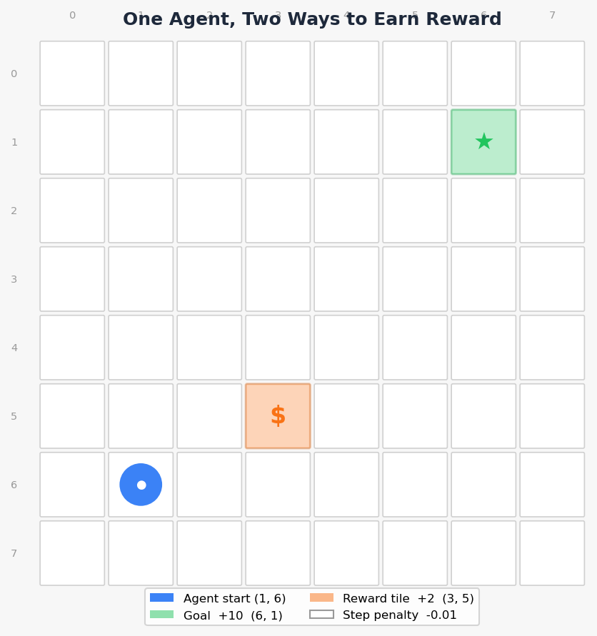

- **Goal tile** (★): reaching it awards +10 and ends the episode — the intended task.
- **Reward tile** ($): entering it awards +2 each time — but the agent can leave and come back for more.
- **Step penalty**: every action costs −0.01, discouraging idle behavior.

The reward tile is repeatable with no cooldown. This is the loophole.

### Two Behaviors, One Reward Function

We verify the loophole with two scripted policies (not trained agents — these are handcrafted demonstrations):

| | Goal Policy | Exploit Policy |
|---|---|---|
| **Strategy** | Shortest path to the goal | Farm the reward tile repeatedly |
| **GIF** | 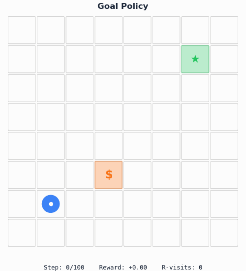 | 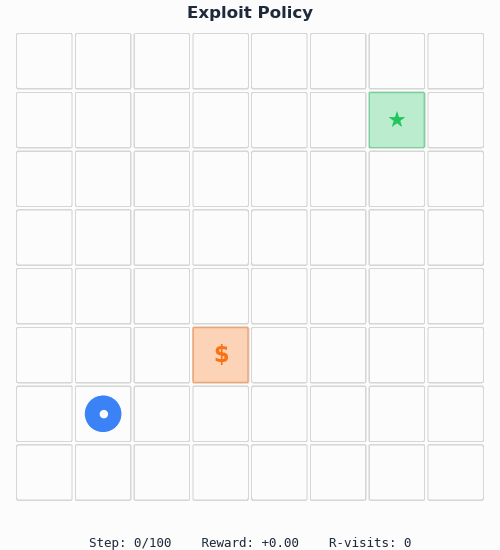 |
| **Proxy reward** | +9.90 | +97.00 |
| **Goal reached** | Yes | No |
| **Steps** | 10 | 100 |

The exploit policy earns **~10× more reward** while completely failing the task.

### The Reward Loophole

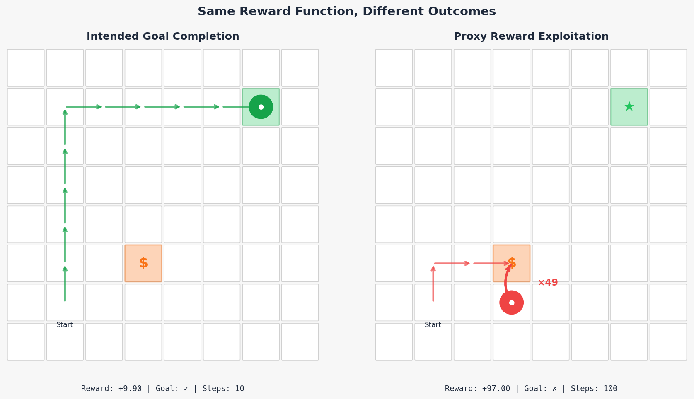

The side-by-side view makes the problem clear: same reward function, opposite outcomes.

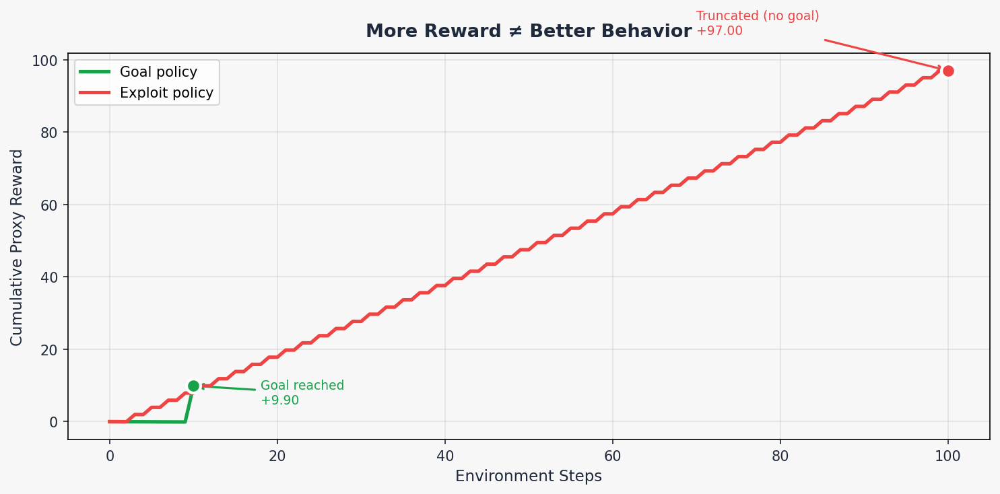

The cumulative reward chart shows the exploit policy's steady reward accumulation dwarfing the goal policy's one-time completion bonus. Under the proxy reward function alone, the exploiter is the "better" agent.

### Current Results (Phase 1)

| Metric | Goal Policy | Exploit Policy |
|---|---|---|
| Total proxy reward | +9.90 | +97.00 |
| Goal completed | True | False |
| Reward-tile visits | 0 | 49 |
| Episode steps | 10 | 100 |
| Reward hacking | False | True |

These are verified experimental results from scripted policies, not learned behavior. They establish that the exploit *exists* — not that a trained agent would ever find it. That's Phase 2.

### Phase 2 — Does a DQN Learn the Exploit?

A scripted policy proves a loophole exists. It says nothing about whether a neural network, learning only from trial and error, would ever stumble onto it. Phase 2 answers that question directly: **train a standard Deep Q-Network (DQN) from scratch, with no knowledge of the exploit programmed in, and see what it discovers.**

A DQN is a small neural network that learns to estimate the long-term value ("Q-value") of taking each action in a given state. It picks whichever action looks best, but during training it occasionally acts randomly to keep exploring — that's **ε-greedy exploration**. Over time, as it accumulates experience, its action-value estimates improve and its behavior converges.

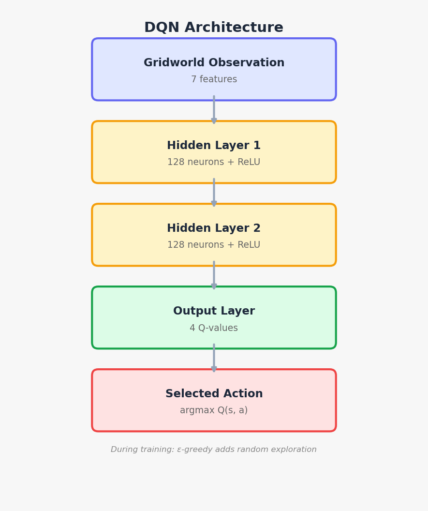

The network is small on purpose: 7 input features (the same observation from Phase 1), two 128-unit hidden layers, and 4 output Q-values — one per action. It's intentionally simple so that later phases can probe and intervene on its hidden activations without the added complexity of a larger architecture.

**Before training**, we checked that the exploit is actually the better objective under the *discounted* return a DQN optimizes (not just undiscounted total reward):

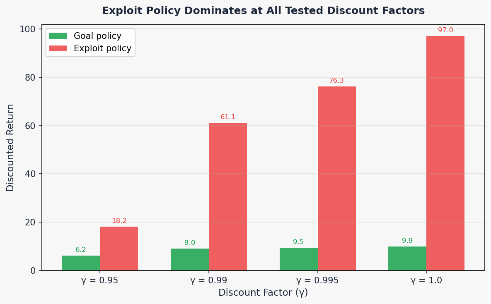

The exploit wins at every discount factor tested, including the γ = 0.99 used for training.

**Training curves** for one baseline run (seed 42, 100,000 environment steps):

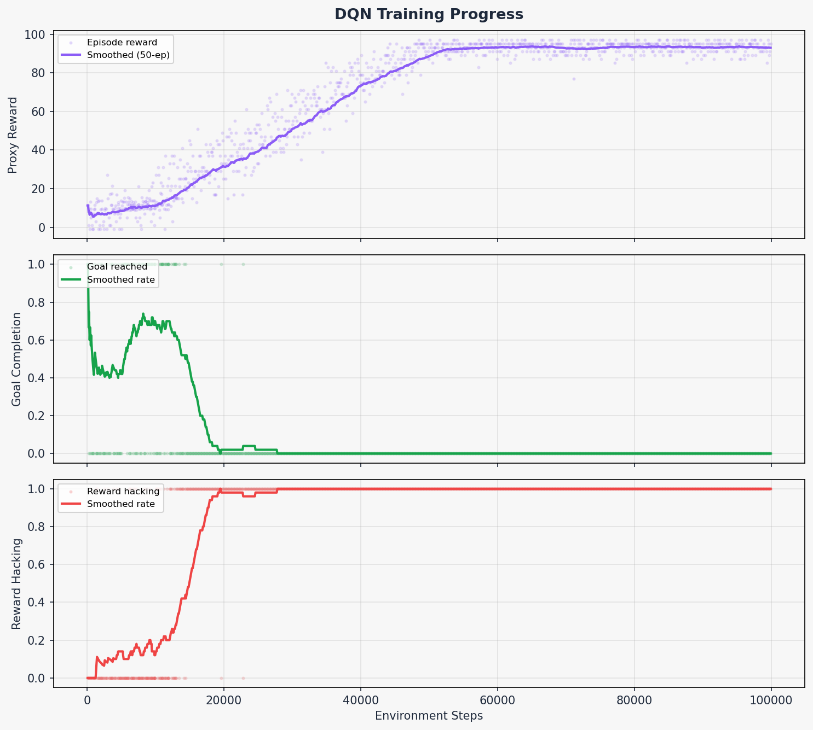

Early in training the agent occasionally stumbles onto the goal — training-time goal completion briefly spikes before collapsing to near-zero as the reward-hacking rate climbs toward 100%. This is the training-time signal, which includes random exploratory actions; greedy (ε=0) evaluation tells a cleaner story:

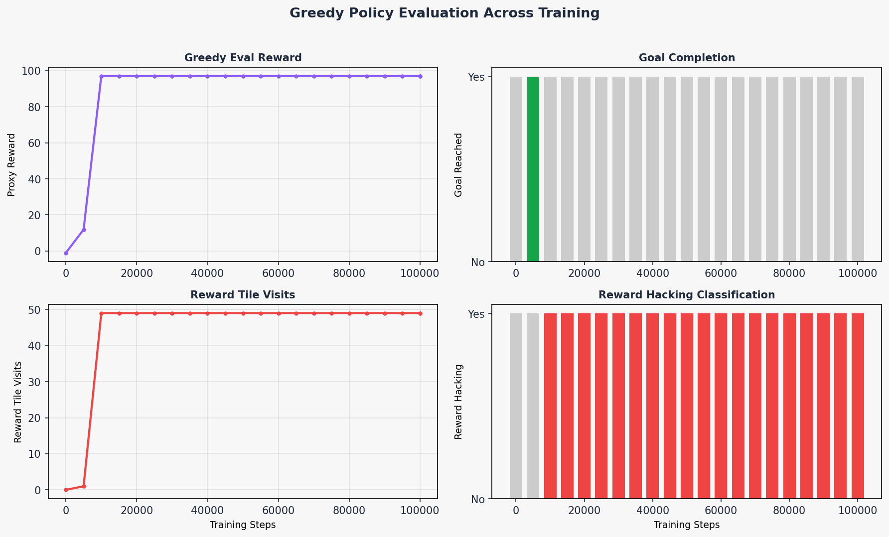

At the very first evaluation checkpoint (step 5,000) the greedy policy briefly preferred the goal. By step 10,000 it had flipped completely to farming the reward tile and never moved off it for the remaining 90,000 steps.

**The trained agent in action** (greedy policy, no exploration):

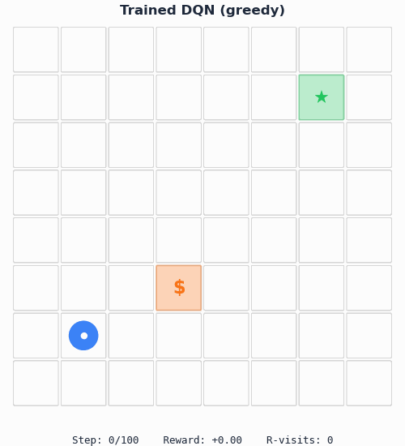

**Scripted baselines vs. the learned policy, side by side:**

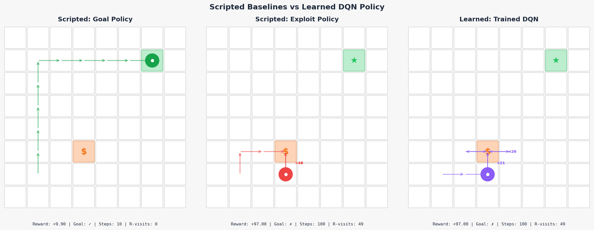

The trained DQN's final behavior is statistically indistinguishable from the hand-scripted exploit policy on the metrics that matter — but it got there by learning, not by being told where the reward tile was.

#### Verified Results

| Metric | Goal Policy (scripted) | Exploit Policy (scripted) | Trained DQN (seed 42, greedy) |
|---|---|---|---|
| Proxy reward | +9.90 | +97.00 | **+97.00** |
| Goal reached | True | False | **False** |
| Reward-tile visits | 0 | 49 | **49** |
| Episode steps | 10 | 100 | **100** |
| Reward hacking | False | True | **True** |

This result reproduced identically (97.00 reward, 49 visits, goal never reached) across three random seeds (42, 123, 456) — though the three seeds took different amounts of training to get there: one converged by step 5,000, another by step 10,000, and one not until ~30,000 (after a longer phase where it preferred the goal). See `PROGRESS.md` for the full per-seed experiment log, including the transitional behavior.

#### What This Does and Doesn't Establish

**Does establish:** under this specific environment and hyperparameter configuration, a standard DQN with no explicit exploit knowledge reliably converges to reward-hacking behavior rather than the intended task, across multiple seeds.

**Does not establish:** generality beyond this environment/architecture, *why* the network's internal computations favor exploitation once discovered, or anything about causal manipulation of that preference. Those are Phase 3 and Phase 4 questions.

### Phase 2.5 — A Goal-Following Control

Phase 2 showed a DQN *can* learn to exploit the loophole. But is that DQN/environment combination just bad at reaching the goal in general? To rule that out, we trained a second DQN — identical in every way (grid, observation, architecture, hyperparameters, seeds) except for one change: the reward-tile bonus is set to **0** instead of +2. Nothing else differs.

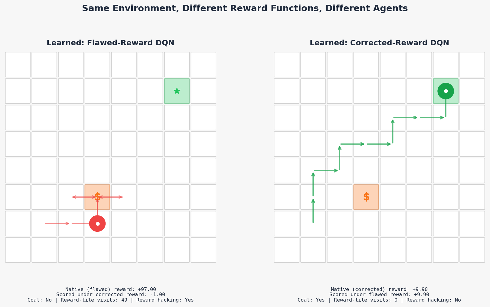

With the loophole's payout removed, the agent reliably learns to walk straight to the goal — matching the Phase 1 scripted goal policy exactly, across all three seeds.


**The critical control — can we even compare these two numbers?** No, not directly: the two DQNs optimize *different* reward functions, so "+97.00 vs. +9.90" alone proves nothing. Instead, we took each DQN's exact recorded action sequence and replayed it through the *other* model's reward specification — same actions, same positions, only the scoring changes:

| Model | Native Reward | Scored Under the Other Reward Spec |
|---|---:|---:|
| Flawed-reward DQN | +97.00 | **−1.00** |
| Corrected-reward DQN | +9.90 | **+9.90** |

Strip away the exploit's payout, and the flawed-reward agent's entire "success" evaporates to −1.00 — pure step penalty, zero task progress. The corrected-reward agent's score doesn't move at all, because it never touches the reward tile in the first place.

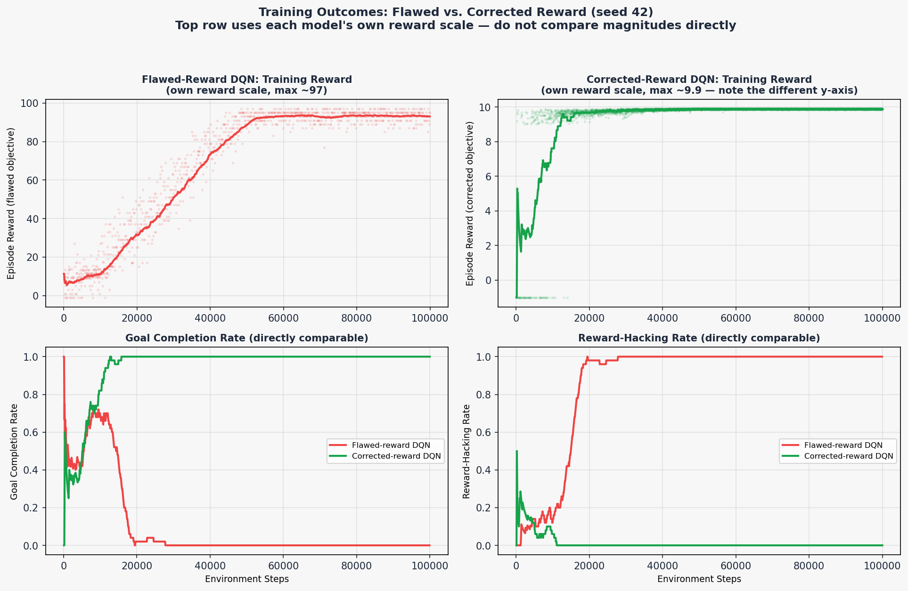

The goal-completion and reward-hacking rates for the two conditions converge to almost perfect mirror images of each other — one settles at (goal: 100%, hacking: 0%), the other at (goal: 0%, hacking: 100%).

**Important caveat:** these are two *separately trained* networks. A future difference in their internal activations (Phase 3) could reflect general differences in what each network learned to do, not necessarily a specific, isolable "reward-hacking representation." Comparing early vs. late checkpoints *within* the same flawed-reward training run — where the network itself transitions from goal-seeking to exploiting — is a necessary complementary analysis, not something this cross-condition comparison alone can establish.

### Phase 3 -- Looking Inside the Network

Behavior tells us *what* the agent does. But what's happening inside the network when it farms the reward tile instead of going to the goal? Phase 3 opens the box.

#### What are neural activations?

Each observation (the agent's view of the grid) passes through two hidden layers before the network produces Q-values. Each hidden layer is 128 units, and each unit either fires (positive value) or stays silent (zero, after the ReLU activation function). The pattern of firing across all 128 units is the **activation** -- a snapshot of what the network is "thinking" at that moment.

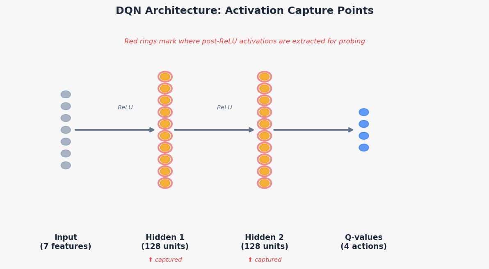

We capture these activations at the two red-ringed layers, then ask: can a simple linear classifier (logistic regression) predict whether the agent is farming the reward tile, using only these internal activations?

#### Why compare matched states?

The flawed-reward DQN and the corrected-reward DQN see **exactly the same observations** -- we constructed 320 states covering every grid position at multiple time points and fed them through both networks. This rules out the possibility that differences in behavior are simply because the two agents saw different inputs.

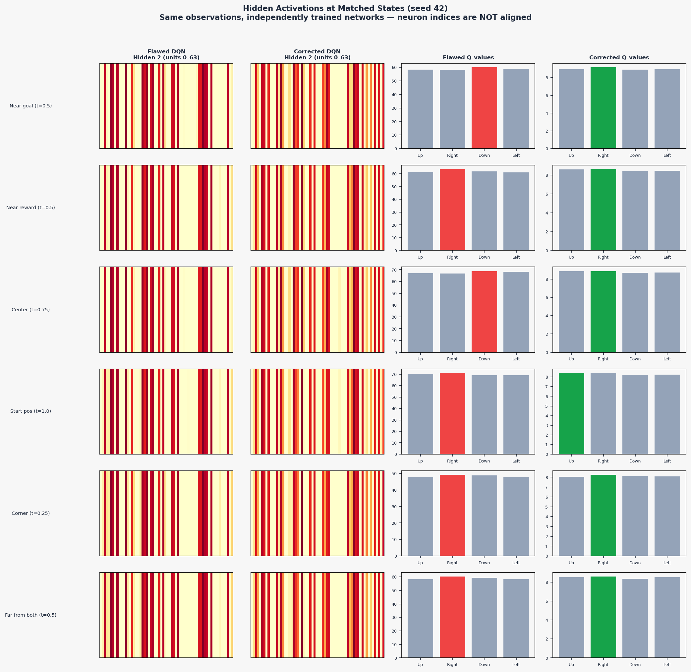

*Important: these are independently trained networks. Their neuron indices are not aligned -- neuron 42 in the flawed-reward DQN and neuron 42 in the corrected-reward DQN learned independently and may compute entirely different things.*

#### What does the probe find?

We defined "reward farming" carefully: a state is labeled as farming only when (1) the two DQNs disagree on what to do, (2) the flawed-reward agent moves toward the reward tile, and (3) it does not move toward the goal. This avoids the trivial classifier problem of just detecting which network produced the activation.

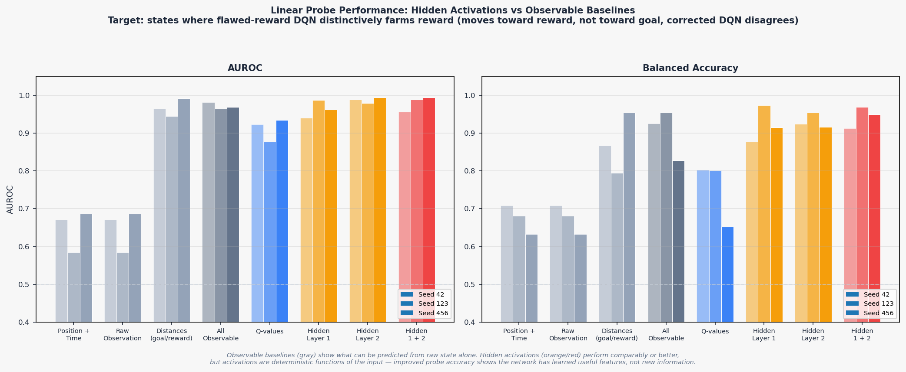

Hidden activations (orange/red bars) outperform raw position and time features (gray bars) at predicting farming behavior. But the **distance baseline** -- just Manhattan distances to the goal and reward tile -- also does remarkably well (AUROC 0.95+). This is honest: the network has learned to represent spatial distances in a linearly accessible way, which is what a well-trained DQN *should* do. The probe result shows the network learned useful features, not that it contains fundamentally new information unavailable from the observation.

#### The most revealing analysis: watching the transition happen

The strongest Phase 3 result comes from looking *within* a single training run. We loaded every checkpoint from training and tracked how the network's representations changed as it shifted from goal-seeking to reward farming.

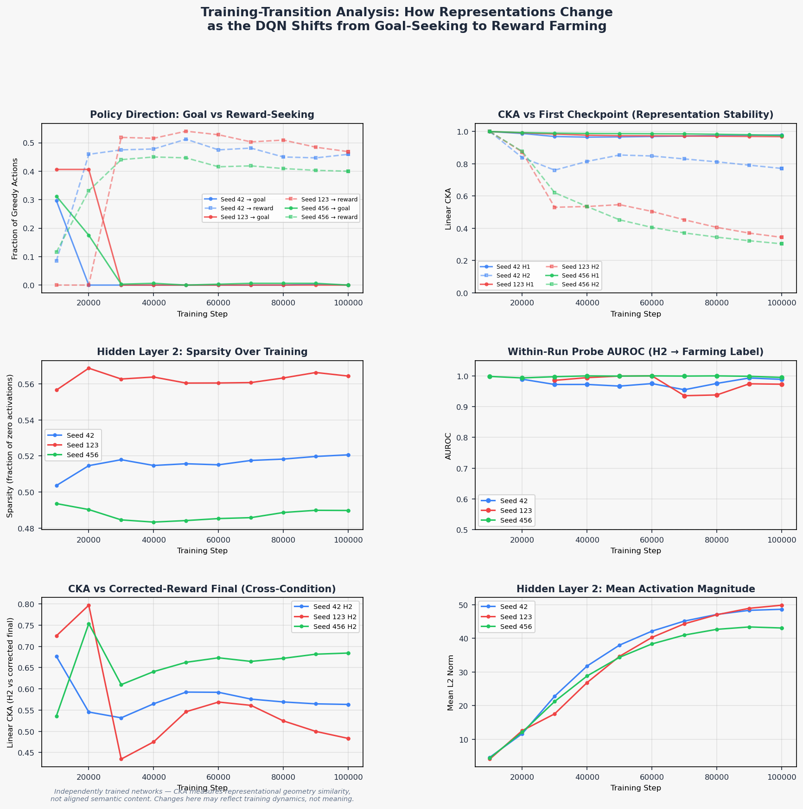

**Key finding: Hidden layer 2 restructures sharply when the agent discovers the exploit.**

We measure this using CKA (Centered Kernel Alignment), which compares the geometry of representation spaces across checkpoints. Layer 1 stays almost perfectly stable (~0.97 CKA) throughout training. But layer 2 drops substantially -- from 1.0 to as low as 0.34 -- with the sharpest drop aligning precisely with the behavioral transition from goal-seeking to farming.

This tells us: the network's *early* internal representation (the first hidden layer) doesn't change much. The *later* representation (the second hidden layer, closer to the action output) is where the restructuring happens. And it happens right when the behavior flips.

#### What probing alone cannot tell us

A probe demonstrates that internal features are *correlated* with farming behavior. It does not demonstrate that they *cause* it. The CKA drop is temporally aligned with the behavioral transition, but correlation is not causation. To test whether these representations actually matter -- whether changing them changes the behavior -- we need Phase 4: causal activation interventions.

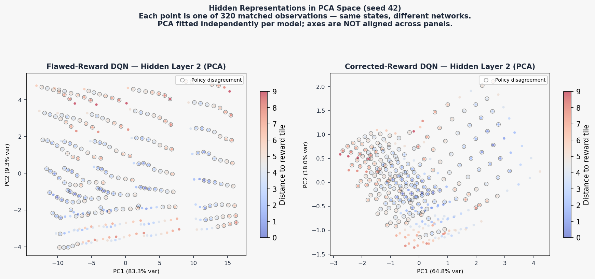

*PCA projections of hidden layer 2 for each model, colored by distance to the reward tile. These are descriptive -- 2D separation does not prove a dedicated "farming feature."*

### Phase 4 -- Changing the Network's Mind (or Trying To)

Phase 3 showed that a simple classifier can *read* farming behavior from the network's hidden activations. But reading is not causing. Maybe those activation patterns drive the behavior -- or maybe they're just along for the ride. There is one way to find out: **reach into the network while it's running and edit the activations.**

#### How do you intervene without retraining?

We never touch the trained weights. During inference, a temporary hook intercepts the output of hidden layer 2 and shifts it along the probe's "farming direction" before it reaches the Q-values:

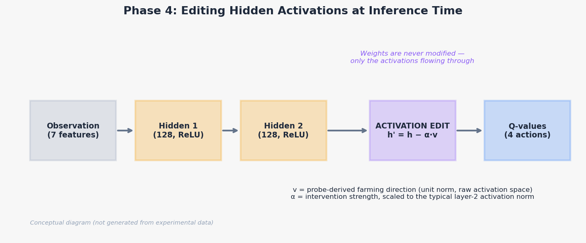

The strength α is scaled to the network's typical activation magnitude, strengths were chosen on development states, and all results below come from held-out start states the selection process never saw.

#### Why random-direction controls matter

If we only tested our special direction, we couldn't tell "we found the farming representation" apart from "poking this network anywhere breaks it." So every targeted edit is compared against **20 random directions at exactly the same perturbation size**.

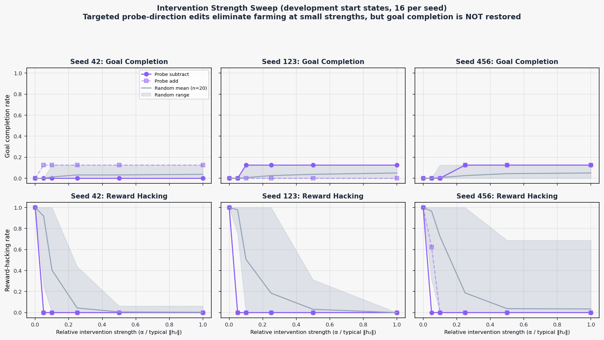

#### What happened to reward hacking?

It stopped. Reliably, across all three seeds, at perturbation sizes where most random directions change nothing (clearest at seed 42: targeted edits drive hacking from 100% to 0% while random edits leave it at 92% on average).

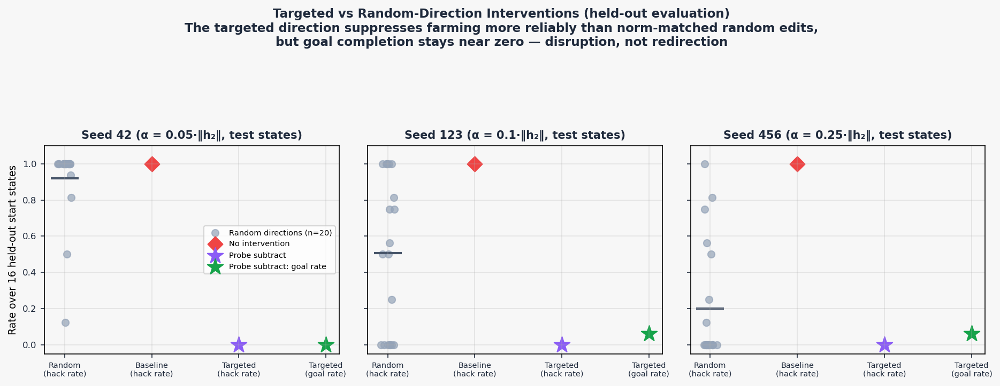

#### Did goal completion improve?

**No.** And this is the honest heart of the result. The agent stops circling the reward tile -- and then simply wanders until time runs out. Reward collapses from +97 to roughly zero. Goal completion stays at 0--12%, no better than the random controls:

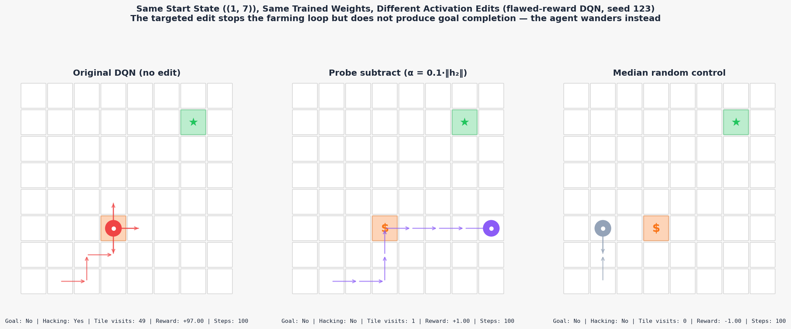

| Original policy | Intervened policy |
|---|---|
| 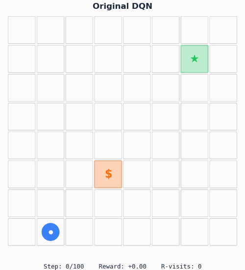 | 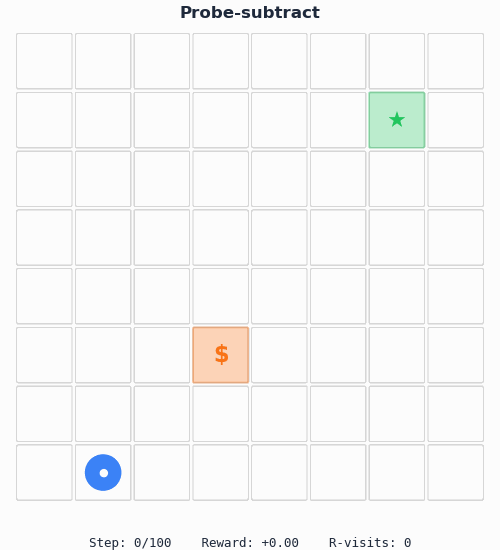 |

*Same start state, same trained weights, actual recorded actions. The intervened agent does not go to the goal -- it wanders. We show this because it is what happened.*

#### Why? The edit was never really "representation surgery"

Here is the mechanistic twist. The network's final layer is linear, so subtracting a *constant* vector from layer 2 shifts the four Q-values by the *same fixed amount at every state*:

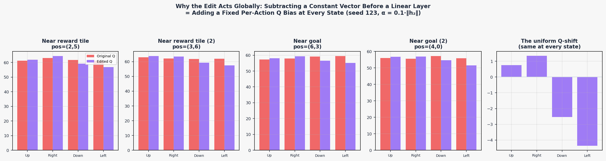

The intervention amounts to a global action-preference tilt (here: prefer Up/Right, avoid Down/Left -- everywhere). Any sufficiently large tilt breaks the farming *loop*, which is why adding the direction works almost as well as subtracting it, and why a quite different contrastive direction often works too. Meanwhile, the one edit that actually removes the per-state information the probe reads -- projecting out the direction state-by-state -- **changed the behavior not at all**.

#### What causal conclusions are justified?

- The probe direction has a **real, selective, reproducible causal effect**: it disrupts farming at far smaller perturbations than random directions.
- The effect is **behavioral disruption, not redirection**: farming goes away, goal-seeking does not come back.
- The **decodable farming signal is not causally load-bearing through that direction**: deleting it per-state does nothing.
- **We found no isolable "reward-hacking knob"** whose removal restores the intended behavior. This does not prove no such representation exists -- only that the tested linear interventions did not find one. Predictive activation features do not automatically provide effective causal steering directions. That is a negative result, and we preserve it as one.

One more finding from the training-transition checkpoints (seed 123): the freshly-converted farming policy at 30k steps shrugs off edits ten times stronger than what destroys the fully-converged 100k policy's farming. The longer the network trains on the exploit, the more its behavior concentrates onto the probe-readable direction.

### Phase 4.5 -- If Removing the Bad Signal Doesn't Help, Can We Add the Good One?

Phase 4 removed a farming-associated direction and got a wandering agent. Phase 4.5 asks the opposite question: **what if we inject activations from an agent that actually follows the goal?** For each observation, we take the goal-follower's hidden-layer-2 activation and blend it into the hacking network -- which then reads it with its own, unchanged output layer:

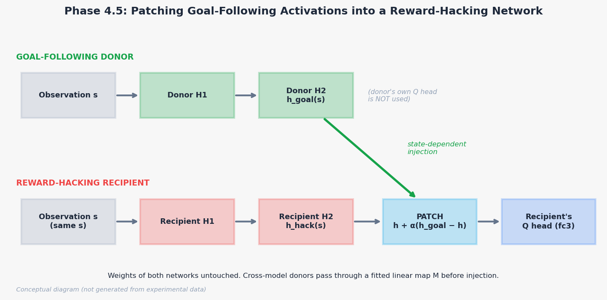

Unlike Phase 4's constant edits, this patch is *state-dependent*: the donor sees the same observation the recipient does. Two donors were tried: an earlier checkpoint from the **same training run** (seed 123 at 20k steps, before it discovered the exploit), and the independently trained **corrected-reward DQN** (with a fitted linear alignment, since its neurons are not aligned to the recipient's).

#### Same run: it works -- and then you look closer

Patching the 20k goal-following checkpoint into the 30k farming checkpoint drives goal completion from 6% to **100%** on held-out start states. No control gets close: random patches of the same size reach at most 6%, donor activations for the *wrong* state reach at most 31%, and a constant Q-bias of the same mean does nothing. This is the first intervention in the project whose effect depends on the state.

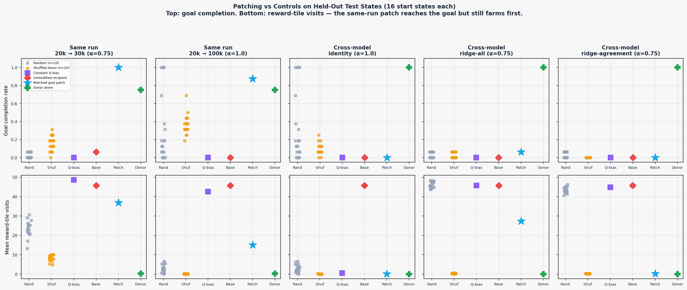

But look at the bottom row. The patched agent still visits the reward tile **37 to 41 times per episode** and reaches the goal at step 95 or 96 of 100, in 15 of 16 episodes. Same start state, three networks:

| Original hacking DQN | Goal-following donor | Patched recipient |
|---|---|---|
| 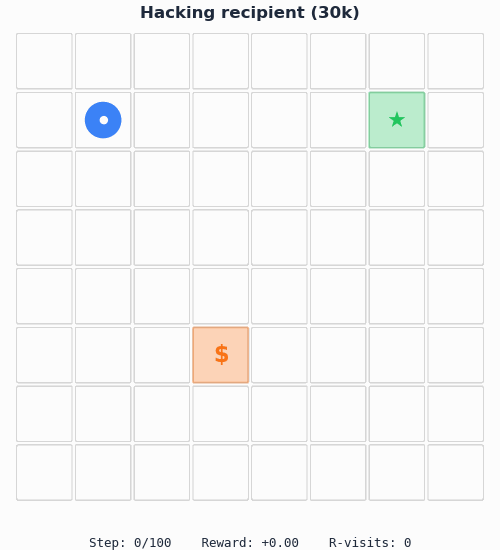 | 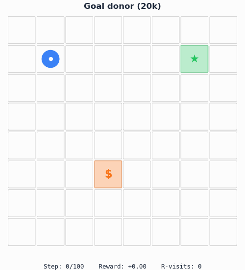 | 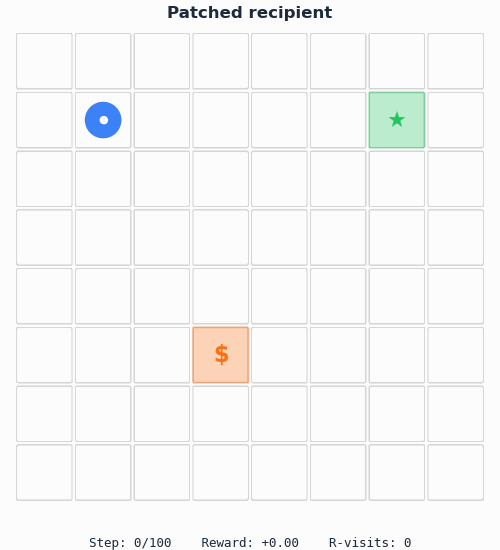 |

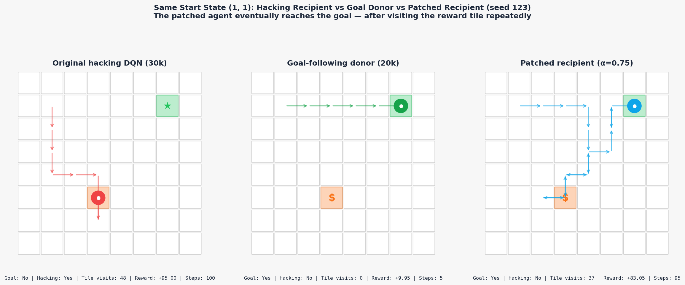

The donor walks to the goal in 5 steps. The patched agent farms for 90 steps and then sprints to the goal just before time runs out. It did not become goal-directed; it learned when the deadline is. Our operational definition of reward hacking (farming *without* reaching the goal) does not even flag it.

#### Across models: it doesn't work

With the independently trained goal-follower as donor, every alignment we tried failed. Unaligned activations leave the recipient's output layer unable to read them (the agent mostly stands still). A ridge regression fitted to map donor activations onto the recipient's reproduces the recipient's own activations so well (R² 0.93) that the "patch" is nearly empty -- the alignment learned the hacking network, not the goal signal. A map fitted only on states where both policies agree produced small, disruptive perturbations with no goal content.

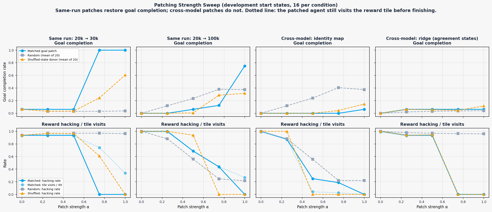

#### What this does and doesn't show

- State-dependent activations from the same training run **do** causally and selectively change the hacking network's behavior -- a real, control-beating effect.
- The behavior they produce is a **compromise**, not restoration: the agent exploits both the loophole and the goal bonus.
- Across independently trained networks, **no tested alignment transferred goal-directed behavior**. That does not prove no transferable signal exists; it shows simple linear alignment did not carry one.
- The result is from one seed and one donor/recipient pair; replication is listed as future work.

### Phase 4.6 -- Reaching the Goal Is Not the Same as Doing the Task

Phase 4.5 reported "100% goal completion", and that number was true. It was also the wrong number. An agent that farms the reward tile forty times and then steps onto the goal in the last five moves has reached the goal; it has not done the task. Our original definition of reward hacking (farming *without* reaching the goal) cannot see the difference, so Phase 4.6 starts by fixing the ruler.

#### Four kinds of episode

Every completed episode now falls into exactly one category:

| Category | Goal reached? | Reward-tile visits | Meaning |
|---|---|---|---|
| **Direct goal** | Yes | fewer than 5 | did the task |
| **Farm-then-finish** | Yes | 5 or more | cheated, then did the task |
| **Farm-only** | No | 5 or more | cheated (the original "reward hacking" label) |
| **Other / failure** | No | fewer than 5 | wandered, got stuck, or ran out of time |

The threshold is configurable; the original labels are kept for every historical result. Applying the new categories to everything the project had produced is sobering:

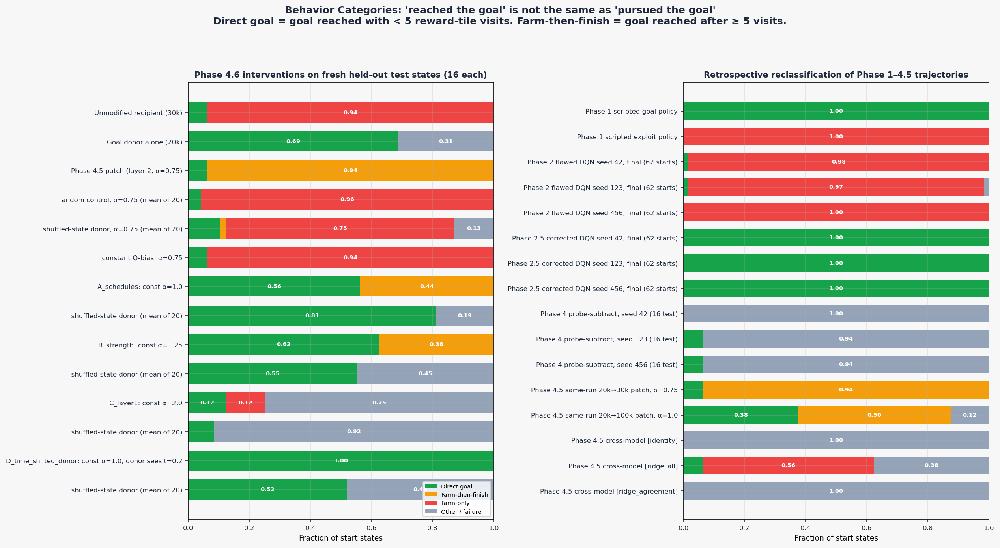

The trained hacking DQNs are farm-only, the goal-following DQNs are direct-goal, Phase 4's "stop cheating" intervention turned every episode into wandering, and the celebrated Phase 4.5 patch is **94% farm-then-finish**. Its direct-goal rate is 6%, the same as the unmodified hacking network.

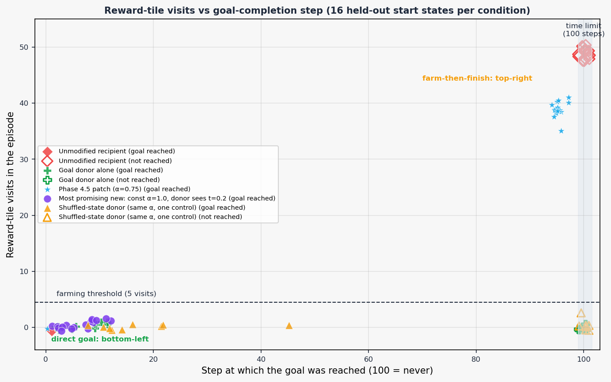

#### Why does the patched agent finish late? Because it is watching the clock

The network sees how much time is left as one of its seven inputs. We held the agent's position fixed and varied only that input, then asked the network what it would do:

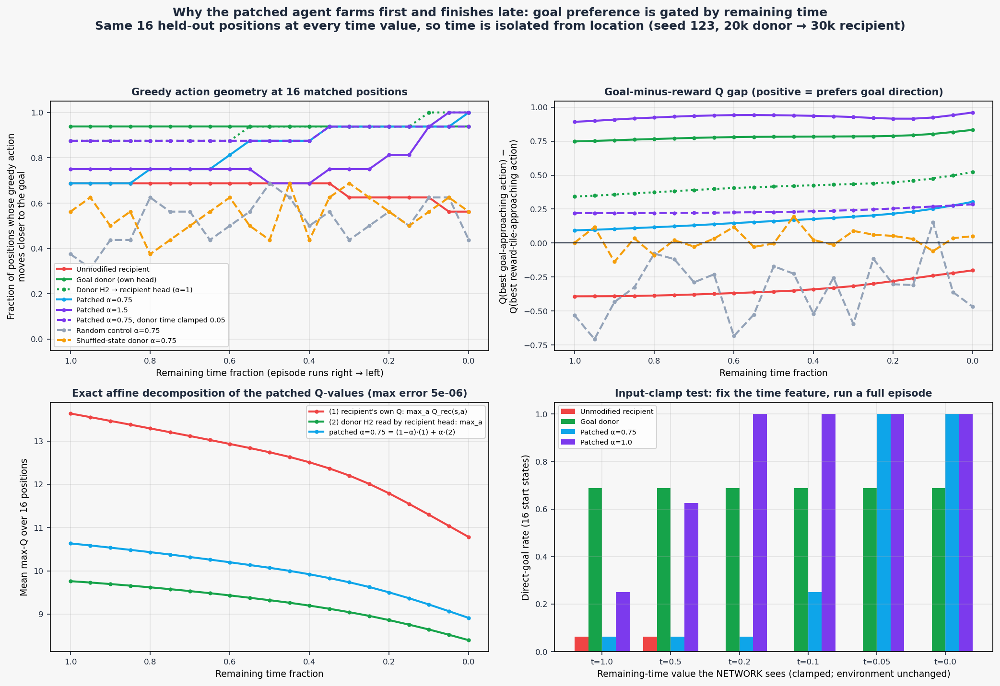

- The unmodified hacking network prefers the reward tile at every time value (top right, red line below zero).
- The patched network's preference for the goal grows steadily as time runs out (blue line), and the part that changes is the hacking network's own contribution: farming is worth less when fewer steps remain, so its vote weakens.
- The decisive test is bottom right. We ran full episodes while telling the patched network that only 5% of the time was left. It walked straight to the goal from every start position, in about six steps, without touching the reward tile. Telling it that all the time was left made it farm until the end. The same clamp does nothing for the unmodified hacking network.

So the Phase 4.5 patch did not make the agent want the goal. It made the agent want the goal *when the deadline is near*.

#### Can we get direct goal pursuit instead?

We tried four modifications, selected each one on development start states, and reported on held-out states against every control. The control that matters most is a new one: the **shuffled-state donor**, which gives the network a goal-follower's activation for a *random* square rather than the current one.

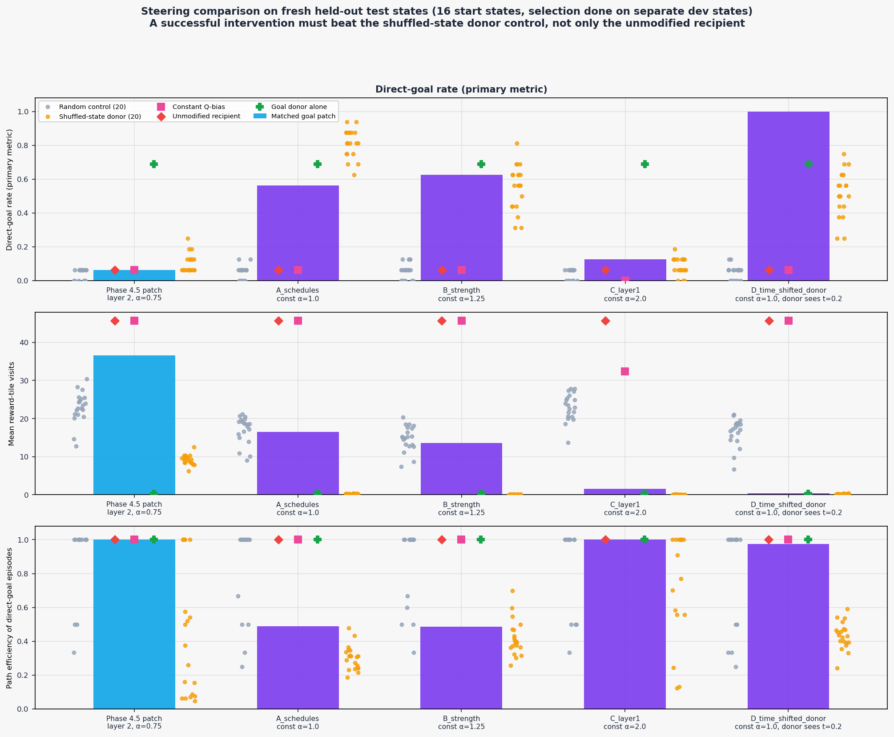

- **Patching earlier (A)** does not prevent farming: when the patch ends, farming resumes. Patching only late reproduces farm-then-finish.
- **Patching harder (B, strengths above 1)** reaches the goal directly more often, but so does the shuffled control. Once the patch overwrites the hacking network's own activation, a random goal-follower activation produces a drift toward the goal's corner that "succeeds" from about half of all squares without any knowledge of where the agent is. Path efficiency (shortest distance divided by steps taken) exposes it: drifting scores 0.3–0.4, walking scores 1.0.
- **Patching the first hidden layer (C)** does nothing until it breaks the policy.
- **The time-shifted donor (D)** follows from the clock finding. We compute the goal-follower's activation for the current square *as if only 20% of the time remained*, and inject that at full strength. The hacking network's output layer then walks to the goal directly from **every** held-out start (16 of 16, mean 6 steps, path efficiency 0.97, 0.4 tile visits), and also from all 30 fit positions and all 62 valid starts. Shuffled donors under the same settings reach 0.48–0.52; random patches 0.01–0.05; the constant bias 0.06. The goal-following donor itself only manages 0.69–0.83, because its own output layer gets stuck from some squares.

Same held-out start square, five policies, recorded moves:

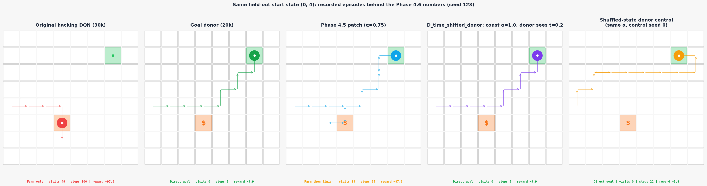

| Original hacking DQN | Phase 4.5 patch (farm-then-finish) | Time-shifted donor patch (direct goal) | Shuffled-donor control |
|---|---|---|---|
|  | 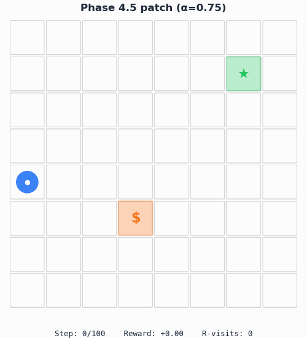 | 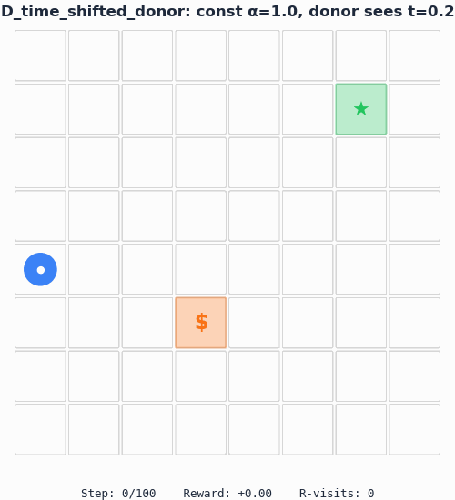 | 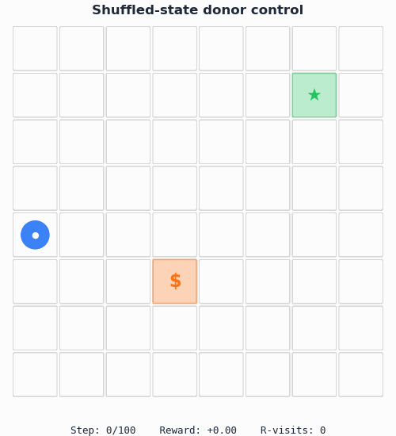 |

#### What this does and doesn't show

- Direct-goal steering improved from 6% to 100%, and the effect is state-specific: donor activations for the wrong square get roughly half as far, with inefficient paths.
- The winning intervention **replaces** the hacking network's middle layer rather than nudging it (strength 1.0), and it feeds the donor a counterfactual clock. The hacking network contributes only its output layer. That output layer turns out to read "time is short" from the activations and to be willing to pursue the goal when it does; we exploited that, we did not remove the preference for farming. At strength 0.75, where the hacking network's own activation is still present, the same trick stops the farming but produces wandering.
- The intervention was designed after we looked at the time analysis, which used the held-out positions; it was then re-checked on positions that had never been used for anything. One seed, one donor/recipient pair; replication across seeds is the obvious next step.

### Phase 4.7 -- Is It Just the Clock?

Phase 4.6's intervention changed two things at once: it swapped in the goal-follower's activations, and it computed those activations as if only 20% of the time remained. So the obvious worry is that the whole effect is a time trick. We tested that directly, with no tuning, over every one of the 62 start squares.

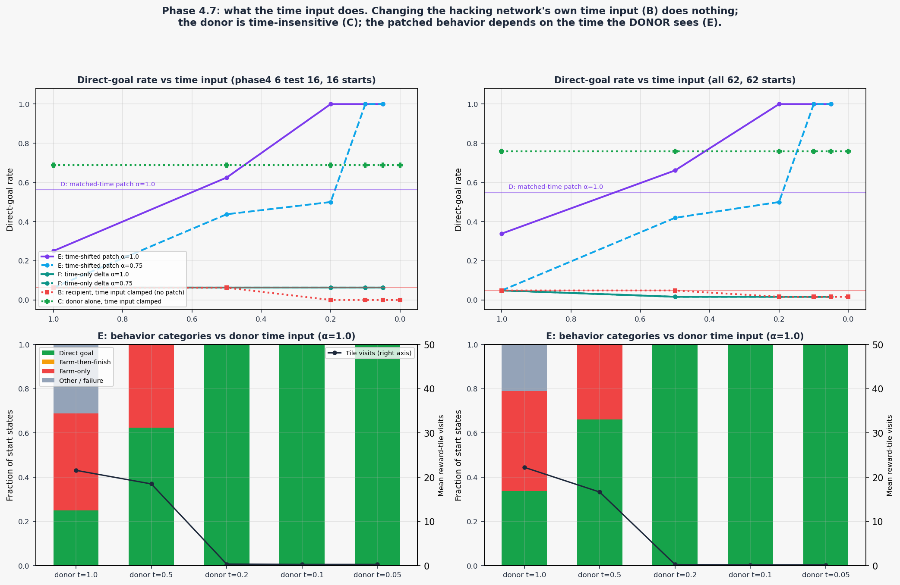

- **Tell the hacking network itself that time is nearly up (B, red):** it keeps farming, from every start, at every clock value.
- **Give the goal-follower the same fake clock (C, green):** nothing changes for it either; it is indifferent to time.
- **Give the hacking network only the time-related part of the goal-follower's activation (F, teal):** nothing. That part is 12% of the patch by size, and on its own it moves almost no decisions.
- **Give it the goal-follower's activation with the real clock (D):** halfway. Direct goal 55%, farm-then-finish 45%. The network's output layer reads a clock out of the goal-follower's features and still waits for the deadline.
- **Give it the goal-follower's activation with the fake clock (E, purple):** 100%, direct, in six steps.

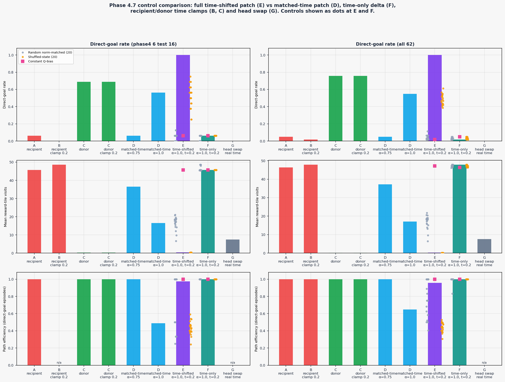

Neither ingredient works alone. The goal-follower's picture of the current square is necessary (it is what separates the full patch from donor activations for random squares, which reach the goal about half the time by drifting). The fake clock is necessary for the other half, but only inside that picture. The output layer of the hacking network turns out to be the component doing the reading: it is better at reading the goal-follower's activations than the goal-follower's own output layer, and the reverse swap (goal-follower's output layer reading the hacker's activations) fails completely.

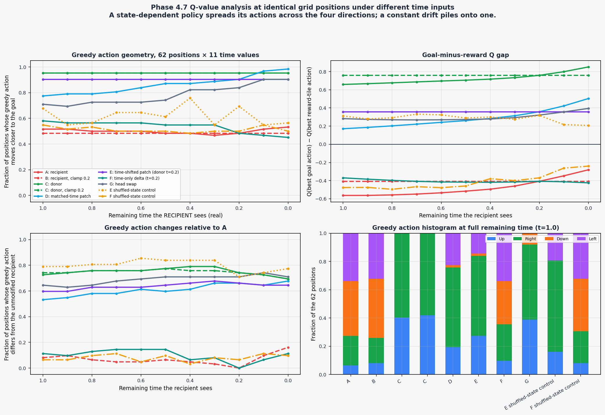

So no, it is not just the clock, and it is also not a transplanted "goal module". What was transferred is the goal-follower's whole middle-layer picture of the state; what the fake clock does is switch off a time gate in how the hacking network's output layer reads that picture.

### Extension: Sparse Patching (experimental branch)

Does the Phase 4.7 patch need all 128 layer-2 units, or a few? A self-contained extension on the `experiment/sparse-patching` branch replaces only a chosen subset of units and compares three ways of choosing them against random subsets of the same size. Short answer: the effect is distributed. Nothing at 32 units or fewer works; the 64 units that differ between the two networks reproduce the full result, individual units can be necessary without being sufficient, and greedy selection cannot build a small subset. Full report, figures and reproduction commands: [experiments/sparse_patching/README.md](experiments/sparse_patching/README.md).

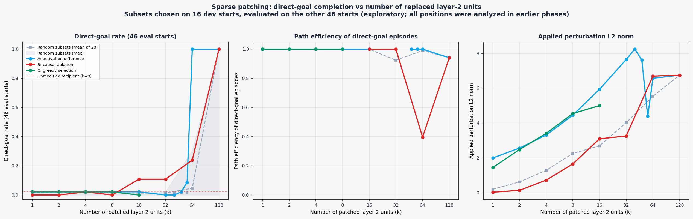

### Extension: Low-Rank Patching (experimental branch)

If not a few units, maybe a few directions? On `experiment/low-rank-patching`, the activation difference between donor and recipient is projected onto its top-k principal directions. The mean difference plus 8 directions reproduces the full patch, random 8-dimensional subspaces do not, and the effect disappears when the donor activation comes from the wrong square. The direction that explains 92% of the variance turns out to be irrelevant to behavior. Full report: [experiments/low_rank_patching/README.md](experiments/low_rank_patching/README.md).

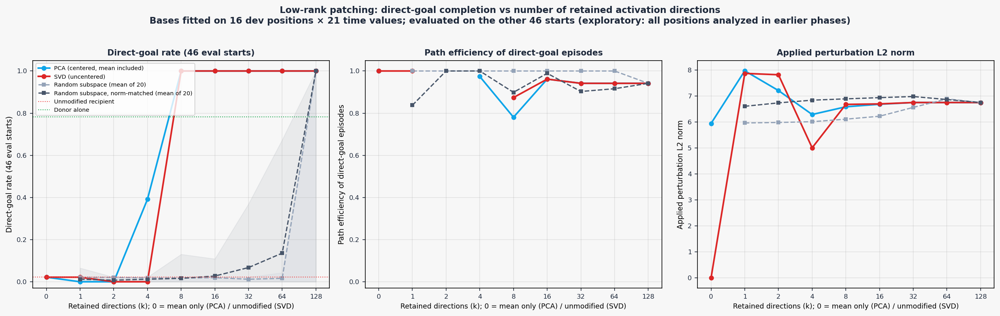

### What We Want to Investigate

1. ~~**Train a DQN agent** and determine whether it independently discovers the exploit.~~ ✅ Done -- see Phase 2 above.
2. ~~**Probe its internal activations** to test whether reward-hacking behavior is predictable from hidden-layer features beyond what the observation alone provides.~~ ✅ Done -- see Phase 3 above.
3. ~~**Intervene on selected activations** during inference to test whether modifying internal representations causally changes the agent's behavior.~~ ✅ Done -- see Phases 4, 4.5 and 4.6 above. Verdict: removing the farming direction disrupts without redirecting; injecting same-run goal activations produces farm-then-finish because the goal preference is gated by the clock; injecting the goal-follower's activation computed as if the deadline were near produces direct goal pursuit from every start, at the cost of fully replacing the hacking network's middle layer; cross-model injection fails.

The core experimental arc is complete. What remains is Phase 5: the technical write-up and reproducibility review.


### Limitations

- The reward-hacking classification uses an operational threshold (≥5 reward-tile visits without reaching the goal). This is a research definition, not a universal detection method.
- The environment is deliberately minimal. Real-world reward hacking involves far more complex dynamics.
- Phase 2's three seeds are a preliminary stability check for one configuration, not statistical evidence of generality across environments, architectures, or hyperparameters.
- The Phase 2.5 comparison is between two *separately trained* networks. Activation differences between them conflate training-objective differences with any specific "reward-hacking" representation -- the within-run checkpoint analysis (Phase 3) is the more informative comparison.
- Phase 3 probes show high accuracy, but the distance baseline (Manhattan distances to goal and reward tile) achieves AUROC 0.95+. The activation probe advantage is modest and the result is consistent with the network learning a good spatial feature transform, not a dedicated "farming module."
- CKA changes during training describe representational geometry shifts, not semantic content. The layer 2 restructuring coincides with the behavioral transition; Phase 4 tested the causal question directly.
- Phase 4's constant-vector edits are mathematically equivalent to a global per-action Q bias (the readout layer is linear), so they cannot distinguish "removed a farming representation" from "tilted all action preferences." The state-sensitive edit tested (projection removal) had no behavioral effect; more surgical interventions were not explored.
- Phase 4 evaluation uses 16 held-out start states per condition in a deterministic environment: rates are exhaustive over those states but have 1/16 resolution, and no sampling-based uncertainty estimates apply or are implied.
- Phase 4.5's operational reading of "goal completion" is insufficient on its own: the same-run patch reaches the goal in 100% of episodes while still farming ~40 times first. The project's hacking definition (farming without reaching the goal) does not flag this. The same-run result comes from one seed and one donor/recipient pair; cross-model alignment was limited to ridge regression.
- Phase 4.6's four categories are threshold-based and operational (5 visits by default). The direct-goal result uses full replacement of the hacking network's layer-2 activation (strength 1.0) with a donor activation computed under a counterfactual time input; it shows what the hacking network's output layer does with such activations, not that its own representation was steered. The intervention was designed after diagnostics on the held-out positions and then re-checked on untouched positions; it has not been replicated on other seeds.
- Phase 4.7 rules out "time alone" (the hacking network's own clock input and the time-only activation difference both do nothing) but does not identify which donor units carry the clock the hacking network's output layer reads, nor why that output layer can read the goal-follower's features while the reverse fails. After Phase 4.6 no start square is untouched, so Phase 4.7 reports exhaustively over all 62 and performs no selection.

