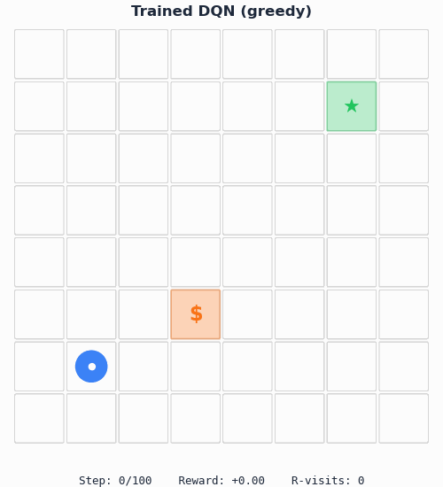

# RewardLens

**Can we find reward hacking inside a neural network, and fix it there?**

Reward hacking happens when an agent maximizes the reward it is given without doing the task that reward was meant to encourage. RewardLens trains small reinforcement-learning agents that learn to exploit a flawed reward, then asks whether their hidden activations reveal the exploit and whether editing activations or weights repairs it.

| Trained on the flawed reward | Trained on the corrected reward |
|---|---|
|  |  |

## Experiments

| # | Experiment | Status |
|---|---|---|
| 1 | [Fixed Gridworld Reward-Hacking Repair](experiments/01_fixed_gridworld_repair/README.md) | Complete |
| 2 | [Generalizable Reward-Hacking Interventions](experiments/02_generalizable_reward_hacking/README.md) | Complete |

**Experiment 1.** In one fixed 8×8 gridworld, transplanting a goal-following checkpoint's activations restored direct goal pursuit in a hacking DQN, and a rank-4 weight edit made that repair permanent. Ordinary fine-tuning worked as well, and neither repair transferred to other training seeds.

**Experiment 2.** Start, goal and reward tile move every episode, and agents are tested on layouts they never trained on.

- **Emergence:** forked from one pretrained checkpoint, the DQN trained on the flawed reward farms in 92% of unseen layouts, in all three independently trained seeds. Its hidden representations change gradually, starting before the behavior flips and continuing after.
- **Activation and weight transplants:** transplanting goal-following activations usually stops the farming without restoring useful behavior, and copying goal-following weights into any subset of layers fails.
- **Repair:** distilling a goal-following teacher into the full network restores goal-directed behavior. A coordinated rank-8 edit of all three layers (a fifth of the parameters) does the same and reached 99.3% mean direct-goal completion on 1,500 reserved layouts, evaluated once (9 of 9 frozen models met the bar).
- **Limits:** the repair needs a goal-following teacher and was not more robust than ordinary fine-tuning. Generalization was tested across randomized layouts from one obstacle-free gridworld generator, not across unrelated tasks.

## More

- [SETUP.md](SETUP.md): installation, tests and reproduction commands
- [CONTEXT.md](CONTEXT.md): current research state and design decisions
- [Experiment 1 progress journal](experiments/01_fixed_gridworld_repair/PROGRESS.md)
- [Experiment 2 progress journal](experiments/02_generalizable_reward_hacking/PROGRESS.md)
- [Project progress index](PROGRESS.md)
