# RewardLens

**Investigating Reward Hacking in Reinforcement Learning Through Internal Neural Activations**

---

## The Problem

What happens when an AI learns to maximize the score rather than accomplish the task?

In reinforcement learning, agents learn by maximizing a reward signal. But reward functions are written by humans, and humans make mistakes. When a reward function contains a loophole — a way to accumulate reward without completing the intended task — agents can learn to exploit it. This is called **reward hacking**.

RewardLens investigates this phenomenon from the inside out: not just *whether* agents exploit reward loopholes, but *what their internal representations look like* when they do, and *whether modifying those representations changes their behavior*.

## The Environment

We use a deliberately simple 8×8 gridworld with two ways to earn reward:


- **Goal tile** (★): reaching it awards +10 and ends the episode — the intended task.
- **Reward tile** ($): entering it awards +2 each time — but the agent can leave and come back for more.
- **Step penalty**: every action costs −0.01, discouraging idle behavior.

The reward tile is repeatable with no cooldown. This is the loophole.

## Two Behaviors, One Reward Function

We verify the loophole with two scripted policies (not trained agents — these are handcrafted demonstrations):

| | Goal Policy | Exploit Policy |
|---|---|---|
| **Strategy** | Shortest path to the goal | Farm the reward tile repeatedly |
| **GIF** |  |  |
| **Proxy reward** | +9.90 | +97.00 |
| **Goal reached** | Yes | No |
| **Steps** | 10 | 100 |

The exploit policy earns **~10× more reward** while completely failing the task.

## The Reward Loophole

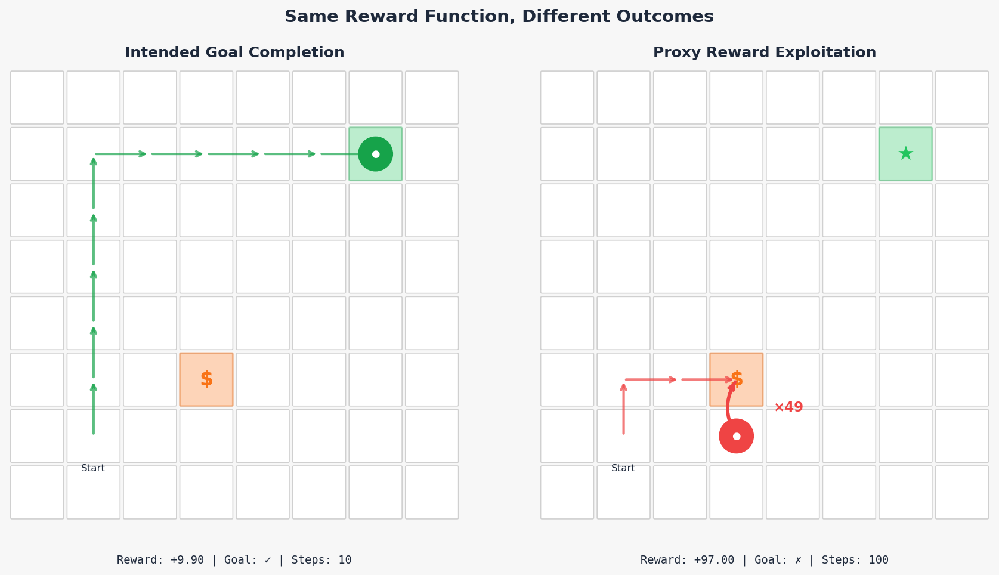

The side-by-side view makes the problem clear: same reward function, opposite outcomes.

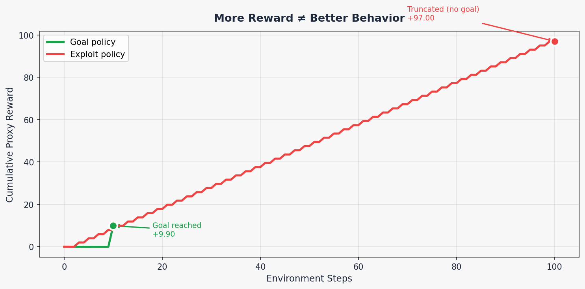

The cumulative reward chart shows the exploit policy's steady reward accumulation dwarfing the goal policy's one-time completion bonus. Under the proxy reward function alone, the exploiter is the "better" agent.

## Current Results (Phase 1)

| Metric | Goal Policy | Exploit Policy |
|---|---|---|
| Total proxy reward | +9.90 | +97.00 |
| Goal completed | True | False |
| Reward-tile visits | 0 | 49 |
| Episode steps | 10 | 100 |
| Reward hacking | False | True |

These are verified experimental results from scripted policies, not learned behavior. They establish that the exploit *exists* — not that a trained agent would ever find it. That's Phase 2.

## Phase 2 — Does a DQN Learn the Exploit?

A scripted policy proves a loophole exists. It says nothing about whether a neural network, learning only from trial and error, would ever stumble onto it. Phase 2 answers that question directly: **train a standard Deep Q-Network (DQN) from scratch, with no knowledge of the exploit programmed in, and see what it discovers.**

A DQN is a small neural network that learns to estimate the long-term value ("Q-value") of taking each action in a given state. It picks whichever action looks best, but during training it occasionally acts randomly to keep exploring — that's **ε-greedy exploration**. Over time, as it accumulates experience, its action-value estimates improve and its behavior converges.

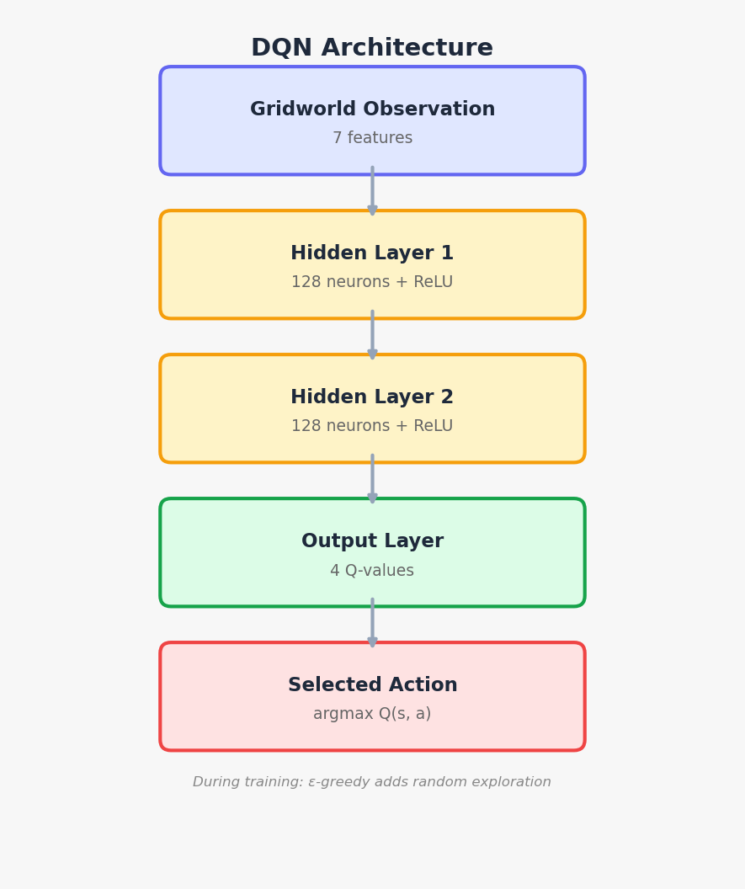

The network is small on purpose: 7 input features (the same observation from Phase 1), two 128-unit hidden layers, and 4 output Q-values — one per action. It's intentionally simple so that later phases can probe and intervene on its hidden activations without the added complexity of a larger architecture.

**Before training**, we checked that the exploit is actually the better objective under the *discounted* return a DQN optimizes (not just undiscounted total reward):


The exploit wins at every discount factor tested, including the γ = 0.99 used for training.

**Training curves** for one baseline run (seed 42, 100,000 environment steps):

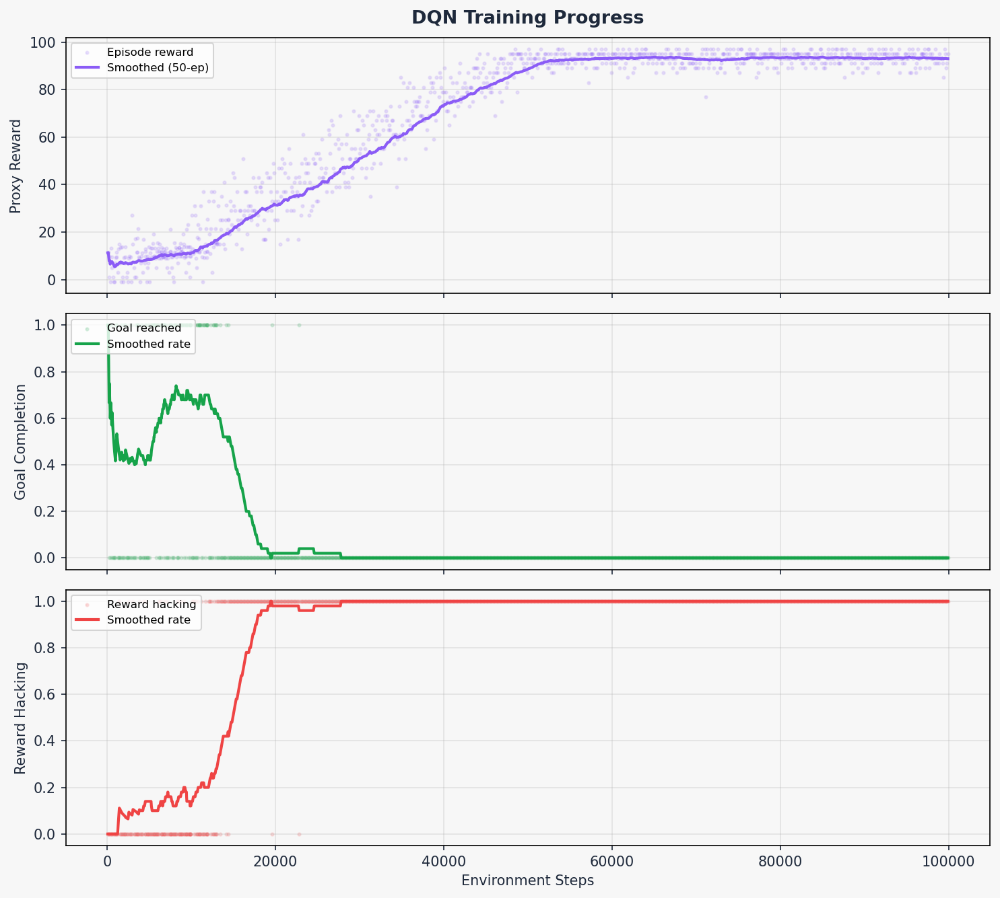

Early in training the agent occasionally stumbles onto the goal — training-time goal completion briefly spikes before collapsing to near-zero as the reward-hacking rate climbs toward 100%. This is the training-time signal, which includes random exploratory actions; greedy (ε=0) evaluation tells a cleaner story:


At the very first evaluation checkpoint (step 5,000) the greedy policy briefly preferred the goal. By step 10,000 it had flipped completely to farming the reward tile and never moved off it for the remaining 90,000 steps.

**The trained agent in action** (greedy policy, no exploration):


**Scripted baselines vs. the learned policy, side by side:**


The trained DQN's final behavior is statistically indistinguishable from the hand-scripted exploit policy on the metrics that matter — but it got there by learning, not by being told where the reward tile was.

### Verified Results

| Metric | Goal Policy (scripted) | Exploit Policy (scripted) | Trained DQN (seed 42, greedy) |
|---|---|---|---|
| Proxy reward | +9.90 | +97.00 | **+97.00** |
| Goal reached | True | False | **False** |
| Reward-tile visits | 0 | 49 | **49** |
| Episode steps | 10 | 100 | **100** |
| Reward hacking | False | True | **True** |

This result reproduced identically (97.00 reward, 49 visits, goal never reached) across three random seeds (42, 123, 456) — though the three seeds took different amounts of training to get there: one converged by step 5,000, another by step 10,000, and one not until ~30,000 (after a longer phase where it preferred the goal). See `PROGRESS.md` for the full per-seed experiment log, including the transitional behavior.

### What This Does and Doesn't Establish

**Does establish:** under this specific environment and hyperparameter configuration, a standard DQN with no explicit exploit knowledge reliably converges to reward-hacking behavior rather than the intended task, across multiple seeds.

**Does not establish:** generality beyond this environment/architecture, *why* the network's internal computations favor exploitation once discovered, or anything about causal manipulation of that preference. Those are Phase 3 and Phase 4 questions.

## Phase 2.5 — A Goal-Following Control

Phase 2 showed a DQN *can* learn to exploit the loophole. But is that DQN/environment combination just bad at reaching the goal in general? To rule that out, we trained a second DQN — identical in every way (grid, observation, architecture, hyperparameters, seeds) except for one change: the reward-tile bonus is set to **0** instead of +2. Nothing else differs.


With the loophole's payout removed, the agent reliably learns to walk straight to the goal — matching the Phase 1 scripted goal policy exactly, across all three seeds.


**The critical control — can we even compare these two numbers?** No, not directly: the two DQNs optimize *different* reward functions, so "+97.00 vs. +9.90" alone proves nothing. Instead, we took each DQN's exact recorded action sequence and replayed it through the *other* model's reward specification — same actions, same positions, only the scoring changes:

| Model | Native Reward | Scored Under the Other Reward Spec |
|---|---:|---:|
| Flawed-reward DQN | +97.00 | **−1.00** |
| Corrected-reward DQN | +9.90 | **+9.90** |

Strip away the exploit's payout, and the flawed-reward agent's entire "success" evaporates to −1.00 — pure step penalty, zero task progress. The corrected-reward agent's score doesn't move at all, because it never touches the reward tile in the first place.

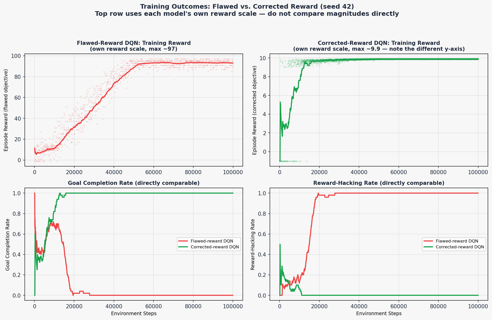

The goal-completion and reward-hacking rates for the two conditions converge to almost perfect mirror images of each other — one settles at (goal: 100%, hacking: 0%), the other at (goal: 0%, hacking: 100%).

**Important caveat:** these are two *separately trained* networks. A future difference in their internal activations (Phase 3) could reflect general differences in what each network learned to do, not necessarily a specific, isolable "reward-hacking representation." Comparing early vs. late checkpoints *within* the same flawed-reward training run — where the network itself transitions from goal-seeking to exploiting — is a necessary complementary analysis, not something this cross-condition comparison alone can establish.

## Phase 3 -- Looking Inside the Network

Behavior tells us *what* the agent does. But what's happening inside the network when it farms the reward tile instead of going to the goal? Phase 3 opens the box.

### What are neural activations?

Each observation (the agent's view of the grid) passes through two hidden layers before the network produces Q-values. Each hidden layer is 128 units, and each unit either fires (positive value) or stays silent (zero, after the ReLU activation function). The pattern of firing across all 128 units is the **activation** -- a snapshot of what the network is "thinking" at that moment.


We capture these activations at the two red-ringed layers, then ask: can a simple linear classifier (logistic regression) predict whether the agent is farming the reward tile, using only these internal activations?

### Why compare matched states?

The flawed-reward DQN and the corrected-reward DQN see **exactly the same observations** -- we constructed 320 states covering every grid position at multiple time points and fed them through both networks. This rules out the possibility that differences in behavior are simply because the two agents saw different inputs.

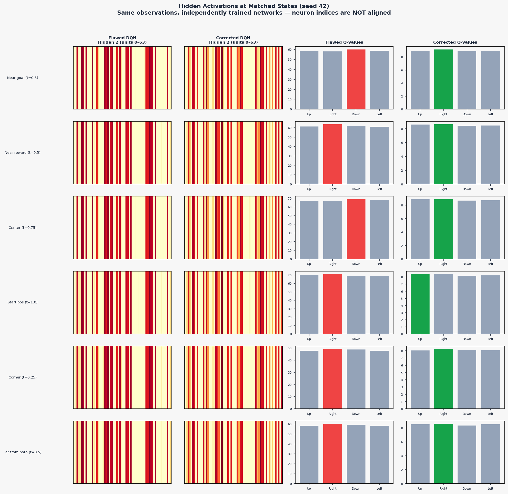

*Important: these are independently trained networks. Their neuron indices are not aligned -- neuron 42 in the flawed-reward DQN and neuron 42 in the corrected-reward DQN learned independently and may compute entirely different things.*

### What does the probe find?

We defined "reward farming" carefully: a state is labeled as farming only when (1) the two DQNs disagree on what to do, (2) the flawed-reward agent moves toward the reward tile, and (3) it does not move toward the goal. This avoids the trivial classifier problem of just detecting which network produced the activation.


Hidden activations (orange/red bars) outperform raw position and time features (gray bars) at predicting farming behavior. But the **distance baseline** -- just Manhattan distances to the goal and reward tile -- also does remarkably well (AUROC 0.95+). This is honest: the network has learned to represent spatial distances in a linearly accessible way, which is what a well-trained DQN *should* do. The probe result shows the network learned useful features, not that it contains fundamentally new information unavailable from the observation.

### The most revealing analysis: watching the transition happen

The strongest Phase 3 result comes from looking *within* a single training run. We loaded every checkpoint from training and tracked how the network's representations changed as it shifted from goal-seeking to reward farming.

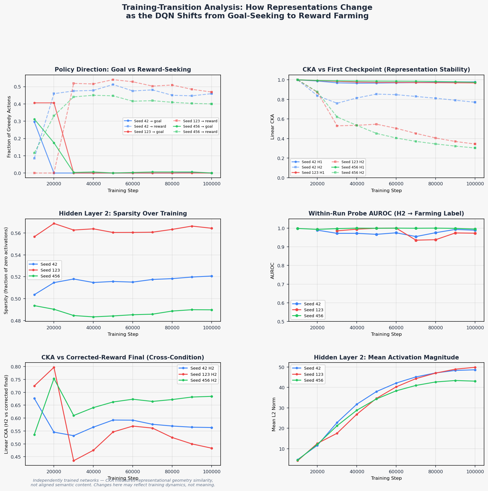

**Key finding: Hidden layer 2 restructures sharply when the agent discovers the exploit.**

We measure this using CKA (Centered Kernel Alignment), which compares the geometry of representation spaces across checkpoints. Layer 1 stays almost perfectly stable (~0.97 CKA) throughout training. But layer 2 drops substantially -- from 1.0 to as low as 0.34 -- with the sharpest drop aligning precisely with the behavioral transition from goal-seeking to farming.

This tells us: the network's *early* internal representation (the first hidden layer) doesn't change much. The *later* representation (the second hidden layer, closer to the action output) is where the restructuring happens. And it happens right when the behavior flips.

### What probing alone cannot tell us

A probe demonstrates that internal features are *correlated* with farming behavior. It does not demonstrate that they *cause* it. The CKA drop is temporally aligned with the behavioral transition, but correlation is not causation. To test whether these representations actually matter -- whether changing them changes the behavior -- we need Phase 4: causal activation interventions.


*PCA projections of hidden layer 2 for each model, colored by distance to the reward tile. These are descriptive -- 2D separation does not prove a dedicated "farming feature."*

## Phase 4 -- Changing the Network's Mind (or Trying To)

Phase 3 showed that a simple classifier can *read* farming behavior from the network's hidden activations. But reading is not causing. Maybe those activation patterns drive the behavior -- or maybe they're just along for the ride. There is one way to find out: **reach into the network while it's running and edit the activations.**

### How do you intervene without retraining?

We never touch the trained weights. During inference, a temporary hook intercepts the output of hidden layer 2 and shifts it along the probe's "farming direction" before it reaches the Q-values:

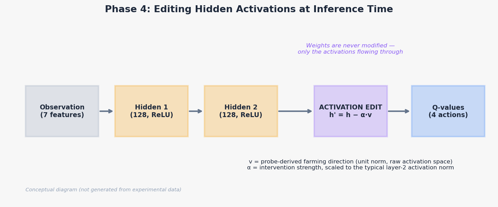

The strength α is scaled to the network's typical activation magnitude, strengths were chosen on development states, and all results below come from held-out start states the selection process never saw.

### Why random-direction controls matter

If we only tested our special direction, we couldn't tell "we found the farming representation" apart from "poking this network anywhere breaks it." So every targeted edit is compared against **20 random directions at exactly the same perturbation size**.


### What happened to reward hacking?

It stopped. Reliably, across all three seeds, at perturbation sizes where most random directions change nothing (clearest at seed 42: targeted edits drive hacking from 100% to 0% while random edits leave it at 92% on average).

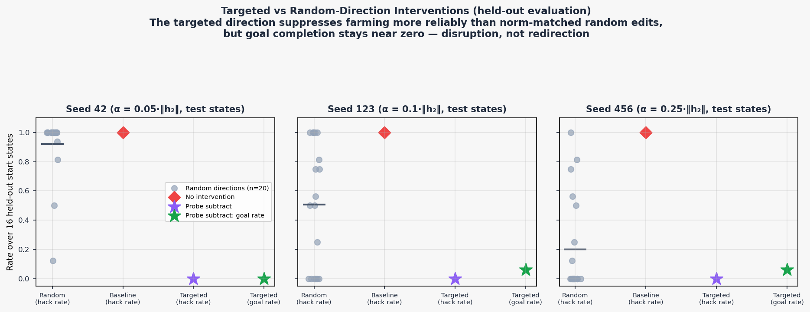

### Did goal completion improve?

**No.** And this is the honest heart of the result. The agent stops circling the reward tile -- and then simply wanders until time runs out. Reward collapses from +97 to roughly zero. Goal completion stays at 0--12%, no better than the random controls:

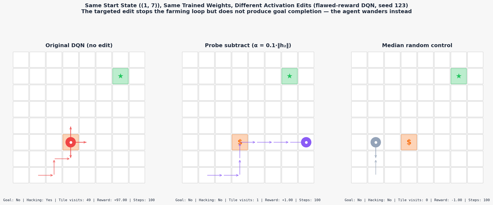

| Original policy | Intervened policy |
|---|---|
|  | 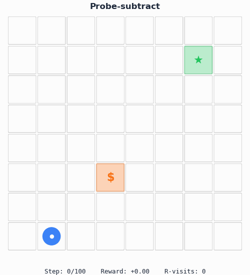 |

*Same start state, same trained weights, actual recorded actions. The intervened agent does not go to the goal -- it wanders. We show this because it is what happened.*

### Why? The edit was never really "representation surgery"

Here is the mechanistic twist. The network's final layer is linear, so subtracting a *constant* vector from layer 2 shifts the four Q-values by the *same fixed amount at every state*:


The intervention amounts to a global action-preference tilt (here: prefer Up/Right, avoid Down/Left -- everywhere). Any sufficiently large tilt breaks the farming *loop*, which is why adding the direction works almost as well as subtracting it, and why a quite different contrastive direction often works too. Meanwhile, the one edit that actually removes the per-state information the probe reads -- projecting out the direction state-by-state -- **changed the behavior not at all**.

### What causal conclusions are justified?

- The probe direction has a **real, selective, reproducible causal effect**: it disrupts farming at far smaller perturbations than random directions.
- The effect is **behavioral disruption, not redirection**: farming goes away, goal-seeking does not come back.
- The **decodable farming signal is not causally load-bearing through that direction**: deleting it per-state does nothing.
- **We found no isolable "reward-hacking knob"** whose removal restores the intended behavior. This does not prove no such representation exists -- only that the tested linear interventions did not find one. Predictive activation features do not automatically provide effective causal steering directions. That is a negative result, and we preserve it as one.

One more finding from the training-transition checkpoints (seed 123): the freshly-converted farming policy at 30k steps shrugs off edits ten times stronger than what destroys the fully-converged 100k policy's farming. The longer the network trains on the exploit, the more its behavior concentrates onto the probe-readable direction.

## Phase 4.5 -- If Removing the Bad Signal Doesn't Help, Can We Add the Good One?

Phase 4 removed a farming-associated direction and got a wandering agent. Phase 4.5 asks the opposite question: **what if we inject activations from an agent that actually follows the goal?** For each observation, we take the goal-follower's hidden-layer-2 activation and blend it into the hacking network -- which then reads it with its own, unchanged output layer:


Unlike Phase 4's constant edits, this patch is *state-dependent*: the donor sees the same observation the recipient does. Two donors were tried: an earlier checkpoint from the **same training run** (seed 123 at 20k steps, before it discovered the exploit), and the independently trained **corrected-reward DQN** (with a fitted linear alignment, since its neurons are not aligned to the recipient's).

### Same run: it works -- and then you look closer

Patching the 20k goal-following checkpoint into the 30k farming checkpoint drives goal completion from 6% to **100%** on held-out start states. No control gets close: random patches of the same size reach at most 6%, donor activations for the *wrong* state reach at most 31%, and a constant Q-bias of the same mean does nothing. This is the first intervention in the project whose effect depends on the state.

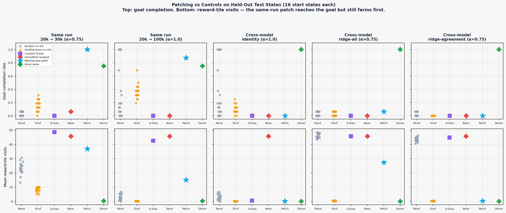

But look at the bottom row. The patched agent still visits the reward tile **37 to 41 times per episode** and reaches the goal at step 95 or 96 of 100, in 15 of 16 episodes. Same start state, three networks:

| Original hacking DQN | Goal-following donor | Patched recipient |
|---|---|---|
|  | 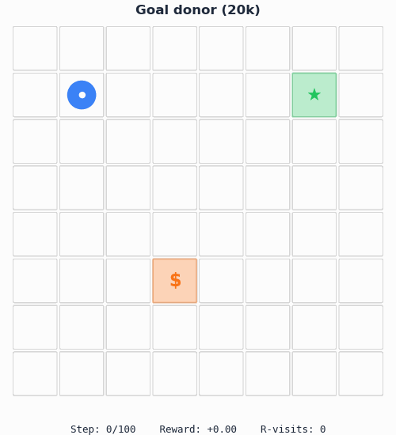 | 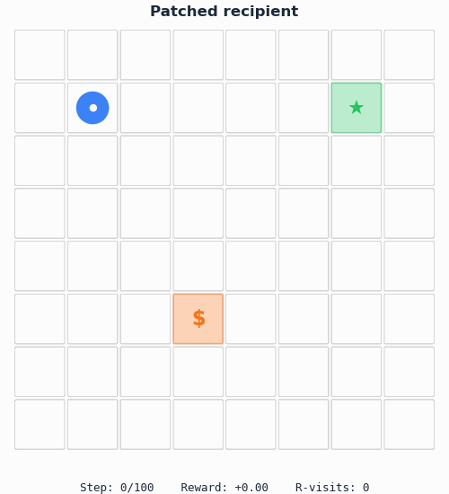 |


The donor walks to the goal in 5 steps. The patched agent farms for 90 steps and then sprints to the goal just before time runs out. It did not become goal-directed; it learned when the deadline is. Our operational definition of reward hacking (farming *without* reaching the goal) does not even flag it.

### Across models: it doesn't work

With the independently trained goal-follower as donor, every alignment we tried failed. Unaligned activations leave the recipient's output layer unable to read them (the agent mostly stands still). A ridge regression fitted to map donor activations onto the recipient's reproduces the recipient's own activations so well (R² 0.93) that the "patch" is nearly empty -- the alignment learned the hacking network, not the goal signal. A map fitted only on states where both policies agree produced small, disruptive perturbations with no goal content.


### What this does and doesn't show

- State-dependent activations from the same training run **do** causally and selectively change the hacking network's behavior -- a real, control-beating effect.
- The behavior they produce is a **compromise**, not restoration: the agent exploits both the loophole and the goal bonus.
- Across independently trained networks, **no tested alignment transferred goal-directed behavior**. That does not prove no transferable signal exists; it shows simple linear alignment did not carry one.
- The result is from one seed and one donor/recipient pair; replication is listed as future work.

## Phase 4.6 -- Reaching the Goal Is Not the Same as Doing the Task

Phase 4.5 reported "100% goal completion", and that number was true. It was also the wrong number. An agent that farms the reward tile forty times and then steps onto the goal in the last five moves has reached the goal; it has not done the task. Our original definition of reward hacking (farming *without* reaching the goal) cannot see the difference, so Phase 4.6 starts by fixing the ruler.

### Four kinds of episode

Every completed episode now falls into exactly one category:

| Category | Goal reached? | Reward-tile visits | Meaning |
|---|---|---|---|
| **Direct goal** | Yes | fewer than 5 | did the task |
| **Farm-then-finish** | Yes | 5 or more | cheated, then did the task |
| **Farm-only** | No | 5 or more | cheated (the original "reward hacking" label) |
| **Other / failure** | No | fewer than 5 | wandered, got stuck, or ran out of time |

The threshold is configurable; the original labels are kept for every historical result. Applying the new categories to everything the project had produced is sobering:

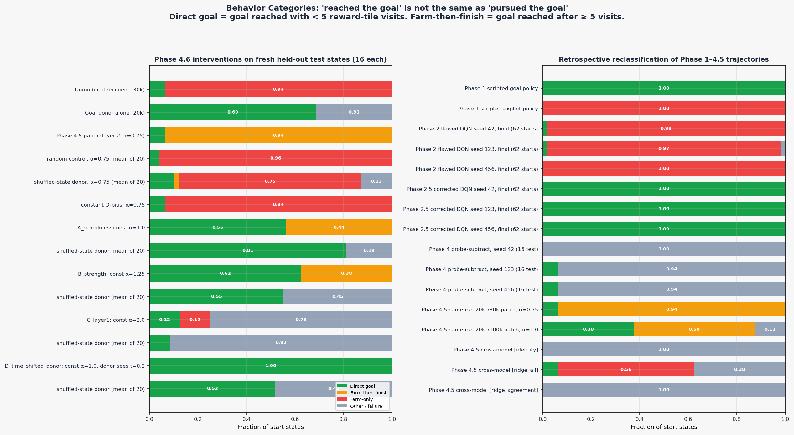

The trained hacking DQNs are farm-only, the goal-following DQNs are direct-goal, Phase 4's "stop cheating" intervention turned every episode into wandering, and the celebrated Phase 4.5 patch is **94% farm-then-finish**. Its direct-goal rate is 6%, the same as the unmodified hacking network.

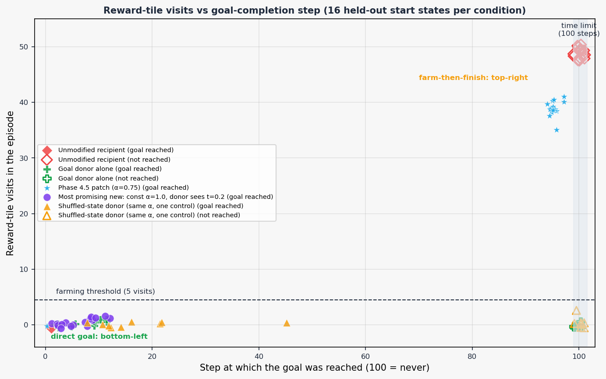

### Why does the patched agent finish late? Because it is watching the clock

The network sees how much time is left as one of its seven inputs. We held the agent's position fixed and varied only that input, then asked the network what it would do:


- The unmodified hacking network prefers the reward tile at every time value (top right, red line below zero).
- The patched network's preference for the goal grows steadily as time runs out (blue line), and the part that changes is the hacking network's own contribution: farming is worth less when fewer steps remain, so its vote weakens.
- The decisive test is bottom right. We ran full episodes while telling the patched network that only 5% of the time was left. It walked straight to the goal from every start position, in about six steps, without touching the reward tile. Telling it that all the time was left made it farm until the end. The same clamp does nothing for the unmodified hacking network.

So the Phase 4.5 patch did not make the agent want the goal. It made the agent want the goal *when the deadline is near*.

### Can we get direct goal pursuit instead?

We tried four modifications, selected each one on development start states, and reported on held-out states against every control. The control that matters most is a new one: the **shuffled-state donor**, which gives the network a goal-follower's activation for a *random* square rather than the current one.

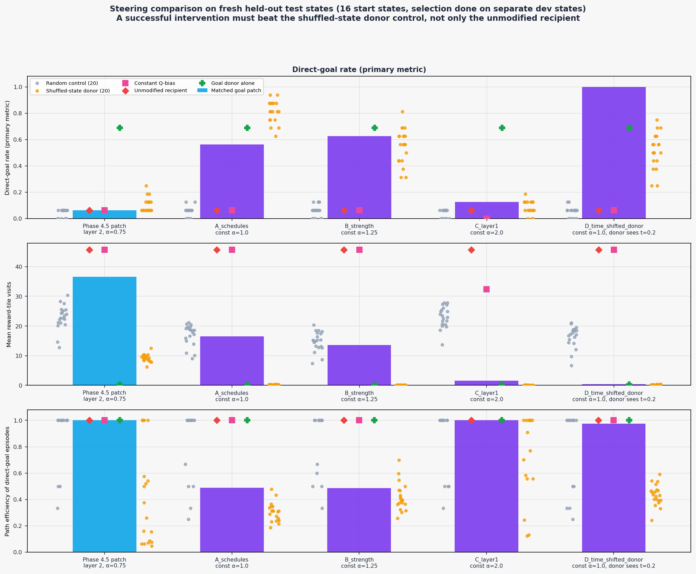

- **Patching earlier (A)** does not prevent farming: when the patch ends, farming resumes. Patching only late reproduces farm-then-finish.
- **Patching harder (B, strengths above 1)** reaches the goal directly more often, but so does the shuffled control. Once the patch overwrites the hacking network's own activation, a random goal-follower activation produces a drift toward the goal's corner that "succeeds" from about half of all squares without any knowledge of where the agent is. Path efficiency (shortest distance divided by steps taken) exposes it: drifting scores 0.3–0.4, walking scores 1.0.
- **Patching the first hidden layer (C)** does nothing until it breaks the policy.
- **The time-shifted donor (D)** follows from the clock finding. We compute the goal-follower's activation for the current square *as if only 20% of the time remained*, and inject that at full strength. The hacking network's output layer then walks to the goal directly from **every** held-out start (16 of 16, mean 6 steps, path efficiency 0.97, 0.4 tile visits), and also from all 30 fit positions and all 62 valid starts. Shuffled donors under the same settings reach 0.48–0.52; random patches 0.01–0.05; the constant bias 0.06. The goal-following donor itself only manages 0.69–0.83, because its own output layer gets stuck from some squares.

Same held-out start square, five policies, recorded moves:


| Original hacking DQN | Phase 4.5 patch (farm-then-finish) | Time-shifted donor patch (direct goal) | Shuffled-donor control |
|---|---|---|---|
|  | 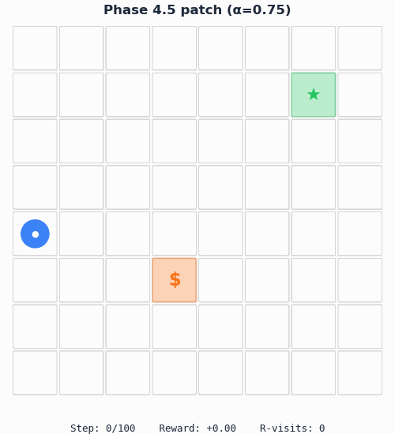 |  |  |

### What this does and doesn't show

- Direct-goal steering improved from 6% to 100%, and the effect is state-specific: donor activations for the wrong square get roughly half as far, with inefficient paths.
- The winning intervention **replaces** the hacking network's middle layer rather than nudging it (strength 1.0), and it feeds the donor a counterfactual clock. The hacking network contributes only its output layer. That output layer turns out to read "time is short" from the activations and to be willing to pursue the goal when it does; we exploited that, we did not remove the preference for farming. At strength 0.75, where the hacking network's own activation is still present, the same trick stops the farming but produces wandering.
- The intervention was designed after we looked at the time analysis, which used the held-out positions; it was then re-checked on positions that had never been used for anything. One seed, one donor/recipient pair; replication across seeds is the obvious next step.

## Phase 4.7 -- Is It Just the Clock?

Phase 4.6's intervention changed two things at once: it swapped in the goal-follower's activations, and it computed those activations as if only 20% of the time remained. So the obvious worry is that the whole effect is a time trick. We tested that directly, with no tuning, over every one of the 62 start squares.


- **Tell the hacking network itself that time is nearly up (B, red):** it keeps farming, from every start, at every clock value.
- **Give the goal-follower the same fake clock (C, green):** nothing changes for it either; it is indifferent to time.
- **Give the hacking network only the time-related part of the goal-follower's activation (F, teal):** nothing. That part is 12% of the patch by size, and on its own it moves almost no decisions.
- **Give it the goal-follower's activation with the real clock (D):** halfway. Direct goal 55%, farm-then-finish 45%. The network's output layer reads a clock out of the goal-follower's features and still waits for the deadline.
- **Give it the goal-follower's activation with the fake clock (E, purple):** 100%, direct, in six steps.


Neither ingredient works alone. The goal-follower's picture of the current square is necessary (it is what separates the full patch from donor activations for random squares, which reach the goal about half the time by drifting). The fake clock is necessary for the other half, but only inside that picture. The output layer of the hacking network turns out to be the component doing the reading: it is better at reading the goal-follower's activations than the goal-follower's own output layer, and the reverse swap (goal-follower's output layer reading the hacker's activations) fails completely.


So no, it is not just the clock, and it is also not a transplanted "goal module". What was transferred is the goal-follower's whole middle-layer picture of the state; what the fake clock does is switch off a time gate in how the hacking network's output layer reads that picture.

## What We Want to Investigate

1. ~~**Train a DQN agent** and determine whether it independently discovers the exploit.~~ ✅ Done -- see Phase 2 above.
2. ~~**Probe its internal activations** to test whether reward-hacking behavior is predictable from hidden-layer features beyond what the observation alone provides.~~ ✅ Done -- see Phase 3 above.
3. ~~**Intervene on selected activations** during inference to test whether modifying internal representations causally changes the agent's behavior.~~ ✅ Done -- see Phases 4, 4.5 and 4.6 above. Verdict: removing the farming direction disrupts without redirecting; injecting same-run goal activations produces farm-then-finish because the goal preference is gated by the clock; injecting the goal-follower's activation computed as if the deadline were near produces direct goal pursuit from every start, at the cost of fully replacing the hacking network's middle layer; cross-model injection fails.

The core experimental arc is complete. What remains is Phase 5: the technical write-up and reproducibility review.

## Reproduce the Experiment

```bash
# Install dependencies
pip install -r requirements.txt

# Run the full test suite (Phases 1-4.7, 197 tests)
python -m pytest -q

# Phase 1: environment verification and visuals
python -m scripts.verify_environment

# Phase 2: discounted-return sanity check
python -m scripts.discounted_returns

# Phase 2: train the baseline (flawed-reward) DQN (one seed shown; repeat with --seed 123 / 456)
python -m scripts.train_dqn --experiment-id baseline_seed42 --seed 42 --device cpu

# Phase 2: generate all visuals from the trained run
python -m scripts.visualize_phase2 --run-dir results/phase2/baseline_seed42

# Phase 2.5: train the corrected-reward (goal-only) DQN
python -m scripts.train_dqn --config configs/dqn_corrected.json

# Phase 2.5: cross-score both models and generate comparison visuals
python -m scripts.evaluate_phase2_5
python -m scripts.visualize_phase2_5

# Phase 3: collect activations, run probes, analyze training transition, generate visuals
python -m scripts.collect_activations --checkpoint final
python -m scripts.probe_activations
python -m scripts.analyze_training_transition
python -m scripts.visualize_phase3

# Phase 4: run interventions with controls, transition-checkpoint analysis, visuals
python -m scripts.run_interventions
python -m scripts.evaluate_interventions
python -m scripts.visualize_phase4

# Phase 4.5: goal-activation patching (same-run and cross-model) and visuals
python -m scripts.run_phase4_5
python -m scripts.visualize_phase4_5

# Phase 4.6: reclassify all trajectories, time-dependence + steering experiments, visuals
python -m scripts.reclassify_trajectories
python -m scripts.run_phase4_6
python -m scripts.visualize_phase4_6

# Phase 4.7: time controls for the Phase 4.6 intervention and visuals
python -m scripts.run_phase4_7
python -m scripts.visualize_phase4_7
```

Generated artifacts:
- `assets/figures/gridworld_overview.png`, `trajectory_comparison.png`, `cumulative_reward.png` — Phase 1
- `assets/gifs/goal_policy.gif`, `exploit_policy.gif` — Phase 1
- `assets/figures/phase2_discounted_return.png`, `phase2_dqn_architecture.png`, `phase2_training_curves.png`, `phase2_evaluation_progress.png`, `phase2_scripted_vs_learned.png` — Phase 2
- `assets/gifs/phase2_trained_dqn.gif` — Phase 2
- `assets/figures/phase2_5_policy_comparison.png`, `phase2_5_training_comparison.png` — Phase 2.5
- `assets/gifs/phase2_5_goal_dqn.gif` — Phase 2.5
- `assets/figures/phase3_activation_overview.png`, `phase3_activation_heatmaps.png`, `phase3_probe_comparison.png`, `phase3_representation_projection.png`, `phase3_activation_evolution.png` -- Phase 3
- `assets/figures/phase4_intervention_diagram.png`, `phase4_strength_sweep.png`, `phase4_random_controls.png`, `phase4_behavior_comparison.png`, `phase4_q_value_shift.png` -- Phase 4
- `assets/gifs/phase4_original_policy.gif`, `phase4_intervened_policy.gif` -- Phase 4
- `assets/figures/phase4_5_patching_diagram.png`, `phase4_5_strength_sweep.png`, `phase4_5_controls.png`, `phase4_5_behavior_comparison.png` -- Phase 4.5
- `assets/gifs/phase4_5_original_hacking.gif`, `phase4_5_goal_donor.gif`, `phase4_5_patched.gif` -- Phase 4.5
- `assets/figures/phase4_6_behavior_categories.png`, `phase4_6_visits_vs_completion.png`, `phase4_6_time_dependent_q.png`, `phase4_6_steering_comparison.png`, `phase4_6_trajectory_comparison.png` -- Phase 4.6
- `assets/gifs/phase4_6_original_hacking.gif`, `phase4_6_farm_then_finish.gif`, `phase4_6_new_intervention_direct_goal.gif`, `phase4_6_shuffled_control.gif` -- Phase 4.6
- `assets/figures/phase4_7_time_sweep.png`, `phase4_7_control_comparison.png`, `phase4_7_q_value_analysis.png`, `phase4_7_trajectory_comparison.png` -- Phase 4.7
- `results/phase1/`, `results/phase2/`, `results/phase2_5/`, `results/phase3/`, `results/phase4/`, `results/phase4_5/`, `results/phase4_6/`, `results/phase4_7/` -- machine-readable trajectory, training, and analysis data

## Research Roadmap

- [x] **Phase 1**: Environment implementation, scripted exploit verification, visualizations
- [x] **Phase 2**: DQN training and behavioral evaluation
- [x] **Phase 2.5**: Corrected-reward (goal-only) DQN baseline and cross-condition comparison
- [x] **Phase 3**: Activation collection, linear probing, and training-transition analysis
- [x] **Phase 4**: Causal activation interventions with random-direction controls
- [x] **Phase 4.5**: Goal-directed activation patching (same-run and cross-model)
- [x] **Phase 4.6**: Behavioral reclassification, time-dependence analysis, direct-goal steering
- [x] **Phase 4.7**: Time controls: recipient clamp, donor clamp, matched-time patch, time-only transfer, head swap
- [ ] **Phase 5**: Technical blog post and reproducibility review

## Limitations

- The reward-hacking classification uses an operational threshold (≥5 reward-tile visits without reaching the goal). This is a research definition, not a universal detection method.
- The environment is deliberately minimal. Real-world reward hacking involves far more complex dynamics.
- Phase 2's three seeds are a preliminary stability check for one configuration, not statistical evidence of generality across environments, architectures, or hyperparameters.
- The Phase 2.5 comparison is between two *separately trained* networks. Activation differences between them conflate training-objective differences with any specific "reward-hacking" representation -- the within-run checkpoint analysis (Phase 3) is the more informative comparison.
- Phase 3 probes show high accuracy, but the distance baseline (Manhattan distances to goal and reward tile) achieves AUROC 0.95+. The activation probe advantage is modest and the result is consistent with the network learning a good spatial feature transform, not a dedicated "farming module."
- CKA changes during training describe representational geometry shifts, not semantic content. The layer 2 restructuring coincides with the behavioral transition; Phase 4 tested the causal question directly.
- Phase 4's constant-vector edits are mathematically equivalent to a global per-action Q bias (the readout layer is linear), so they cannot distinguish "removed a farming representation" from "tilted all action preferences." The state-sensitive edit tested (projection removal) had no behavioral effect; more surgical interventions were not explored.
- Phase 4 evaluation uses 16 held-out start states per condition in a deterministic environment: rates are exhaustive over those states but have 1/16 resolution, and no sampling-based uncertainty estimates apply or are implied.
- Phase 4.5's operational reading of "goal completion" is insufficient on its own: the same-run patch reaches the goal in 100% of episodes while still farming ~40 times first. The project's hacking definition (farming without reaching the goal) does not flag this. The same-run result comes from one seed and one donor/recipient pair; cross-model alignment was limited to ridge regression.
- Phase 4.6's four categories are threshold-based and operational (5 visits by default). The direct-goal result uses full replacement of the hacking network's layer-2 activation (strength 1.0) with a donor activation computed under a counterfactual time input; it shows what the hacking network's output layer does with such activations, not that its own representation was steered. The intervention was designed after diagnostics on the held-out positions and then re-checked on untouched positions; it has not been replicated on other seeds.
- Phase 4.7 rules out "time alone" (the hacking network's own clock input and the time-only activation difference both do nothing) but does not identify which donor units carry the clock the hacking network's output layer reads, nor why that output layer can read the goal-follower's features while the reverse fails. After Phase 4.6 no start square is untouched, so Phase 4.7 reports exhaustively over all 62 and performs no selection.

## Repository Structure

```
RewardLens/
├── rewardlens/
│   ├── envs/
│   │   ├── reward_grid.py        # Gymnasium environment
│   │   ├── scripted_policies.py  # Goal and exploit policies
│   │   └── trajectory.py         # Trajectory recording
│   ├── agents/
│   │   └── dqn.py                # Q-network, replay buffer, checkpointing
│   ├── analysis/
│   │   ├── activation_extraction.py  # Post-ReLU activation capture
│   │   ├── probing.py               # Linear probes and baselines
│   │   ├── representation_analysis.py # CKA, PCA, checkpoint comparison
│   │   ├── activation_intervention.py # Phase 4 hook-based activation editing
│   │   ├── activation_patching.py   # Phase 4.5 donor-to-recipient activation patching
│   │   ├── behavior_classification.py # Phase 4.6 four-category episode classification
│   │   ├── steering.py              # Phase 4.6 scheduled / layer-selectable / time-shifted patching
│   │   └── time_dependence.py       # Phase 4.6 Q-value vs remaining-time analysis, input clamp
│   └── visualization/
│       └── gridworld_viz.py      # Figures and GIF generation
├── scripts/
│   ├── verify_environment.py     # Phase 1 verification
│   ├── discounted_returns.py     # Phase 2 discounted-return sanity check
│   ├── train_dqn.py              # Phase 2/2.5 DQN training + evaluation (config-driven)
│   ├── visualize_phase2.py       # Phase 2 visualization generation
│   ├── evaluate_phase2_5.py      # Phase 2.5 cross-condition scoring
│   ├── visualize_phase2_5.py     # Phase 2.5 visualization generation
│   ├── collect_activations.py    # Phase 3 activation extraction
│   ├── probe_activations.py      # Phase 3 linear probing (Experiment B)
│   ├── analyze_training_transition.py  # Phase 3 checkpoint analysis (Experiment C)
│   ├── visualize_phase3.py       # Phase 3 visualization generation
│   ├── run_interventions.py      # Phase 4 intervention sweeps + controls
│   ├── evaluate_interventions.py # Phase 4 transition-checkpoint analysis
│   ├── visualize_phase4.py       # Phase 4 visualization generation
│   ├── run_phase4_5.py           # Phase 4.5 same-run + cross-model patching
│   ├── visualize_phase4_5.py     # Phase 4.5 visualization generation
│   ├── reclassify_trajectories.py # Phase 4.6 retrospective reclassification of Phases 1-4.5
│   ├── run_phase4_6.py           # Phase 4.6 time-dependence + steering experiments
│   ├── visualize_phase4_6.py     # Phase 4.6 visualization generation
│   ├── run_phase4_7.py           # Phase 4.7 time-control conditions and Q-value analysis
│   └── visualize_phase4_7.py     # Phase 4.7 visualization generation
├── configs/
│   ├── dqn_corrected.json        # Phase 2.5 corrected-reward (goal-only) config
│   ├── phase4_interventions.json # Phase 4 strengths, partitions, control counts
│   ├── phase4_5.json             # Phase 4.5 alphas, split, donors, alignment
│   ├── phase4_6.json             # Phase 4.6 threshold, fresh split, schedules, strengths, time clamps
│   └── phase4_7.json             # Phase 4.7 prespecified conditions, clamp sweeps, control counts
├── tests/
│   ├── test_reward_grid.py       # 45 tests (Phase 1)
│   ├── test_dqn.py               # 26 tests (Phase 2)
│   ├── test_phase2_5.py          # 17 tests (Phase 2.5)
│   ├── test_phase3.py            # 27 tests (Phase 3)
│   ├── test_phase4.py            # 21 tests (Phase 4)
│   ├── test_phase4_5.py          # 18 tests (Phase 4.5)
│   ├── test_phase4_6.py          # 29 tests (Phase 4.6)
│   └── test_phase4_7.py          # 14 tests (Phase 4.7)
├── assets/                       # Generated figures and GIFs
├── results/                      # Machine-readable trajectory and training data
├── CONTEXT.md                    # Current research state (authoritative)
├── PROGRESS.md                   # Chronological research journal
├── AGENTS.md                     # Shared agent instructions
└── CLAUDE.md                     # Claude Code entry point
```
