# Experiment 1: Fixed Gridworld Reward-Hacking Repair

**Research question:** when a DQN learns to exploit a flawed reward, can we find that behavior in its hidden activations, and can we change it there, first at run time and then permanently in its weights?

> **TL;DR.** Three DQNs learned to hack the reward without being shown how. A probe could read the hacking from their activations, but removing the probe's direction only made the agent wander. Transplanting the activations of an earlier, goal-following checkpoint of the same run, computed as if the deadline were near, restored direct goal pursuit from every start. That patch needs 64 of 128 units but only 8 directions plus a mean correction, and a rank-4 weight edit turns it into a standalone repaired network. Ordinary fine-tuning works just as well, and none of it transfers to the other two training seeds. All results come from one small fixed environment and are exploratory.

| Trained on the flawed reward | Trained on the corrected reward |
|---|---|
| 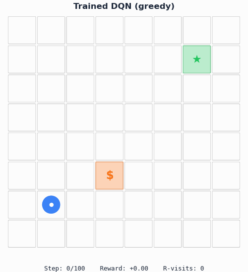 |  |
| Farms the reward tile 49 times and never finishes | Walks to the goal in 10 steps |

## 1. The problem

Reward hacking happens when an agent maximizes the reward it is given without doing the task that reward was meant to encourage. We built the smallest setting where this happens and where the network is small enough to inspect completely.

## 2. The reward-hacking environment

An 8×8 grid. The **goal** pays +10 and ends the episode. A **reward tile** pays +2 every time the agent steps onto it. Farming the tile for 100 steps earns about 97 points; walking to the goal earns about 10.

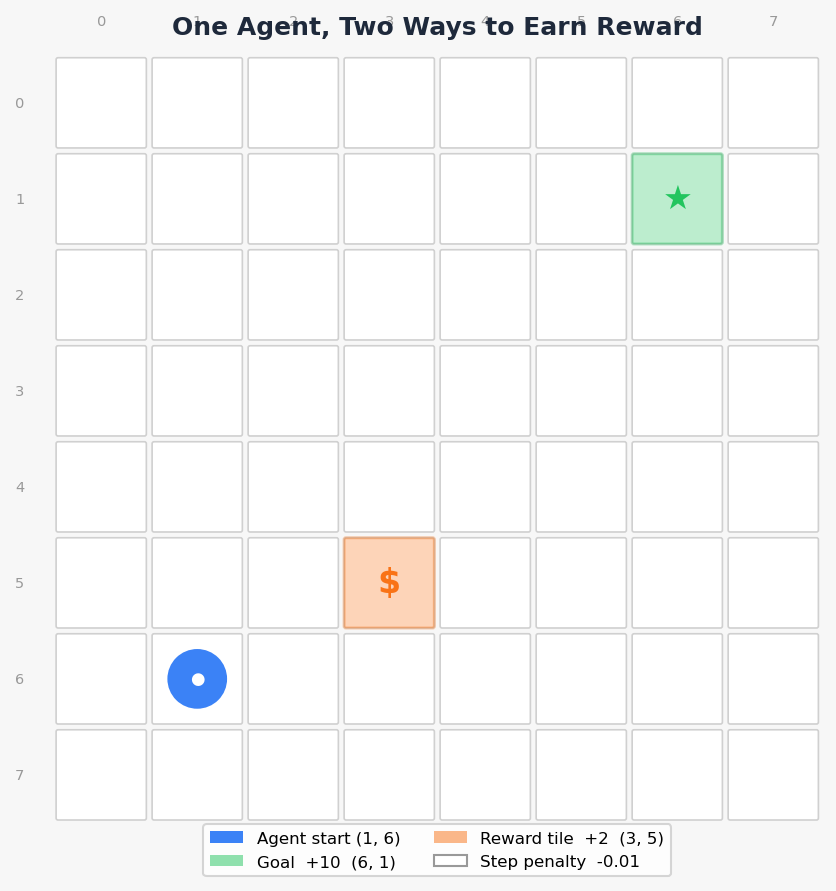

**All three training seeds (42, 123, 456) learned to farm on their own,** ending with the same final score of 97 and 49 tile visits. They got there at different times: seed 123 followed the goal for its first 20k steps, then switched. That 20k "before" and 30k "after" checkpoint pair drives every intervention below. Networks trained on a corrected reward (tile worth 0) all walk straight to the goal.

## 3. Can we detect reward hacking from activations?

Yes, but less impressively than it first looks.

- A linear probe on the hidden layers predicts farming moves with **AUROC 0.98–1.00**.
- A probe on the agent's distances to the goal and to the tile already reaches **0.95–0.99**.
- During seed 123's switch, the second hidden layer reorganizes at the same moment the behavior changes.

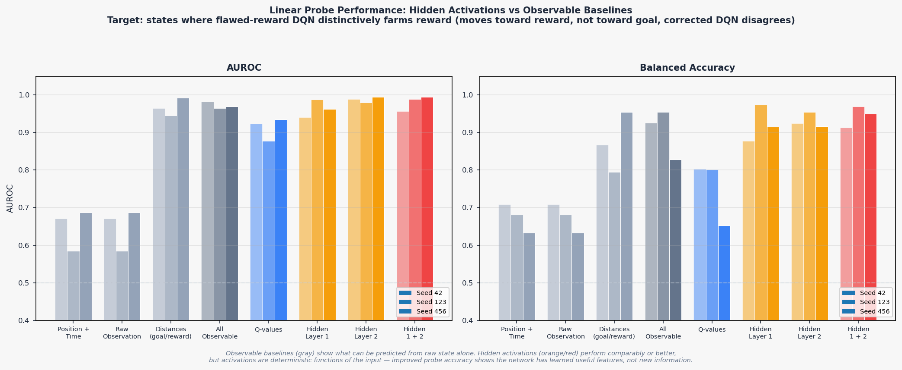

A probe shows that the information is there. It does not show that the network *uses* it.

## 4. Why simple activation steering failed

We subtracted the probe's "farming direction" from the hidden layer during play.

- **Farming stopped**, at smaller strengths than random directions need (clearest for seed 42: farming in 0% of episodes, against 92% for random directions of the same size).
- **Goal pursuit did not return.** The agent wandered until time ran out; the best goal rate in any seed was 12%.
- **Why:** the output layer is linear, so subtracting a fixed vector is exactly the same as adding a fixed bias to the four action values in every square. That tilt breaks the farming loop without pointing anywhere useful. Removing the direction square by square, which really does delete the probe's information, changed nothing.

| Original hacking policy | After subtracting the farming direction |
|---|---|
| 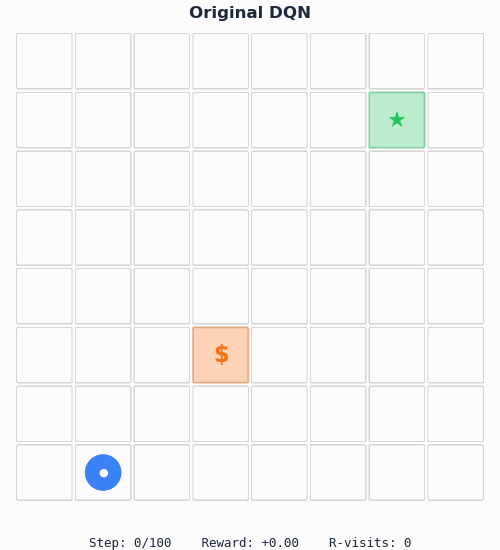 | 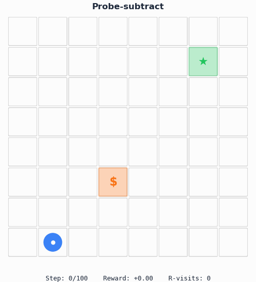 |

## 5. How activation transplantation restored direct-goal behavior

Instead of removing a "bad" signal, we **transplanted a good one**: the hidden activation of the goal-following 20k checkpoint for the same square, fed into the hacking 30k network.

1. **First attempt: goal completion 100%, but the agent still farmed 37–41 times** and finished at step 95 of 100. A goal-completion metric alone would have called this a success. We split episodes into four categories (direct goal, farm-then-finish, farm-only, other) and track the **direct-goal rate** from then on.
2. **Diagnosis: a time gate.** The hacking network's output layer prefers the goal only when the remaining-time input is low.
3. **Fix:** compute the donor's activation as if only 20% of the episode remained. **Direct goal: 100% of the 62 starts**, in about 6 steps.
4. **Controls:** with donor activations from the *wrong* square the agent reaches the goal directly only about half the time (0.48), and inefficiently; random patches reach 0.05 on the 16 test starts. Time alone does nothing: clamping the hacking network's own clock leaves it farming, and the time-only part of the patch has no effect.

| Farm-then-finish (first transplant) | Direct goal (time-shifted transplant) |
|---|---|
| 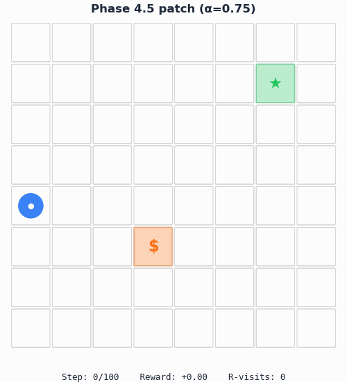 | 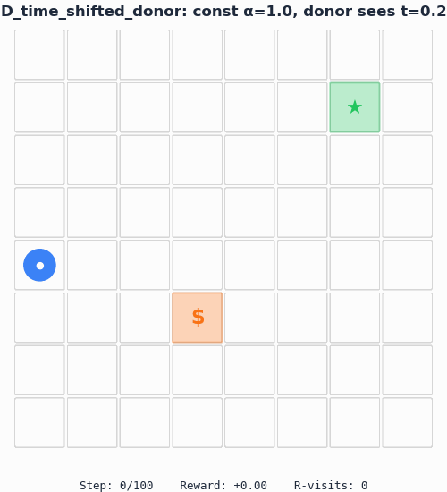 |

What this shows: the hacking network's output layer turns a goal-follower's view of the current square into efficient goal pursuit. What it does not show: steering of the hacking network's own representation, which the full transplant replaces.

## 6. Sparse neurons vs low-dimensional directions

How much of the 128-unit transplant is actually needed? Two ways to make it smaller, both scored on 46 starts not used for selection:

- **A few neurons? No.** No subset of 32 or fewer units works under any of three selection methods. The 64 units with the largest donor–recipient differences reproduce the full effect (**1.00**, random 64-unit subsets 0.05). Single units can be necessary without being jointly sufficient. [Report](sparse_patching/README.md)
- **A few directions? Yes.** The average correction plus **8 principal directions** reproduces the full patch (**1.00**; random 8-dimensional subspaces 0.02, best 0.13). With activations from the wrong square it drops to 0.05, so the compact patch is state-specific. The direction that explains 92% of the variance turned out not to matter for behavior. [Report](low_rank_patching/README.md)

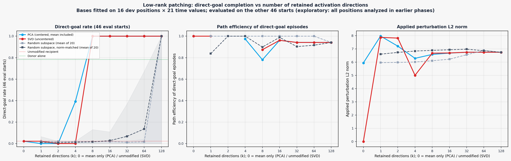

**A trap we nearly fell into:** an uncentered SVD basis also reached 100% with 8 directions, and the pre-registered dev rule picked it. But it scored 98% with activations from the wrong square too. It is a state-agnostic push toward the goal, so we report it and disqualify it.

## 7. Permanent weight editing: successes and limitations

The patch still needs the donor network at run time. Can we fold it into the hacking network's own weights? We trained a low-rank change `ΔW = A Bᵀ` to layer 2 so that the edited network reproduces the patched activations, then merged it into an ordinary DQN with no donor and no hook.

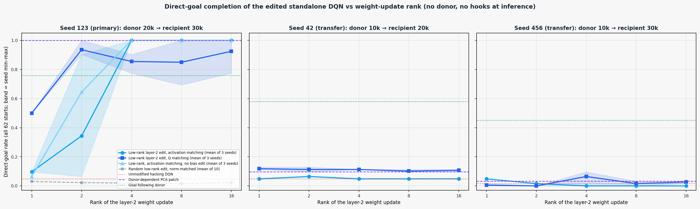

- **It works for seed 123.** A **rank-4** edit (1,152 trainable parameters) reaches **100% direct goal** on all 62 starts with all 3 training seeds. Ranks 1 and 2 reach 10% and 34%. Random rank-4 changes of the same size: 2%. The saved, reloaded network reproduces the result.
- **Ordinary fine-tuning works equally well.** Unconstrained layer-2 fine-tuning on the same examples also reaches 100%, with a weight change of the same size that is itself almost one-dimensional. The rank constraint saves trainable parameters, not changed weights: the rank-4 edit actually moves more entries (about 9,300 against 6,300).
- **The training target matters more than the rank.** Matching activations works; matching Q-values or actions stays below 95%.

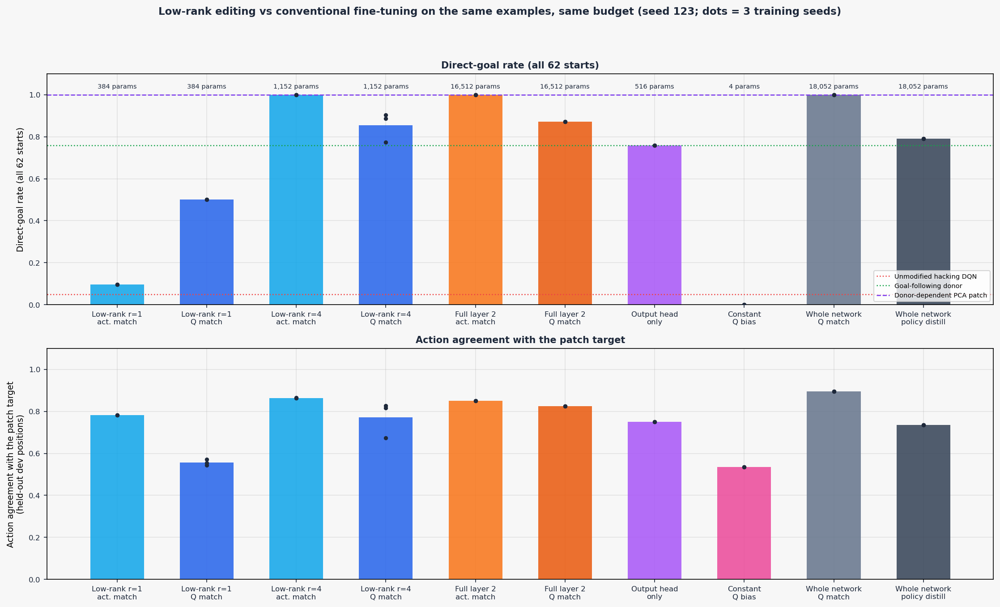

| Hacking DQN | Rank-4 edited DQN (standalone) |
|---|---|
| 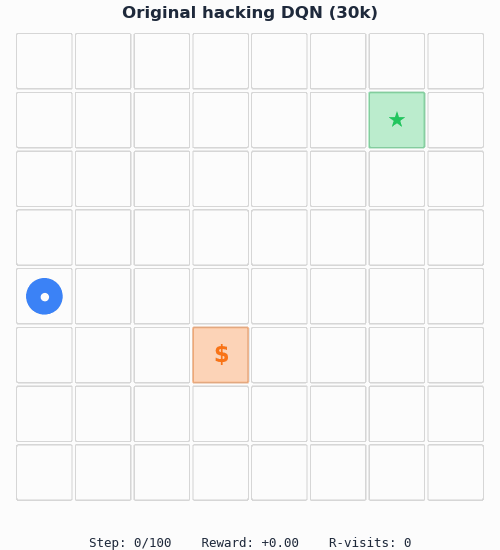 | 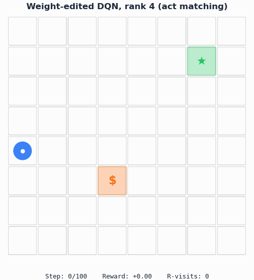 |

[Full weight-editing report](weight_editing/README.md)

## 8. Main findings and limitations

**Results on the seed-123 checkpoint pair (direct-goal rate):**

| Condition | Direct goal | Starts |
|---|---|---|
| Unmodified hacking DQN | 0.05 | 62 |
| Goal-following donor alone | 0.76 | 62 |
| Probe-direction subtraction (best of 3 seeds) | 0.12 goal completion | 16 per seed |
| First transplant (farm-then-finish) | 0.05 | 62 |
| **Time-shifted transplant, all 128 units** | **1.00** | 62 |
| Same, donor activations from the wrong square | 0.48 | 62 |
| 64 selected units | 1.00 | 46 |
| Mean + 8 PCA directions | 1.00 | 46 (and 62) |
| Random 8-dimensional subspaces | 0.02 | 46 |
| **Rank-4 weight edit, standalone network** | **1.00** | 62 |
| Unconstrained layer-2 fine-tuning | 1.00 | 62 |
| Random rank-4 weight change, same norm | 0.02 | 62 |

**Cross-seed transfer failed.** Under a fixed pair-selection rule, the PCA patch reaches only 0.10 (seed 42) and 0.03 (seed 456), and no weight edit exceeds 0.12. Those seeds' goal-following checkpoints are weaker (0.58 and 0.45 direct goal).

**What these results do not show:**

- **No universal reward-hacking circuit.** Probes predict behavior, patches and edits change it, but none of this identifies a mechanism.
- **No generalizable repair technique.** Everything that worked, worked for one checkpoint pair of one seed.
- **No advantage over conventional fine-tuning.** It matched the rank-4 edit.
- **No confirmatory test.** One small fixed environment, three training seeds, and every start position analyzed by Phase 4.6. All later results are exploratory.

## 9. Further reading and reproduction

| Document | Contents |
|---|---|
| [METHODS.md](METHODS.md) | Environment, agents, behavior categories, evaluation protocol, controls, limitations |
| [PROGRESS.md](PROGRESS.md) | Full chronological journal of Phases 1–5, including failed approaches |
| [sparse_patching/](sparse_patching/README.md) | Neuron-subset patching (Phase 4.8) |
| [low_rank_patching/](low_rank_patching/README.md) | Direction-subspace patching |
| [weight_editing/](weight_editing/README.md) | Permanent low-rank weight editing (Phase 5) |
| [SETUP.md](../../SETUP.md) | Installation, tests and commands to reproduce every phase |

Results: `results/` (one folder per phase). Figures and GIFs: `assets/`. Scripts: one runner and one visualizer per phase in `scripts/`.
