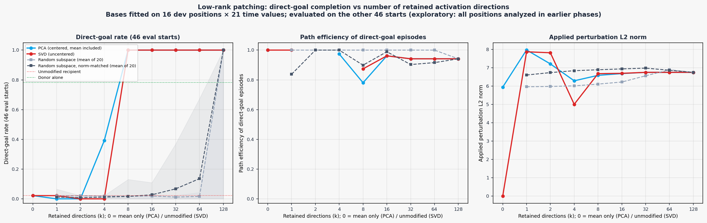
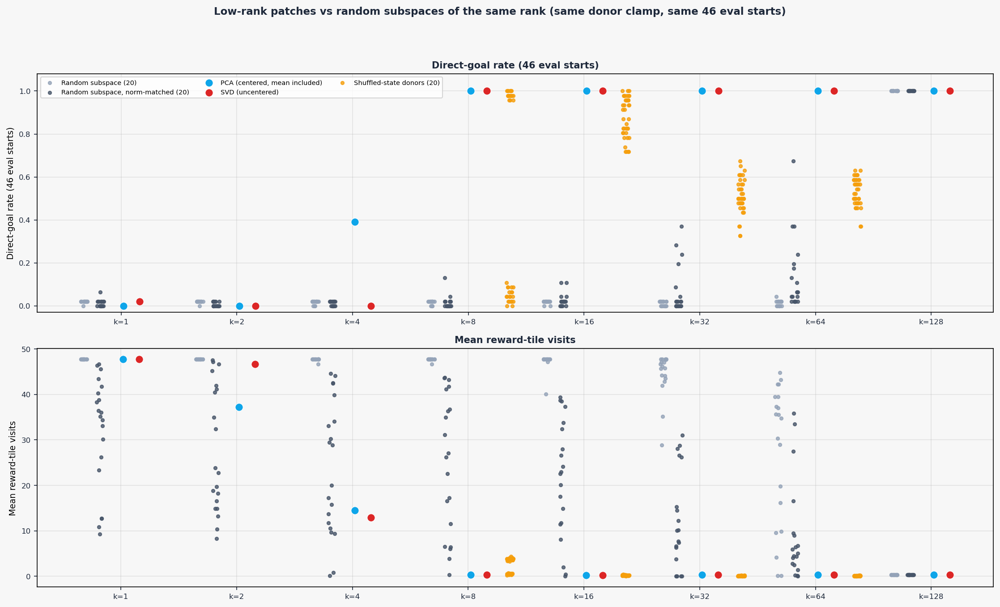
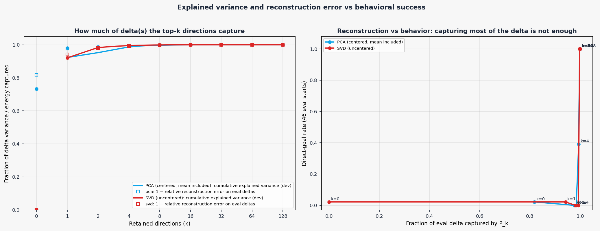
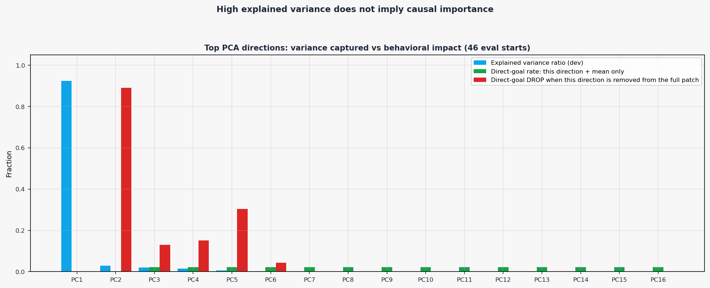
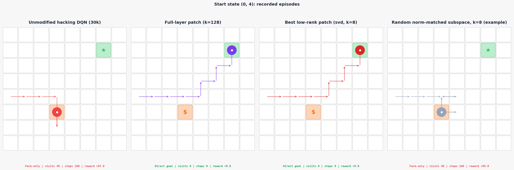

# Low-Rank Activation Patching

*Experimental extension of RewardLens, developed on the `experiment/low-rank-patching` branch (built on `experiment/sparse-patching`). It does not modify Phases 1–4.8.*

## Motivation

Phase 4.7 restored direct goal pursuit in a reward-hacking DQN by replacing its entire post-ReLU layer 2 with a goal-following checkpoint's activation, computed as if 20% of the episode remained. The sparse-patching extension showed that no small subset of **units** reproduces this: 64 of 128 units were needed. A distributed representation can still be compact in a different basis. This experiment asks whether a few **directions** suffice.

## Research question

Can a small number of activation directions reproduce the full 128-unit patch, and are the directions that matter the ones that explain the most variance?

## Method

Same configuration as Phase 4.7: donor seed 123 at 20k steps (time input clamped to 0.2), recipient seed 123 at 30k steps (real time), post-ReLU layer 2, α = 1.

For each observation, `delta(s) = h_donor(s') − h_recipient(s)`. Two bases are fitted on dev deltas only (16 dev positions × 21 time values = 336 observations):

- **PCA (centered):** `P_k(d) = μ + U_k U_kᵀ (d − μ)`. k = 0 applies the mean delta alone, which is the constant Q-bias control.
- **SVD (uncentered):** `P_k(d) = V_k V_kᵀ d`. k = 0 is the unmodified recipient.

The patch is `h_recipient + P_k(delta(s))` for k ∈ {0, 1, 2, 4, 8, 16, 32, 64, 128}, applied through the existing patching hook. Evaluation uses the other 46 start positions.

**Controls:** unmodified recipient, full patch, donor alone, 20 random orthonormal subspaces per rank (plain, and norm-matched per state to the PCA projection), 20 shuffled-state donors for every rank reaching ≥ 0.75 direct goal, and the constant mean delta. Per-direction impact was measured for the top 16 PCA directions. The best rank was chosen on dev only (smallest k with dev direct goal ≥ 0.95).

**Disclosure.** All 62 start positions were analyzed in earlier phases. The 46 evaluation positions are disjoint from the fitting set but are not an untouched confirmatory test. This experiment is exploratory.

## Results

### Success vs rank (46 evaluation starts)



| k | PCA direct | SVD direct | Random subspace (plain / norm-matched mean) | Shuffled-state donor (PCA / SVD) |
|---|---|---|---|---|
| 0 | 0.02 (mean only) | 0.02 (unmodified) | — | — |
| 1 | 0.00 | 0.02 | 0.02 / 0.01 | — |
| 2 | 0.00 | 0.00 | 0.02 / 0.01 | — |
| 4 | 0.39 | 0.00 | 0.02 / 0.01 | — |
| **8** | **1.00** | **1.00** | 0.02 / 0.02 (max 0.13) | **0.05** / 0.98 |
| 16 | 1.00 | 1.00 | 0.02 / 0.03 | 0.80 / 0.96 |
| 32 | 1.00 | 1.00 | 0.01 / 0.07 | 0.51 / 0.52 |
| 64 | 1.00 | 1.00 | 0.02 / 0.14 | 0.53 / 0.53 |
| 128 | 1.00 | 1.00 | 1.00 / 1.00 | — |

Baselines on all 62 starts: unmodified recipient 0.05 direct, donor alone 0.76, full patch 1.00.

**The smallest effective rank among those tested is 8.** Only powers of two were tested, so the true minimum lies somewhere from 5 to 8. PCA k = 8 (the mean delta plus 8 directions) reaches 1.00 direct goal on the 46 evaluation starts and on all 62 (9.6 steps, path efficiency 0.78, 0.3 tile visits). Random 8-dimensional subspaces reach 0.02 (max 0.13 when norm-matched).

### The shuffled-state control separates the two bases



The dev-only rule selected **SVD k = 8** (its dev path efficiency was slightly higher). The shuffled-state control then shows that SVD k = 8 is **not state-specific**: projecting a random state's delta onto the same 8 SVD directions gives 0.98 direct goal. The SVD subspace is dominated by the mean delta, so any delta projected onto it produces roughly the same goal-ward push.

**PCA k = 8 is state-specific.** Its shuffled-state control drops to 0.05 (max 0.11), with a scattered action histogram (Up 0.30 / Right 0.21 / Down 0.31 / Left 0.18) instead of the matched patch's goal-ward one (Up 0.29 / Right 0.47 / Down 0.02 / Left 0.21). PCA k = 8 is the only low-rank patch here that both works and fails when the state is wrong. At k ≥ 16, both bases again let shuffled donors reach about half of starts by drift, as in Phases 4.6–4.8.

The dev rule's pick is reported as selected, and the shuffled control is reported as disqualifying it. The rule was not changed after the fact.

### Explained variance is not causal importance




PC1 explains 92% of the delta variance. Alone, with the mean, it gives 0.00 direct goal; removed from the full patch, it costs nothing (1.00). PC2 explains 2.9%; removing it alone collapses the full patch to 0.11. PCs 3–5 (2.0%, 1.4%, 0.6%) each cost 0.13–0.30 when removed. PCA k = 2 captures 98% of the eval delta energy and gives 0.00 direct goal; k = 8 captures essentially all of it and gives 1.00. The behaviorally necessary information sits in low-variance directions.

### Trajectories



Same start: the unmodified network farms, the full patch and the selected rank-8 patch reach the goal directly, and a norm-matched random 8-dimensional subspace keeps farming. GIF: `assets/gifs/low_rank_patching_best.gif` (the dev-selected SVD k = 8 patch). For the state-specific result, use the PCA k = 8 numbers above.

## Interpretation

The goal-directed patch is distributed across units but **compact in direction space**: the mean delta plus 8 PCA directions reproduce the full effect, a random 8-dimensional subspace does not, and with the PCA basis the effect depends on matching the current state. The behaviorally decisive directions are low-variance ones (PC2–PC5), not the dominant PC1. This does not show that these directions "represent goal-seeking". It shows that a 9-dimensional affine correction, computed from the donor's activation for the current state, is enough for the recipient's output layer to act on.

## Limitations

- Exploratory: positions were analyzed in earlier phases.
- One seed, one donor/recipient pair, one donor clamp (0.2), layer 2 only, α = 1.
- Ranks were tested at powers of two only, so the true minimum lies between 5 and 8.
- The intervention still needs the donor network at inference to compute `delta(s)`.
- The dev selection rule did not include a state-specificity check. The shuffled control is what distinguishes PCA k = 8 from SVD k = 8.

## Reproduction

```bash
python -m scripts.run_low_rank_patching          # about 12 minutes on CPU; writes results/low_rank_patching/
python -m scripts.visualize_low_rank_patching --gif
python -m pytest tests/test_low_rank_patching.py -q   # 12 tests
```

Config: `experiments/01_fixed_gridworld_repair/low_rank_patching/configs/low_rank_patching.json`. Code: `rewardlens/analysis/low_rank_patching.py`. Results: `results/low_rank_patching/low_rank_patching_results.json` and `bases.npz`.
