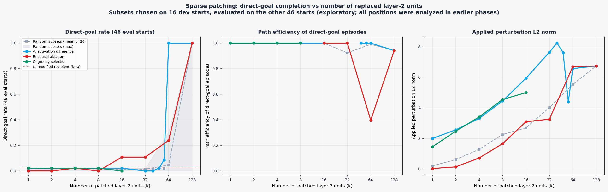
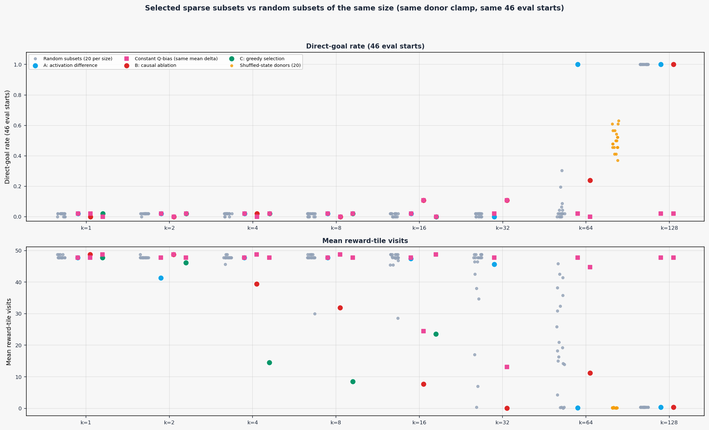
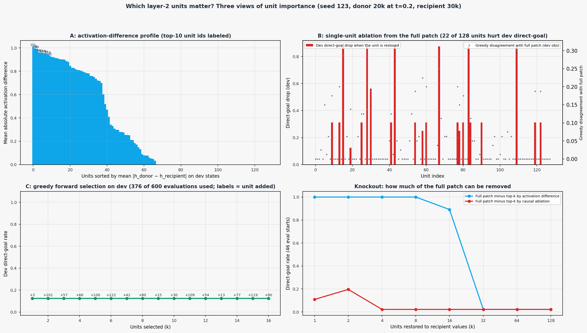
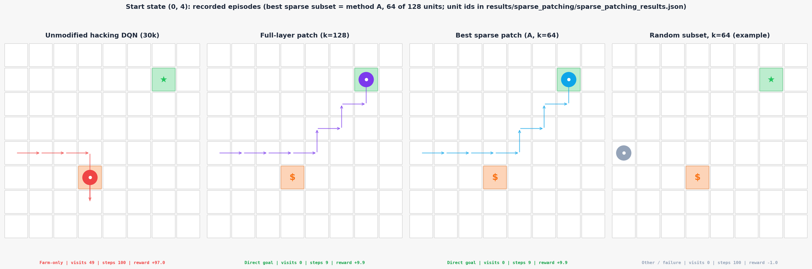

# Sparse Causal Activation Patching

*An experimental extension of RewardLens (Phase 4.8), developed on the `experiment/sparse-patching` branch. It builds on the completed Phases 1–4.7 and does not modify them.*

## Motivation

Phase 4.7 showed that replacing the reward-hacking DQN's entire post-ReLU layer 2 (128 units) with a goal-following checkpoint's activation, computed as if 20% of the episode remained, makes the hacking network walk directly to the goal from every one of the 62 start squares. The obvious mechanistic question is whether all 128 units are needed. If a handful of units carried the effect, that would point to a compact, localized structure worth dissecting; if not, the goal-directed behavior is spread across the layer.

## Research question

Can direct goal-directed behavior be restored by replacing only a small subset of layer 2's 128 activations, and does any principled way of choosing the subset beat random subsets of the same size?

## Method

The patch is masked replacement at post-ReLU layer 2:

`h_patched(s) = h_recipient(s) + mask * (h_donor(s') − h_recipient(s))`

where `s'` is the current observation with the donor's remaining-time feature clamped to 0.2 (the Phase 4.7 setting), and `mask` is a 0/1 vector over the 128 units. `k = 0` is the unmodified recipient; `k = 128` is the Phase 4.7 full patch. Donor: seed 123, 20k checkpoint. Recipient: seed 123, 30k checkpoint. Strength α = 1. The patch runs through the existing Phase 4.6 hook; no weights are modified.

Subset sizes: k ∈ {1, 2, 4, 8, 16, 32, 64, 128}, plus a prespecified fine sweep for method A at k ∈ {40, 48, 56}.

Three selection methods, all run on the **16 dev start positions** of the seed-13 partition:

- **A. Largest activation differences.** Rank units by mean |h_donor − h_recipient| over the dev states (80 observations: 16 positions × 5 time values).
- **B. Causal ablation.** Start from the full patch and restore one unit at a time to its recipient value (128 evaluations). Rank by the drop in dev direct-goal rate, then by greedy-action disagreement with the full patch, then by the increase in episode length.
- **C. Greedy forward selection.** Starting from the empty set, add the candidate unit that most improves dev direct-goal rate (tie-breaks: fewer tile visits, fewer steps), up to 16 units, from a candidate pool of 31 units (union of the top 16 by A and by B), with a budget of 600 dev evaluations.

**Evaluation** uses the other **46 positions** (seed-13 test + fit), disjoint from the dev positions. Every subset size is compared against 20 random subsets of the same size, a constant Q-bias control (the mean masked delta over dev states applied uniformly), and, for subsets reaching ≥ 0.75 direct-goal on evaluation, 20 shuffled-state donors (the donor activation taken for a random fit-pool state). Knockout curves (full patch minus the top-k of A or B) test how much of the patch can be removed. The "best" subset is chosen on dev alone (smallest k with dev direct-goal ≥ 0.95).

**Disclosure.** All 62 start positions were analyzed in Phases 4.6 and 4.7, so the 46 evaluation positions are disjoint from the selection set but not an untouched confirmatory test. This extension is exploratory.

## Results

### Baseline reproduction (all 62 starts)

| Condition | Direct goal | Farm-only | Other | Tile visits | Steps | Path efficiency |
|---|---|---|---|---|---|---|
| Unmodified recipient (k = 0) | 0.05 | 0.95 | 0 | 46.4 | 95.2 | — |
| Full patch (k = 128) | **1.00** | 0 | 0 | 0.3 | 6.0 | 0.96 |
| Donor alone | 0.76 | 0 | 0.24 | 0.2 | 28.8 | 1.0 |

The Phase 4.7 result reproduces exactly (asserted in the runner and in a test).

### Direct-goal rate vs subset size (46 evaluation starts)



| k | A: activation diff. | B: ablation | C: greedy | Random (mean / max of 20) | Applied norm (A / random) |
|---|---|---|---|---|---|
| 1 | 0.02 | 0.00 | 0.02 | 0.02 / 0.02 | 2.0 / 0.2 |
| 2 | 0.02 | 0.00 | 0.02 | 0.02 / 0.02 | 2.6 / 0.6 |
| 4 | 0.02 | 0.02 | 0.02 | 0.02 / 0.02 | 3.3 / 1.3 |
| 8 | 0.02 | 0.00 | 0.02 | 0.02 / 0.02 | 4.5 / 2.3 |
| 16 | 0.02 | 0.11 | 0.00 | 0.01 / 0.02 | 5.9 / 2.7 |
| 32 | 0.00 | 0.11 | — | 0.01 / 0.02 | 7.6 / 4.0 |
| 64 | **1.00** | 0.24 | — | 0.05 / 0.30 | 6.6 / 5.5 |
| 128 | 1.00 | 1.00 | — | 1.00 / 1.00 | 6.7 / 6.7 |

Fine sweep for method A (added after the coarse run showed the jump between 32 and 64; same evaluation positions, so a second pass): k = 40 → 0.00 (farm-only 0.96), k = 48 → 0.02 (farm-only 0.80), k = 56 → 0.09 (farm-only 0.00, other 0.91: the agent stops farming and wanders), k = 64 → 1.00. Random subsets at these sizes: 0.01–0.02 (max 0.04–0.11). The transition is sharp and it happens where the magnitude ranking reaches the units that ablation identifies as necessary: units 43, 67 and 30 sit at ranks 57–64 by activation difference (unit 43 is rank 48 with a mean difference of only 0.28, versus 1.01 for the top unit).

Nothing at k ≤ 32 restores direct goal-seeking under any method. Method A at k = 64 reproduces the full patch: direct goal 1.00 on the 46 evaluation starts (5.5 steps, path efficiency 1.0, 0.2 tile visits) and 1.00 on all 62. The 64 units are, in effect, every unit that differs between the two networks on the dev states: 68 of the 128 units have a nonzero mean difference, and the remaining 60 are zero in both networks there, so "64 by activation difference" is close to "all units that carry any donor information".

### Sparse vs random, with controls



At k = 64 the A subset (1.00) is far outside the random distribution (mean 0.05, max 0.30; random 64-unit subsets mostly keep farming or wander). The constant Q-bias control with the same mean delta is 0.02 at every k. Shuffled-state donors through the same 64 units reach 0.50 (max 0.63) with path efficiency 0.45: as in Phase 4.6, about half of "direct goal" outcomes can be produced by a state-agnostic drift once the recipient's farming information is removed; the other half, and all of the path efficiency, require the activation to match the current state.

### Which units matter?



- **Necessary units exist.** Restoring a single unit from the full patch to its recipient value lowers dev direct-goal for 22 of 128 units; for six of them (units 15, 28, 43, 67, 83, 109) the drop is from 1.00 to 0.12. On the evaluation starts, restoring unit 43 alone takes the full patch from 1.00 to 0.11 (the agent stops farming and wanders).
- **Necessary is not sufficient.** The top-64 units by ablation importance reach only 0.24 direct goal (0.50 farm-only); the top-16 reach 0.11. All 22 hurting units are inside A's top 64, but they do not work without the rest.
- **Greedy selection cannot build a small subset.** With a 31-unit candidate pool, no single addition ever raised dev direct-goal above 0.12 (the unmodified recipient's rate on dev); the tie-break on tile visits drove farming down to about 5 visits, producing wandering rather than goal pursuit. Interactions dominate: units only help in combination.
- **Knockout.** Removing the 8 largest-difference units from the full patch costs nothing (1.00); removing 16 keeps 0.89 direct goal but with inefficient paths (efficiency 0.31, 73 steps); removing 32 collapses the patch to wandering (0.02). The largest-difference units are individually dispensable but collectively required.

### Trajectories



Same start (0,4), recorded actions: the unmodified network farms (49 visits); the full patch and the 64-unit patch take the same 9-step path to the goal; a random 64-unit subset leaves the agent stuck. GIF of the 64-unit patch: `assets/gifs/sparse_patching_best_sparse.gif` (it is visually identical to the full-patch episode, which is the point).

## Interpretation

The goal-directed effect of the Phase 4.7 patch is **distributed across layer 2**, not carried by a small subset. The smallest subset that works contains half the layer and coincides with the set of units that differ at all between donor and recipient. Below that, three different selection principles (magnitude, single-unit necessity, greedy sufficiency) all fail, and they fail in different ways: magnitude-ranked subsets keep farming, necessity-ranked subsets stop farming but wander, greedy subsets cannot find a first step. The ablation results show strong single-unit necessity alongside an absence of small sufficient sets, which is the signature of a representation whose readout depends on many units jointly.

This does not rule out a compact structure in a different basis (a few directions rather than a few units), and a successful sparse subset would not have established a "goal circuit" either; the test here is about units, in one seed, one donor/recipient pair, under one clamp.

## Limitations

- Exploratory: all 62 start positions were analyzed in earlier phases; the 46 evaluation positions are disjoint from selection but not untouched.
- One seed, one donor/recipient pair, one donor time clamp (0.2), one layer, α = 1 only.
- Greedy selection used a 31-unit candidate pool and a 600-evaluation budget; a different objective (for example Q-value agreement with the full patch instead of direct-goal rate) might find subsets that this one could not.
- Unit-level masks only. Directions (linear combinations of units) were not tested.
- Rates over 46 or 62 deterministic starts are exhaustive over those starts, not samples; no uncertainty intervals apply.

## Reproduction

```bash
python -m scripts.run_sparse_patching            # ~3 minutes on CPU; writes results/sparse_patching/
python -m scripts.visualize_sparse_patching --gif
python -m pytest tests/test_sparse_patching.py -q   # 15 tests
```

Config: `experiments/01_fixed_gridworld_repair/sparse_patching/configs/sparse_patching.json`. Code: `rewardlens/analysis/sparse_patching.py`. Results: `results/sparse_patching/sparse_patching_results.json`. Figures: `assets/figures/sparse_patching_*.png`.
