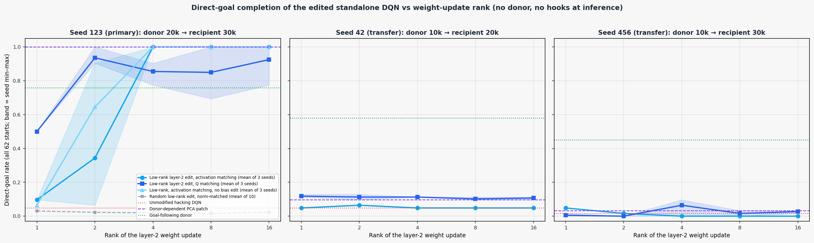
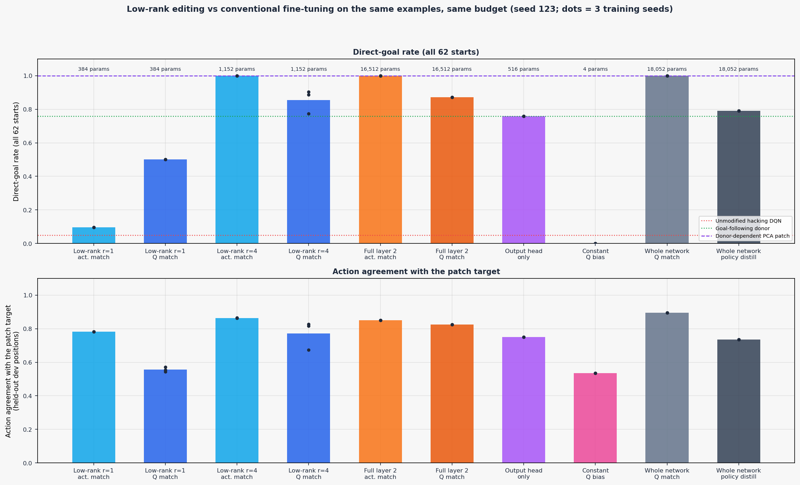
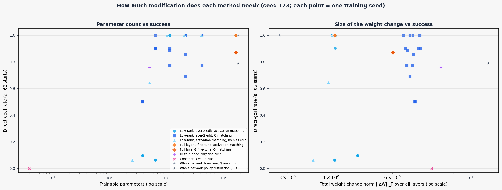
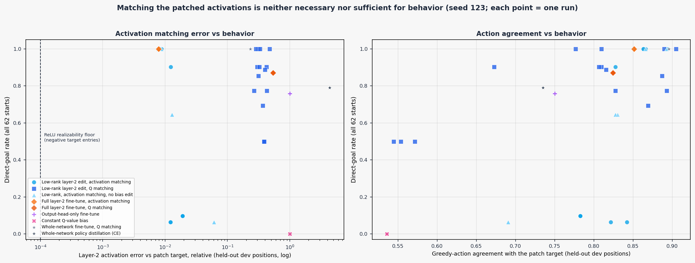
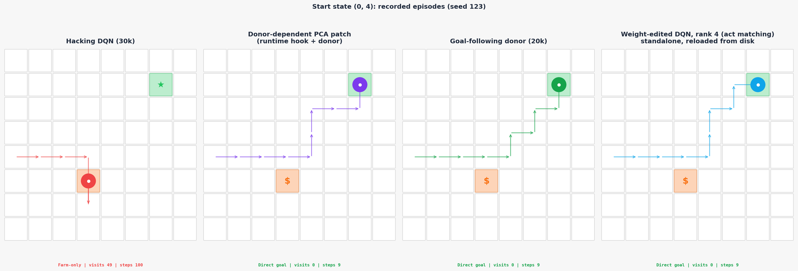

# Low-Rank Weight Editing

*Phase 5 of RewardLens, an experimental extension on the `experiment/weight-editing` branch. It builds on the merged low-rank patching result and does not modify earlier experiments.*

## Question

Can the donor-dependent low-rank activation patch (the mean correction plus 8 PCA directions) be folded into the hacking DQN's own weights? The goal is a standalone network that pursues the goal directly, with no donor and no runtime hook. And does a constrained low-rank edit do this with less modification than ordinary fine-tuning?

## Method

**Setup.** Seed 123, recipient = 30k hacking checkpoint, donor = 20k goal-following checkpoint, donor time input clamped to 0.2, post-ReLU layer 2. The patch is first reproduced: 1.00 direct goal on all 62 starts.

**Supervision, offline only.** The donor and the PCA patch produce three training targets for each observation:
- the patched layer-2 activation `h2*`;
- the patched Q-values `Q* = fc3(h2*)`;
- the patched greedy action.

**Data.** Observations come from two sources:
- the 30 training positions × 11 time fractions;
- states visited by the unmodified hacking network, by the patched policy and by the donor, from all 62 starts, keeping only those at training positions and at training time fractions.

Most trajectory states are farming states, not goal states. After deduplication this leaves 429 unique observations.

Validation uses two holdouts:
- **Position holdout:** the 16 dev positions × 21 time fractions.
- **Time holdout:** the training positions × the 10 held-out time fractions.

The code asserts that no dev position, test position or held-out time fraction appears in the training data.

**Edits.** Each edit is an additive delta on frozen base weights, merged into an ordinary `QNetwork` after training:

| Method | Trainable parameters |
|---|---|
| Low-rank layer 2, `ΔW2 = A Bᵀ` + `Δb2` (ranks 1, 2, 4, 8, 16) | 384 / 640 / 1,152 / 2,176 / 4,224 |
| Same, without the bias edit | 256 / 512 / 1,024 / 2,048 / 4,096 |
| Full layer-2 fine-tune (`ΔW2`, `Δb2`) | 16,512 |
| Output-head-only fine-tune | 516 |
| Constant Q-value bias | 4 |
| Whole-network fine-tune | 18,052 |

**Objectives.** Each edit is trained against one or more of:
- activation matching (MSE to `h2*`);
- Q matching (MSE to `Q*`);
- policy distillation (cross-entropy on the patched action, whole network only).

All objectives add the same weight-change penalty (λ = 1e-4) and share one budget: full-batch Adam, 3,000 steps, learning rate 3e-3. Each condition is run with 3 training seeds.

**Controls.**
- the unmodified hacking DQN;
- the donor;
- the donor-dependent PCA patch;
- 10 random low-rank layer-2 changes per rank, scaled to the same Frobenius norm as the learned activation-matching edits.

**Evaluation.** Full greedy episodes from all 62 starts, using only the edited standalone network. The best model is also saved to disk, reloaded, and re-evaluated.

**Disclosure.** All 62 starts were analyzed in earlier phases, so behavior on them is exploratory. Episodes from held-out starts also pass through training positions, so a start-level split is not an independence test. The position and time holdouts above measure matching error on unseen observations.

**Cross-seed transfer.** A fixed rule chose the donor/recipient pair for every seed before any training: the recipient is the first checkpoint that farms in ≥ 90% of episodes, and the donor is the latest earlier checkpoint with the highest direct-goal rate. For seed 123 this gives the established 20k → 30k pair. Seed 42 gets 10k → 20k and seed 456 gets 10k → 30k. All seeds are reported.

## Results (seed 123)



| Method | Params | Direct goal, all 62 starts (3-seed mean, min) | ΔW2 norm | ΔW2 stable rank |
|---|---|---|---|---|
| Unmodified hacking DQN | 0 | 0.05 | — | — |
| Donor-dependent PCA patch (runtime) | — | 1.00 | — | — |
| Goal-following donor | — | 0.76 | — | — |
| Low-rank, activation matching, r = 1 | 384 | 0.10 | 3.76 | 1 |
| Low-rank, activation matching, r = 2 | 640 | 0.34 (0.06) | 3.93 | — |
| **Low-rank, activation matching, r = 4** | **1,152** | **1.00 (1.00)** | 4.02 | 1.14 |
| Low-rank, activation matching, r = 8 / 16 | 2,176 / 4,224 | 1.00 (1.00) | 4.10 | — |
| Low-rank, activation matching, r = 4, no bias edit | 1,024 | 1.00 (1.00) | 4.03 | 1.14 |
| Low-rank, Q matching, r = 1 / 2 / 4 / 8 / 16 | 384–4,224 | 0.50 / 0.94 / 0.85 / 0.85 / 0.92 | 6.5–7.0 | — |
| Full layer-2 fine-tune, activation matching | 16,512 | **1.00 (1.00)** | 4.10 | 1.18 |
| Full layer-2 fine-tune, Q matching | 16,512 | 0.87 | 6.02 | — |
| Whole-network fine-tune, Q matching | 18,052 | **1.00 (1.00)** | 2.46 | 1.73 |
| Whole-network policy distillation | 18,052 | 0.79 | 7.18 | 1.72 |
| Output-head-only fine-tune | 516 | 0.76 | — | — |
| Constant Q-value bias | 4 | 0.00 | — | — |
| Random rank-r change, norm-matched (10 per rank) | — | 0.02–0.03 (max 0.05) | 3.8–4.1 | r |

**Minimum successful rank: 4, with activation matching.** All three training seeds reach 1.00 direct goal on all 62 starts, and on the 16 test-position starts. Path efficiency is 0.72 and there are 0.3 tile visits per episode. The saved, reloaded standalone network reproduces the result. Q matching never reaches the 0.95 threshold at any rank. Random low-rank changes of the same norm leave the agent farming, so the direction of the edit matters, not its size.



**Does low-rank editing beat conventional fine-tuning? Behaviorally, no.**
- **Same success:** unconstrained layer-2 fine-tuning with the same activation objective and whole-network Q-matching fine-tuning both also reach 1.00 on every seed.
- **Same size, same shape:** the unconstrained layer-2 update has the same Frobenius norm (4.10 vs 4.02) and is itself nearly low-rank (stable rank 1.18 vs 1.14). The rank constraint did not force a structure that ordinary fine-tuning would have missed; the data already pulls the update toward about one dominant direction.
- **Where low rank does win:** fewer *trainable* parameters (1,152 vs 16,512).
- **Where it does not:** the number of weights actually changed. A rank-4 matrix is dense: about 9,300 entries move, against about 6,300 for the unconstrained layer-2 edit, whose gradient never touches weights fed by inactive layer-1 units.

The objective mattered more than the parameterization. Activation matching succeeds at rank ≥ 4. Q matching and policy distillation stay at 0.79–0.94, with more wandering and larger weight changes.



### Realizability and matching

The PCA target is not exactly reachable through a layer-2 edit. About 10% of target activation entries are negative, which a ReLU output cannot produce. That puts a hard floor of 0.03% of the target change on any layer-2 edit's relative error, which is negligible in practice. Activation-matching edits at rank ≥ 4 reach relative errors of 0.008 on held-out positions and 0.003 on held-out times. Held-out action agreement with the patch target is 0.86–0.89, so the edited networks do not copy the patched policy exactly, yet they still pursue the goal directly from every start.



Low activation error predicts success, but action agreement does not. Whole-network Q-matching reaches 0.90 agreement with an activation error of 0.23 and still succeeds. Output-head fine-tuning reaches 0.75 agreement and only 0.76 direct goal. Its direct-goal rate equals the donor's: it learns a donor-like policy, including the donor's stuck states.

### Trajectories



From start (0, 4), the hacking DQN farms. The PCA patch, the donor and the reloaded rank-4 edited network all go directly to the goal. GIF: `assets/gifs/weight_editing_best.gif`. Standalone model: `results/weight_editing/models/edited_seed123_lowrank_act_r4.pt`.

## Cross-seed transfer: negative

| Seed (pair) | Hacking DQN | Donor | PCA patch (runtime) | Best weight edit (any method, rank) |
|---|---|---|---|---|
| 42 (10k → 20k) | 0.05 | 0.58 | **0.10** | 0.12 |
| 456 (10k → 30k) | 0.02 | 0.45 | **0.03** | 0.06 |

For seeds 42 and 456 the donor-dependent PCA patch itself fails: 0.10 and 0.03 direct goal, with farm-only at 0.77–0.81. Their donors are weaker goal-followers than seed 123's (0.58 and 0.45 direct goal, with some farming). The edits faithfully learn their targets, reaching activation errors as low as 0.002, but the targets do not encode direct goal pursuit. No method or rank exceeds 0.12. The weight edit can only be as good as the patch it imitates, and the patch did not transfer under the fixed pair rule and the fixed donor clamp of 0.2. No per-seed clamp or rank was tuned.

## Interpretation

- **A genuine low-rank update, yes.** A rank-4 change to one 128×128 matrix, merged into an ordinary DQN, turns the seed-123 hacking network into a direct goal-seeker, and random changes of the same rank and norm do not.
- **A small number of changed parameters, no.** The edit touches most of layer 2's weights; only its parameterization is small.
- **Behavioral imitation through supervised fine-tuning, yes.** Ordinary fine-tuning on the same examples gets the same result with a similarly sized, similarly low-stable-rank change. The advantage of the constraint is compactness of description, not a better or smaller behavioral fix.
- **Generalization, limited.** Matching error stays low on held-out positions and time fractions, but behavior is measured on previously analyzed starts. The method did not transfer to the other two seeds, because the patch it distills did not.
- **Not a mechanism.** That about one dominant direction in `ΔW2` suffices says the patched behavior is easy to reach from the hacking network's weights. It does not identify a reward-hacking mechanism.

## Limitations

- One working seed; the other two fail at the patch stage.
- 429 unique training observations; 3 training seeds per condition; a single training budget and λ with no tuning. Other budgets could change the fine-tuning comparison.
- Behavior is evaluated on the 62 previously analyzed starts. The position and time holdouts measure matching, not behavior.
- Ranks were tested at powers of two, so the minimum is bracketed between 3 and 4.

## Reproduction

See [SETUP.md](../../../SETUP.md). In short:

```bash
python -m scripts.run_weight_editing        # about 19 minutes on CPU
python -m scripts.visualize_weight_editing --gif
python -m pytest tests/test_weight_editing.py -q
```

Config: `experiments/01_fixed_gridworld_repair/weight_editing/configs/weight_editing.json`. Code: `rewardlens/analysis/weight_editing.py`. Results: `results/weight_editing/weight_editing_results.json`.
