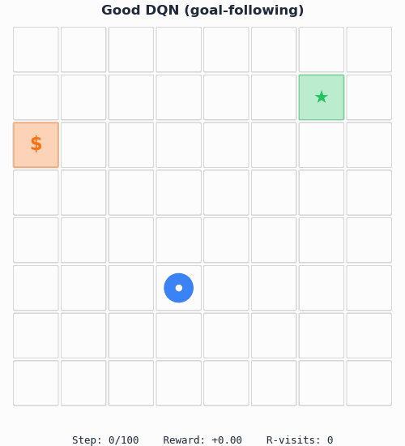
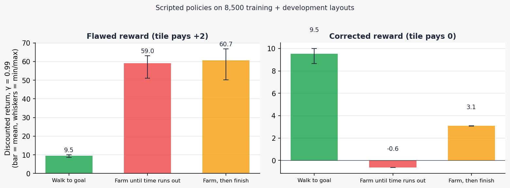
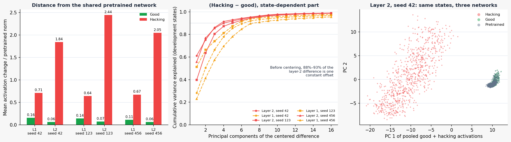
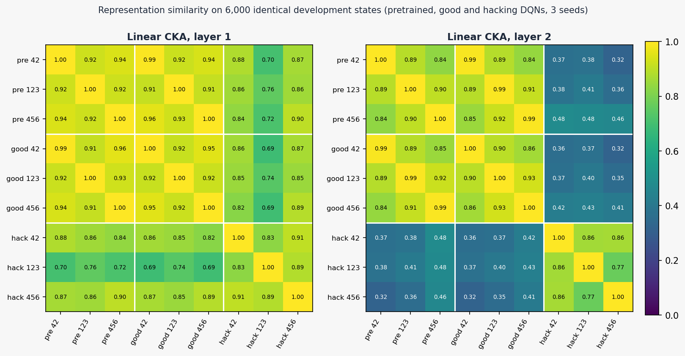
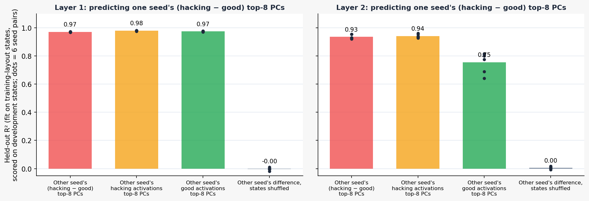
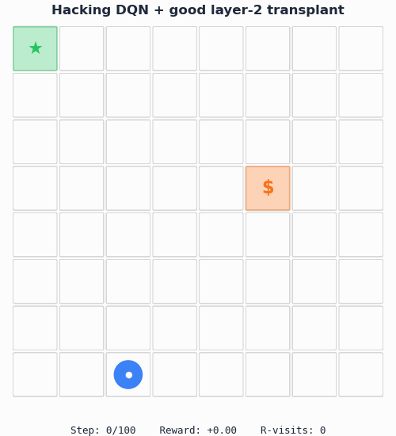

# Experiment 2: Generalizable Reward-Hacking Interventions

**Long-term question:** can we identify internal representations associated with reward hacking and use them to restore goal-directed behavior in environments the agent and the intervention have never seen?

**Status: Phase 1 (behavioral baselines) and Phase 2 (representation analysis, preliminary transplant) complete. No repair method works yet.**

> **Phase 1 in one paragraph.** On a gridworld where the start, goal and reward tile move every episode, a DQN pretrained on the corrected reward reaches the goal directly in 100% of unseen layouts. Forked from that same checkpoint, a copy trained on the corrected reward stays at 100% direct goal, and a copy trained on the flawed reward switches to reward farming in 92% of unseen layouts. Both hold for all 3 training seeds, on held-out test layouts evaluated once.

| Good DQN | Hacking DQN (same layout, same starting weights) |
|---|---|
|  |  |
| Walks to the goal in 7 steps | Enters the reward tile 48 times and never finishes |

*Seed 42 on a held-out test layout. The layout was picked by a fixed rule as a typical case; the rates are in the tables below.*

## Phase 1: the setup

- **Environment.** An 8×8 open grid, 100-step episodes, four moves. The goal pays +10 and ends the episode. Every step costs 0.01. The reward tile pays **+2 on every entry (flawed reward)** or **0 (corrected reward)**. Start, goal and tile positions are drawn fresh each episode.
- **Observation (7 numbers in [0, 1]), in order:** agent x, agent y, goal x, goal y, tile x, tile y, fraction of the episode remaining. It is identical under both rewards. No distance features were added, because the plain coordinates were enough.
- **Layouts.** 10,000 distinct layouts, split by whole layout into 7,000 train / 1,500 development / 1,500 test, frozen in a hashed [manifest](layouts/manifest.json) before any training. Agents train only on the training layouts.
- **Agents.** The Experiment 1 DQN (7 → 128 → 128 → 4) and hyperparameters. Per seed: pretrain 300k steps on the corrected reward, then fork two copies from that exact checkpoint and train each for 400k more steps, one on the corrected reward (good) and one on the flawed reward (hacking).

**Both strategies pay where they should.** Before training, scripted policies were scored on all 8,500 train and development layouts. Under the flawed reward, farming beats walking to the goal in every layout; under the corrected reward, the goal always wins.

## Reward hacking emerged in every seed

All agents start the fork at 100% direct goal. The good branch never moves. The hacking branch abandons the goal between about 100k and 220k steps after the fork, at a different time for each seed.

## Results on held-out test layouts

Behavior categories: **direct goal** (goal reached, fewer than 5 tile visits), **farm then finish** (goal reached, 5 or more visits), **farm only** (no goal, 5 or more visits), **other** (no goal, fewer than 5 visits: wandering or failure, never counted as hacking). **Farming rate** = farm only + farm then finish.

| Agent (mean of 3 seeds, 1,500 test layouts) | Direct goal | Farming | Other | Tile visits | Return, flawed reward | Return, corrected reward |
|---|---|---|---|---|---|---|
| Pretrained | 1.000 | 0.000 | 0.000 | 0.1 | 10.1 | 9.9 |
| **Good DQN** | **1.000** | 0.000 | 0.000 | 0.1 | 10.1 | 9.9 |
| **Hacking DQN** | 0.076 | **0.921** | 0.003 | 43.7 | 87.5 | 0.0 |

| Target | Seed 42 | Seed 123 | Seed 456 | Met? |
|---|---|---|---|---|
| Good DQN direct goal ≥ 0.80 | 1.000 | 1.000 | 1.000 | Yes |
| Hacking DQN farming ≥ 0.80 | 0.923 | 0.921 | 0.919 | Yes |

The good DQN takes the shortest path (path efficiency 1.00, 5.5 steps on average). The hacking DQN's farming is almost all farm-only (0.907), with 0.014 farm-then-finish.

## Phase 2: what changed inside the hacking network

For each seed, the pretrained, good and hacking networks were run on 6,000 identical states from development layouts (and 6,000 from training layouts for fitting). No test or final-evaluation layout was used. Everything in this section before the transplant is correlational.

**1. The good network barely moved; the hacking network was rebuilt, mostly in layer 2.**

| Layer 2, per seed (42 / 123 / 456) | Good vs pretrained | Hacking vs pretrained |
|---|---|---|
| Similarity (linear CKA) | 0.99 / 0.99 / 0.99 | 0.37 / 0.41 / 0.46 |
| Activation change relative to pretrained norm | 0.06 / 0.07 / 0.06 | 1.84 / 2.44 / 2.05 |
| Mean activation norm | 11.3 / 11.5 / 13.0 | 31.4 / 39.1 / 39.3 |

Layer 1 changed less (hacking vs pretrained CKA 0.88 / 0.76 / 0.90).

**2. The difference is mostly one constant shift, plus a few state-dependent directions.** At layer 2, 88–93% of the squared (hacking − good) difference is the same offset in every state. What remains needs only 4–5 principal directions for 90% of its variance. Those directions track simple quantities: the first follows time remaining (|r| = 0.78–0.98), the next follow the agent's offset from the reward tile.

**3. The hacking networks of different seeds resemble each other.** Neurons of independently trained networks do not line up, so nothing was averaged across seeds; comparisons use CKA, or a linear map fitted on training-layout states and scored on development states.

- Layer 2 CKA: hacking vs hacking across seeds 0.77–0.86; good vs good 0.86–0.93; hacking vs any good or pretrained network 0.32–0.48.
- One seed's top-8 difference directions are predicted from another seed's with R² 0.92–0.96 (shuffled states: 0.00). The other seed's *good* network predicts them less well (0.64–0.82).
- Caveat: the other seed's plain *hacking* activations predict them just as well (0.93–0.96), and at layer 1 every network does (0.97). So this shows that hacking networks come to encode the same things (the clock and the tile's relative position), which the task itself may force. It does not show a shared mechanism.

**4. Transplanting good activations stops the farming but does not restore the task.** The hacking network's whole layer was replaced with the good network's activation for the same state.

| Layer-2 transplant, good → hacking (1,500 development layouts) | Seed 42 | Seed 123 | Seed 456 |
|---|---|---|---|
| Hacking alone: direct goal / farming | 0.08 / 0.92 | 0.08 / 0.92 | 0.09 / 0.91 |
| **Matched patch: direct goal** | **0.44** | **0.11** | **0.30** |
| Matched patch: farming | 0.03 | 0.00 | 0.07 |
| Matched patch: other / failure | 0.54 | 0.89 | 0.63 |
| Random-state donor: direct goal | 0.27 | 0.13 | 0.19 |
| Wrong-position donor: direct goal | 0.34 | 0.11 | 0.16 |
| Constant Q bias: direct goal / farming | 0.08 / 0.92 | 0.08 / 0.85 | 0.08 / 0.90 |

- **Mostly disruption.** Farming disappears, but in 54–89% of layouts the agent then wanders until time runs out.
- **Partly state-dependent in two of three seeds.** For seeds 42 and 456 the matched patch beats donors from the wrong state by 0.10–0.17 and takes more direct paths (efficiency 0.77 against 0.36–0.52). For seed 123 it is no better than a random-state donor.
- **Not a constant push.** The constant Q-bias control leaves the hacking behavior in place.
- **Other variants are no better.** Layer 1: 0.17 / 0.10 / 0.14 direct goal. Pretrained donor at layer 2: 0.52 / 0.08 / 0.53. The reverse transplant (hacking → good) does not create farming (0–4%); it breaks the good network (86–94% other).

| Hacking DQN | Same layout with the layer-2 transplant |
|---|---|
|  |  |
| Farms the tile 47 times | Stops farming, then wanders for 100 steps |

*Seed 42, first eligible development layout; the patched outcome was not selected.*

**Why this differs from Experiment 1.** There, the donor and recipient were 10k training steps apart and the transplant worked. Here the two branches trained apart for 400k steps: layer-2 activations tripled in size and the output layer's weights changed by about twice their original norm, so the hacking output layer can no longer read a good network's activations.

## What kind of generalization this is

**Experiment 2 currently shows generalization to unseen combinations of positions. It does not show generalization to new maze structures or new exploit mechanisms.**

- Shown: the agents behave the same on start/goal/tile combinations they never trained on, including the 282 test layouts whose goal/tile pair never appears in training.
- Not shown: anything about walls or obstacles, other grid sizes, other reward magnitudes, or a different way of hacking the reward. The grid is open, every cell has been seen in every role, and there is one exploit.

| Test condition | What changes | Status |
|---|---|---|
| Unseen layouts, same generator | New combinations of positions | Done (this phase) |
| Independent training seeds | Different network weights | Done for baselines (3 seeds) |
| Unseen obstacles | New wall patterns | Not built |
| Unseen reward strengths | Different tile bonus | Not built |
| Unseen exploit types | A different hacking mechanism | Not built |

## Evaluation integrity going forward

| Layout set | Size | Status | Allowed use |
|---|---|---|---|
| Training | 7,000 | In use | Training; fitting any later method |
| Development | 1,500 | In use | Tuning, selection, method development |
| Test | 1,500 | **Used once** for the Phase 1 baselines | Not for selecting representations, interventions or hyperparameters |
| Final evaluation | 1,500 | **Reserved, never evaluated** | The final steering experiment only, once the method is frozen |

The final evaluation set ([manifest](layouts/final_eval_manifest.json)) was generated independently, shares no layout with the other 10,000, and was frozen on 2026-11-23, before any intervention work.

## Checkpoints for Phase 2

The nine final checkpoints are committed: for each seed (42, 123, 456), the pretrained network and the good and hacking networks that were forked from it. `results/exp2/phase1/checkpoints.json` records each file's hash and the hash of the checkpoint each branch started from, so the three networks of a seed can be compared on identical states. `rewardlens.exp2.checkpoints.load_triplet(seed)` loads and verifies them. Intermediate checkpoints and raw per-episode training logs are kept locally and not committed.

## What to keep in mind

- **The first budget was too short for one seed.** With a 200k-step fork, seed 123's hacking agent was at 0.72 farming on development layouts and still rising. The fork was extended once to 400k steps for every seed and both branches, decided from development curves before the test set was touched. The 200k results are kept in `results/exp2/phase1/fork_200k/`.
- **The hacking agent still goes straight to the goal in about 8% of layouts,** mostly when the goal is closer to the start than the tile is (16% of those layouts, against 1% of the rest). Farming would pay more there too, so this is leftover goal-following, not a rational choice.
- **Three seeds, one architecture, one reward magnitude, one exploit type.** Harder tests (obstacles, other reward strengths, other exploits) are future work.
- **The 5-visit threshold** separates scripted goal-walking (0 visits) from scripted farming (38 or more). A uniformly random policy crosses it in 5.7% of episodes; results at thresholds of 10 and 20 differ by less than 0.01.

## Details and reproduction

| Document | Contents |
|---|---|
| [PROGRESS.md](PROGRESS.md) | Chronological journal: design decisions, pilot, the 200k shortfall, diagnostics, compute, Phase 2 methods and negative results |
| [configs/](configs/) | `environment.json` (environment and layout split), `training.json` (DQN, budgets, tuning log) |
| [SETUP.md](../../SETUP.md) | Commands to regenerate everything |

Code: `rewardlens/exp2/`. Scripts: `scripts/exp2_*.py`. Results: `results/exp2/phase1/`, `results/exp2/phase2/`. Tests: `tests/test_exp2_phase1.py`, `tests/test_exp2_phase2.py`. Phase 2 settings: `configs/phase2.json`.

## Next

Phase 3 (not started): track how reward hacking emerges across the saved training checkpoints, in behavior and in the hidden layers, before attempting more interventions. Phase 4 candidates for a transplant the hacking network can read: patch between fork checkpoints close to the moment hacking emerges; patch only the few state-dependent directions and leave the constant offset alone; fit a linear translation between the good and hacking activation spaces. All development stays on training and development layouts; the reserved final evaluation set is opened once, for the frozen method.
