# Experiment 2: Generalizable Reward-Hacking Interventions

**Long-term question:** can we identify internal representations associated with reward hacking and use them to restore goal-directed behavior in environments the agent and the intervention have never seen?

**Status: Phase 1 (behavioral baselines), Phase 2 (representation analysis, preliminary transplant), Phase 3 (how hacking emerges during training), Phase 4 (near-transition patching), Phase 5 (weight-level interventions) and Phase 6 (coordinated low-rank edits) complete, and the rank-8 edit confirmed once on 1,500 reserved layouts (9 of 9 models). Copying weights or activations does not repair the hacking network; retraining all three layers together toward a goal-following teacher does, and a rank-8 update across the layers is enough.**

> **Phase 1 in one paragraph.** On a gridworld where the start, goal and reward tile move every episode, a DQN pretrained on the corrected reward reaches the goal directly in 100% of unseen layouts. Forked from that same checkpoint, a copy trained on the corrected reward stays at 100% direct goal, and a copy trained on the flawed reward switches to reward farming in 92% of unseen layouts. Both hold for all 3 training seeds, on held-out test layouts evaluated once.

| Good DQN | Hacking DQN (same layout, same starting weights) |
|---|---|
|  |  |
| Walks to the goal in 7 steps | Enters the reward tile 48 times and never finishes |

*Seed 42 on a held-out test layout. The layout was picked by a fixed rule as a typical case; the rates are in the tables below.*

## Phase 1: the setup

- **Environment.** An 8×8 open grid, 100-step episodes, four moves. The goal pays +10 and ends the episode. Every step costs 0.01. The reward tile pays **+2 on every entry (flawed reward)** or **0 (corrected reward)**. Start, goal and tile positions are drawn fresh each episode.
- **Observation (7 numbers in [0, 1]), in order:** agent x, agent y, goal x, goal y, tile x, tile y, fraction of the episode remaining. It is identical under both rewards. No distance features were added, because the plain coordinates were enough.
- **Layouts.** 10,000 distinct layouts, split by whole layout into 7,000 train / 1,500 development / 1,500 test, frozen in a hashed [manifest](layouts/manifest.json) before any training. Agents train only on the training layouts.
- **Agents.** The Experiment 1 DQN (7 → 128 → 128 → 4) and hyperparameters. Per seed: pretrain 300k steps on the corrected reward, then fork two copies from that exact checkpoint and train each for 400k more steps, one on the corrected reward (good) and one on the flawed reward (hacking).

**Both strategies pay where they should.** Before training, scripted policies were scored on all 8,500 train and development layouts. Under the flawed reward, farming beats walking to the goal in every layout; under the corrected reward, the goal always wins.

## Reward hacking emerged in every seed

All agents start the fork at 100% direct goal. The good branch never moves. The hacking branch abandons the goal between about 100k and 220k steps after the fork, at a different time for each seed.

## Results on held-out test layouts

Behavior categories: **direct goal** (goal reached, fewer than 5 tile visits), **farm then finish** (goal reached, 5 or more visits), **farm only** (no goal, 5 or more visits), **other** (no goal, fewer than 5 visits: wandering or failure, never counted as hacking). **Farming rate** = farm only + farm then finish.

| Agent (mean of 3 seeds, 1,500 test layouts) | Direct goal | Farming | Other | Tile visits | Return, flawed reward | Return, corrected reward |
|---|---|---|---|---|---|---|
| Pretrained | 1.000 | 0.000 | 0.000 | 0.1 | 10.1 | 9.9 |
| **Good DQN** | **1.000** | 0.000 | 0.000 | 0.1 | 10.1 | 9.9 |
| **Hacking DQN** | 0.076 | **0.921** | 0.003 | 43.7 | 87.5 | 0.0 |

| Target | Seed 42 | Seed 123 | Seed 456 | Met? |
|---|---|---|---|---|
| Good DQN direct goal ≥ 0.80 | 1.000 | 1.000 | 1.000 | Yes |
| Hacking DQN farming ≥ 0.80 | 0.923 | 0.921 | 0.919 | Yes |

The good DQN takes the shortest path (path efficiency 1.00, 5.5 steps on average). The hacking DQN's farming is almost all farm-only (0.907), with 0.014 farm-then-finish.

## Phase 2: what changed inside the hacking network

For each seed, the pretrained, good and hacking networks were run on 6,000 identical states from development layouts (and 6,000 from training layouts for fitting). No test or final-evaluation layout was used. Everything in this section before the transplant is correlational.

**1. The good network barely moved; the hacking network was rebuilt, mostly in layer 2.**

| Layer 2, per seed (42 / 123 / 456) | Good vs pretrained | Hacking vs pretrained |
|---|---|---|
| Similarity (linear CKA) | 0.99 / 0.99 / 0.99 | 0.37 / 0.41 / 0.46 |
| Activation change relative to pretrained norm | 0.06 / 0.07 / 0.06 | 1.84 / 2.44 / 2.05 |
| Mean activation norm | 11.3 / 11.5 / 13.0 | 31.4 / 39.1 / 39.3 |

Layer 1 changed less (hacking vs pretrained CKA 0.88 / 0.76 / 0.90).

**2. The difference is mostly one constant shift, plus a few state-dependent directions.** At layer 2, 88–93% of the squared (hacking − good) difference is the same offset in every state. What remains needs only 4–5 principal directions for 90% of its variance. Those directions track simple quantities: the first follows time remaining (|r| = 0.78–0.98), the next follow the agent's offset from the reward tile.

**3. The hacking networks of different seeds resemble each other.** Neurons of independently trained networks do not line up, so nothing was averaged across seeds; comparisons use CKA, or a linear map fitted on training-layout states and scored on development states.

- Layer 2 CKA: hacking vs hacking across seeds 0.77–0.86; good vs good 0.86–0.93; hacking vs any good or pretrained network 0.32–0.48.
- One seed's top-8 difference directions are predicted from another seed's with R² 0.92–0.96 (shuffled states: 0.00). The other seed's *good* network predicts them less well (0.64–0.82).
- Caveat: the other seed's plain *hacking* activations predict them just as well (0.93–0.96), and at layer 1 every network does (0.97). So this shows that hacking networks come to encode the same things (the clock and the tile's relative position), which the task itself may force. It does not show a shared mechanism.

**4. Transplanting good activations stops the farming but does not restore the task.** The hacking network's whole layer was replaced with the good network's activation for the same state.

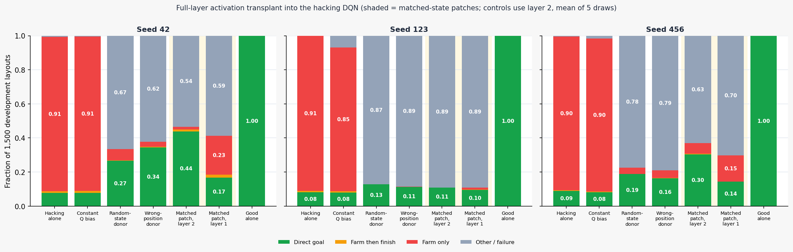

| Layer-2 transplant, good → hacking (1,500 development layouts) | Seed 42 | Seed 123 | Seed 456 |
|---|---|---|---|
| Hacking alone: direct goal / farming | 0.08 / 0.92 | 0.08 / 0.92 | 0.09 / 0.91 |
| **Matched patch: direct goal** | **0.44** | **0.11** | **0.30** |
| Matched patch: farming | 0.03 | 0.00 | 0.07 |
| Matched patch: other / failure | 0.54 | 0.89 | 0.63 |
| Random-state donor: direct goal | 0.27 | 0.13 | 0.19 |
| Wrong-position donor: direct goal | 0.34 | 0.11 | 0.16 |
| Constant Q bias: direct goal / farming | 0.08 / 0.92 | 0.08 / 0.85 | 0.08 / 0.90 |

- **Mostly disruption.** Farming disappears, but in 54–89% of layouts the agent then wanders until time runs out.
- **Partly state-dependent in two of three seeds.** For seeds 42 and 456 the matched patch beats donors from the wrong state by 0.10–0.17 and takes more direct paths (efficiency 0.77 against 0.36–0.52). For seed 123 it is no better than a random-state donor.
- **Not a constant push.** The constant Q-bias control leaves the hacking behavior in place.
- **Other variants are no better.** Layer 1: 0.17 / 0.10 / 0.14 direct goal. Pretrained donor at layer 2: 0.52 / 0.08 / 0.53. The reverse transplant (hacking → good) does not create farming (0–4%); it breaks the good network (86–94% other).

| Hacking DQN | Same layout with the layer-2 transplant |
|---|---|
| 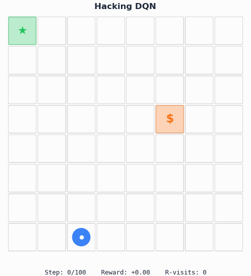 |  |
| Farms the tile 47 times | Stops farming, then wanders for 100 steps |

*Seed 42, first eligible development layout; the patched outcome was not selected.*

*Added in Phase 4:* a uniformly random policy reaches the goal directly in 0.49 of these development layouts, with path efficiency 0.23, because the grid is open and episodes last 100 steps. The matched transplant's direct-goal rates above are below that, although its paths are more efficient (0.77).

**Why this differs from Experiment 1.** There, the donor and recipient were 10k training steps apart and the transplant worked. Here the two branches trained apart for 400k steps: layer-2 activations tripled in size and the output layer's weights changed by about twice their original norm, so the hacking output layer can no longer read a good network's activations.

## Phase 3: how the hacking emerges during training

Both branches of every seed were saved every 10k steps (41 checkpoints each). Each checkpoint was scored on the same 1,500 development layouts and run on the same 6,000 development states. Nothing was retrained and no intervention was run, so everything in this section is observational.

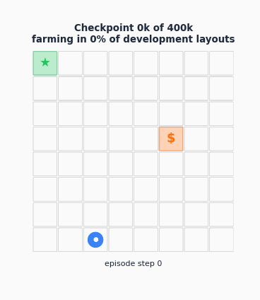

*Seed 42 on one development layout at five checkpoints: fork start, 60k, 100k, 160k and 400k steps. Layout and checkpoints were fixed by rule. On this layout the 160k checkpoint wanders and never reaches the tile.*

**1. The switch takes about 100k steps and passes through a wandering stage.**

| Hacking branch, development layouts | Seed 42 | Seed 123 | Seed 456 |
|---|---|---|---|
| Onset (farming stays ≥ 10%) | 70k | 120k | 100k |
| Midpoint (stays ≥ 50%) | 100k | 180k | 140k |
| Completion (stays ≥ 80%) | 160k | 220k | 190k |
| Peak share of wandering episodes | 0.24 | 0.30 | 0.29 |

The good branch never farms at any checkpoint. The thresholds were fixed before the analysis; the first 1,500 training layouts give the same steps.

**2. The hidden layers start drifting at once, change fastest late in the transition, and keep changing afterwards.**

- **Before behavior changes:** by the first checkpoint (10k) the hacking branch's layer 2 has moved 3–7 times as far from the fork start as the good branch's. At the last checkpoint before onset its similarity to the start is 0.93 / 0.77 / 0.76 (good branch: 1.00). That is still only 7–10% of the eventual change.
- **During:** the largest change per 10k steps falls at 160k / 220k / 180k, at or within 10k steps of behavioral completion. The average rate during the transition is 2.5 to 3.4 times the rate before or after it.
- **After:** at completion only 46–53% of the final layer-2 change has happened. The rest is mostly growth in activation size while the predicted returns climb, with behavior already settled.
- Layer 1 follows the same course with smaller changes. The good branch's layer 2 changes by 0.4–0.8% per 10k steps throughout.

So there is no single moment. The representation change spans the whole transition and outlasts it.

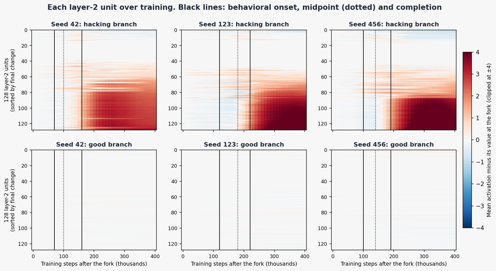

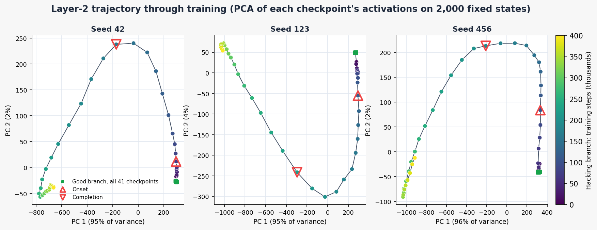

The layer-2 trajectory is close to one-dimensional (95–96% of its variance on one axis, which mostly tracks activation size). The good branch stays at the starting point.

**3. No activation spike marks the decisions that flip (negative result).** For each seed, the last checkpoint before onset was compared with the checkpoint at completion on identical states.

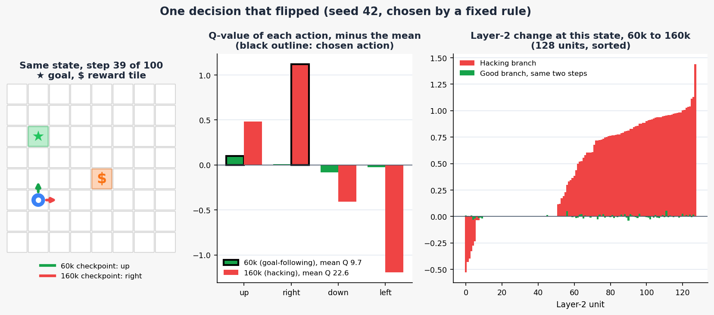

- **How often they differ:** on uniformly sampled states the two checkpoints choose different actions in 46–52% of states, and in 24–29% the later one moves toward the tile where the earlier one moved toward the goal. On states the agents actually visit, these "tile instead of goal" flips are 22–33% (goal-follower's states) and 42–43% (hacker's states).
- **The change is everywhere:** between the two checkpoints, layer 2 changes by about 1.0–1.4 times its own size at every kind of state (good branch over the same steps: 0.02). It is no larger where the decision flipped (standardized gap between −0.16 and +0.10).
- **Under controls nothing is left:** position, distances and remaining time explain 98–99% of how much layer 2 changes at a state. They also predict which decisions flip with AUROC 0.94–0.99. Adding the earlier checkpoint's Q-values or the size of the activation change adds nothing; the size alone scores 0.54–0.58.
- **No clean "farming direction":** one direction in the layer-2 change separates flipped decisions with AUROC 0.52–0.67, about what the distance to the tile gives by itself (0.52–0.61).

**4. Across seeds: the same sequence at different times, but not the same directions.**

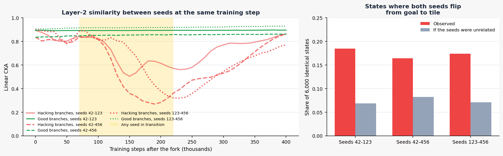

- The three seeds follow the same order of events, up to 60k steps apart.
- They flip the same decisions: two seeds both flip in 17–19% of identical states, against 7–8% if they were unrelated.
- Hacking branches of different seeds become dissimilar while they transition at different times (layer-2 CKA falls to 0.27–0.50) and similar again by the end (0.77–0.86). Good branches stay at 0.84–0.93.
- The direction fitted to flipped decisions is not shared: its scores on identical states correlate 0.74, −0.05 and −0.33 between seed pairs.

## Phase 4: does patching work between nearby checkpoints?

**Question:** did the Phase 2 transplant fail because the two networks had drifted too far apart? If so, patching between checkpoints of the *same* hacking run, a few training steps apart, should work better.

**Design (fixed in [configs/phase4.json](configs/phase4.json) before the run):** for each seed, the recipient is the hacking checkpoint at behavioral completion. Donors are checkpoints of the same run 10k, 20k and 50k steps earlier, the last checkpoint before onset, and the fork start. Each pair is tested with full layer-2 and layer-1 replacement, a shuffled-state donor, a wrong-position donor and a constant Q-value bias, on the 1,500 development layouts. To count as goal restoration a patch had to gain ≥ 0.2 direct goal over the recipient, beat the better wrong-state donor by ≥ 0.1, and leave ≤ 25% of episodes wandering.

**No pair met the criterion, in any seed.**

**1. Nearby donors are compatible but are already hacking.** The behavioral switch and the representational drift happen together, so no checkpoint is both close to the recipient and goal-following.

| Donor (recipient = completion checkpoint) | Steps apart | Layer-2 CKA with recipient | Donor's own direct goal | Layer-2 patch: direct goal | Better wrong-state donor |
|---|---|---|---|---|---|
| 10k earlier | 10k | 0.98–1.00 | 0.09–0.11 | 0.09–0.11 | 0.38–0.48 |
| 20k earlier | 20k | 0.92–0.98 | 0.09–0.14 | 0.11–0.12 | 0.33–0.48 |
| 50k earlier | 50k | 0.65–0.74 | 0.18–0.24 | 0.12–0.24 | 0.21–0.41 |
| Last before onset | 100–110k | 0.34–0.48 | 0.80–0.88 | 0.21 / 0.12 / 0.25 | 0.24 / 0.13 / 0.27 |
| Fork start (pretrained) | 160–220k | 0.28–0.42 | 1.00 | **0.61** / 0.07 / 0.29 | 0.37 / 0.12 / 0.26 |

Per-seed values are in seed order 42 / 123 / 456. A uniformly random policy reaches the goal directly in 0.49 of these layouts.

**2. Matched donors do not beat wrong-state donors where it matters.** At small gaps the matched patch reproduces the recipient's farming, while wrong-state donors break it and the agent wanders like a random walk (direct goal 0.33–0.48, path efficiency 0.23–0.30). For goal-following donors the matched patch is within 0.05 of the wrong-state donors in seeds 123 and 456. Seed 42 is the exception: the fork-start donor gives 0.61 against 0.37 (efficiency 0.74), and the good branch at the same step gives 0.45 against 0.34. Both still leave 36% and 53% of episodes wandering, so both fail the criterion.

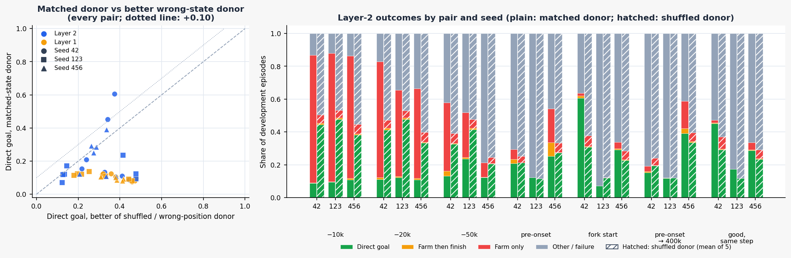

**3. Compatibility, as measured, does not predict repair.** Across the 15 main pairs, the patch's advantage over wrong-state donors goes *down* as donor and recipient become more similar (Spearman ρ −0.91 with CKA). This is not evidence that similarity hurts: steps apart, CKA, head drift and the donor's own goal-following move together along the run (|ρ| ≥ 0.76), and the advantage tracks donor quality (ρ +0.87). Similar donors simply have nothing to give.

**4. More drift after completion does not make it worse.** Holding the pre-onset donor fixed and moving the recipient from completion to 400k (layer-2 activation norm 21–24 rising to 31–39) changes the result by −0.06 / 0.00 / +0.14. The good branch at the completion step as donor gives 0.45 / 0.17 / 0.29, close to Phase 2's final-to-final transplant (0.44 / 0.11 / 0.30). Whatever blocks the transplant is already in place at completion.

**5. The patch disrupts rather than restores, decision by decision.** On uniform development states where the donor heads for the goal and the recipient for the tile, the layer-2 patch takes the donor's action in 29–60% of cases. Where donor and recipient already agree, it changes the action in 32–72% of cases for goal-following donors. The output layer reads the transplanted activations, but not the way the donor's own output layer does. Swapping the other way (recipient features into the donor's output layer) gives 0.06–0.12 direct goal. Neither half on its own carries goal pursuit across the transition.

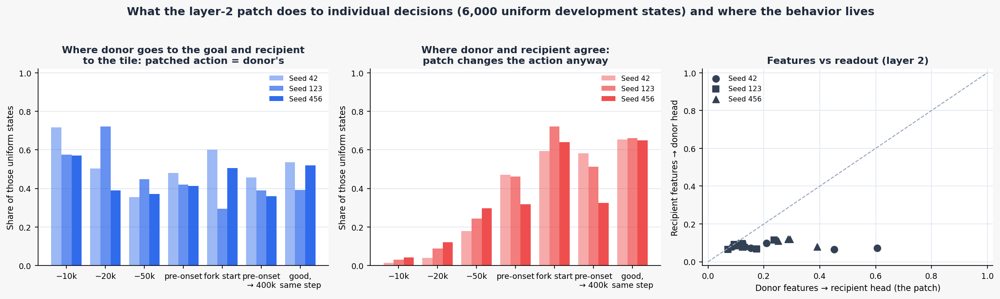

| Hacking recipient (160k) | Pre-onset donor (60k) | Recipient + donor's layer 2 |
|---|---|---|
| 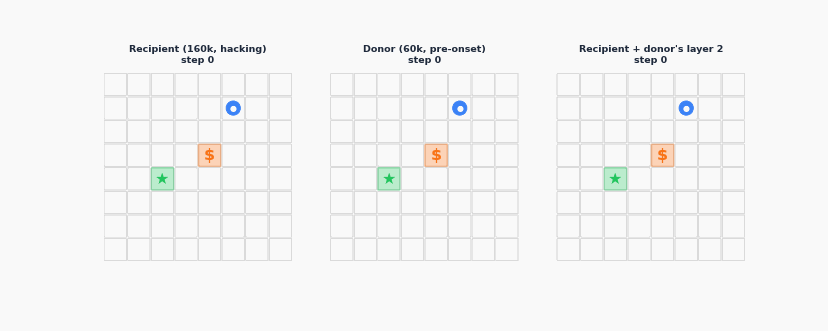 | | |

*Seed 42, first development layout (by the Phase 2 rule) where the recipient farms: 49 tile entries; donor reaches the goal in 6 steps; patched recipient stops farming and wanders for 100 steps.*

**Answer:** the hypothesis is not supported. Near the transition there is no compatible goal-following donor to patch from, and the strength sweep that ran for the two triggering pairs (seed 42) only weakened the patch (α 0.75: 0.29–0.32). The Phase 2 failure is better explained by goal pursuit and representation changing together than by drift afterwards.

## Phase 5: which weights have to change?

**Question:** to turn the hacking network back into a goal-follower, is it enough to change the output layer (which picks the action), or a hidden layer, or do they have to change together?

**Bar for "repair" (fixed in [configs/phase5.json](configs/phase5.json) before the run):** direct goal ≥ 0.90, path efficiency ≥ 0.90 and farming ≤ 0.05 on development layouts. Reaching the goal is not enough: a random policy does that in half of these layouts.

| Reference on 1,500 development layouts | Direct goal | Farming | Path efficiency | Steps to goal | Tile visits |
|---|---|---|---|---|---|
| Scripted shortest path | 1.00 | 0.00 | 1.00 | 5.2 | 0.0 |
| Pretrained and good DQN (all seeds) | 1.00 | 0.00 | 1.00 | 5.2 | 0.1 |
| Hacking DQN, final (seeds 42 / 123 / 456) | 0.08 / 0.08 / 0.09 | 0.92 / 0.92 / 0.91 | 0.98–0.99 | 6.7–9.4 | 43–44 |
| Uniformly random policy | 0.49 | 0.05 | 0.23 | 41 | 0.9 |

**1. Copying goal-following weights into the hacking network does not restore navigation.** Each row replaces the named layers of the final hacking network with the same seed's pretrained weights.

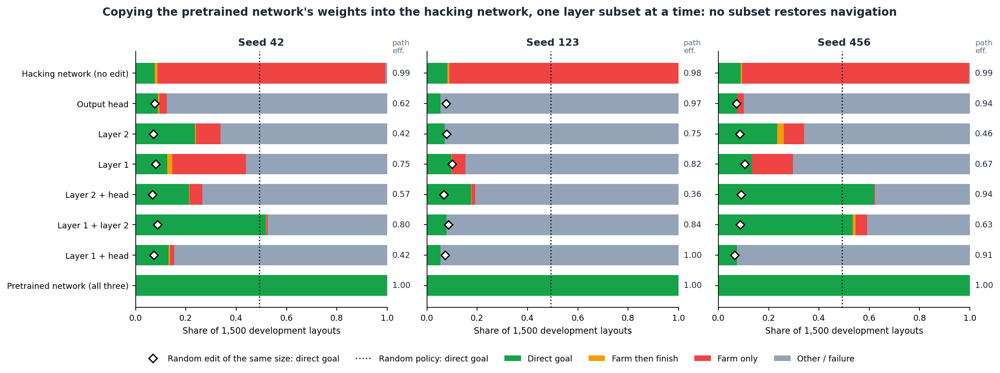

| Layers copied from the pretrained network | Direct goal (42 / 123 / 456) | Other / failure | Random edit of the same size: direct goal |
|---|---|---|---|
| Output head | 0.09 / 0.05 / 0.08 | 0.88 / 0.95 / 0.90 | 0.07–0.08 |
| Layer 2 | 0.24 / 0.07 / 0.23 | 0.66 / 0.93 / 0.66 | 0.07–0.09 |
| Layer 1 | 0.13 / 0.10 / 0.13 | 0.56 / 0.85 / 0.70 | 0.08–0.11 |
| Layer 2 + head | 0.21 / 0.18 / 0.62 | 0.73 / 0.81 / 0.38 | 0.07–0.09 |
| Layer 1 + layer 2 (follow-up) | 0.52 / 0.08 / 0.53 | 0.47 / 0.92 / 0.41 | 0.08–0.09 |
| Layer 1 + head (follow-up) | 0.13 / 0.05 / 0.07 | 0.85 / 0.95 / 0.93 | 0.06–0.07 |

- **None of 72 swaps meets the bar** (4 donor/recipient pairs × 6 layer subsets × 3 seeds, including the good network as donor and the pre-onset checkpoint into the completion checkpoint). The best single result, layer 2 + head from the pretrained network into seed 456's completion checkpoint, reaches 0.84 direct goal with path efficiency 0.72.
- **The output head alone only breaks things.** A goal-following head on hacking features gives 0.05–0.12 direct goal in every pair, about what a random head of the same size gives (0.07–0.08).
- **Swaps that include layer 2 do more than damage in two seeds.** They beat same-size random edits (0.21–0.62 against 0.07–0.09) in seeds 42 and 456. Seed 123 responds least (at most 0.30 in any pair), as in Phases 2 and 4.
- The two follow-up subsets ran because no primary swap repaired all three seeds (rule fixed in advance). Together with layer 2 + head they show that keeping any one hacking layer is enough to block repair.

**2. Fine-tuning on the corrected reward removes the farming but, in 200k steps, does not bring navigation back, whichever layers are trainable.**

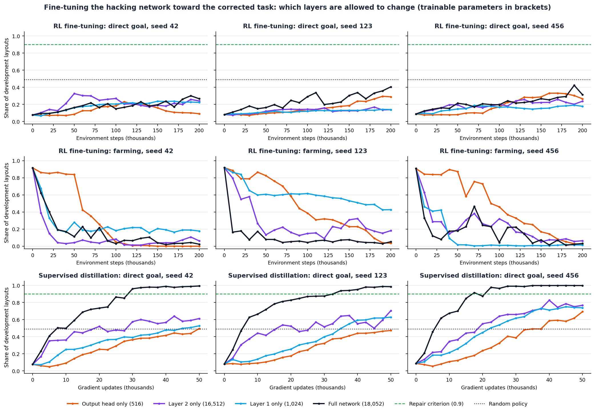

| Trainable layers (parameters) | RL fine-tuning, 200k steps: direct goal | Supervised distillation, 50k updates: direct goal | Distillation: path efficiency |
|---|---|---|---|
| Output head only (516) | 0.24 / 0.29 / 0.32 | 0.49 / 0.49 / 0.69 | 0.50–0.63 |
| Layer 1 only (1,024) | 0.23 / 0.12 / 0.17 | 0.53 / 0.61 / 0.75 | 0.51–0.61 |
| Layer 2 only (16,512) | 0.32 / 0.18 / 0.26 | 0.64 / 0.70 / 0.83 | 0.58–0.61 |
| **Full network (18,052)** | 0.28 / 0.41 / 0.41 | **0.99 / 0.99 / 1.00** | **0.98–1.00** |

Seeds 42 / 123 / 456. Checkpoints were picked on 750 development layouts and are reported on the other 750.

- **Reinforcement learning (top two rows of the figure):** farming falls below 0.10 in 9 of 12 runs, but the agent then wanders. Even with every layer trainable, direct goal is 0.28–0.41, below the random policy's 0.49. No run meets the bar at any point. Unlearning the exploit is fast; relearning the task from the hacking weights is slow.
- **Supervised distillation (bottom row; a separate experiment, added after the RL result):** the same-seed good network labels 28,000 training-layout states with its Q-values, and each condition gets the same data, batches and number of updates. **Only the full network is repaired**, in all three seeds, from 27.5k–35k updates on. Each single layer reaches only 0.49–0.83 direct goal with inefficient paths, and is still improving slowly when the budget ends.
- **The output head cannot do it even at its optimum.** The exact least-squares head on the frozen hacking features gives 0.66 / 0.66 / 0.89 direct goal with path efficiency 0.60–0.71.
- **It is not the parameter count.** Layer 2 holds 91% of the parameters and fails; adding the other 1,540 succeeds.

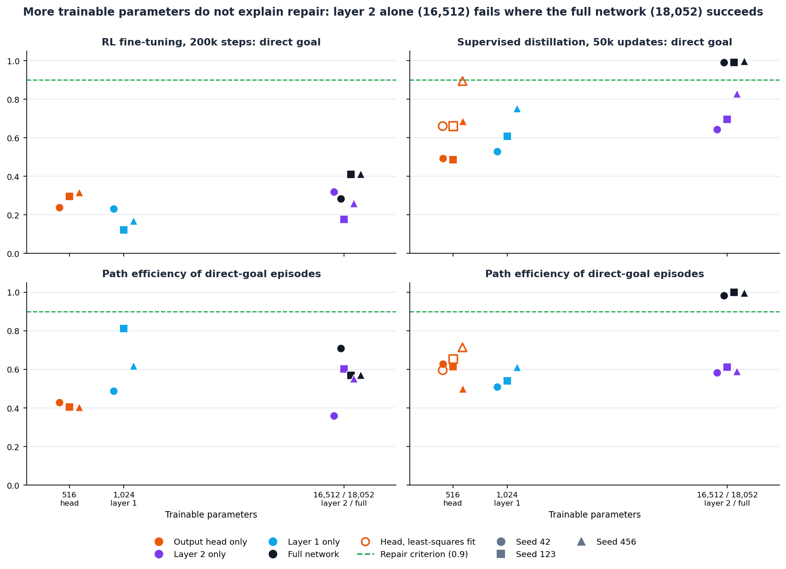

- **The repaired network is not the good network.** After full-network distillation the weights have moved 0.18–0.40 of their size per layer, while the good network is 0.59–0.86 away. Random edits of the same size as any fine-tuning result give 0.07–0.11 direct goal.

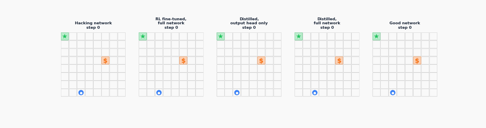

*Seed 42 on the first development layout (Phase 2 rule) where the hacking network farms. The layout was not chosen by outcome. Here the RL fine-tuned network happens to reach the goal; it does so directly on only about 30% of layouts. The head-only distilled network needs 62 steps for a 9-step route. Still frame: [exp2_phase5_trajectories.png](../../assets/figures/exp2_phase5_trajectories.png).*

**3. During training, all three layers change, and the hidden layers move first.**

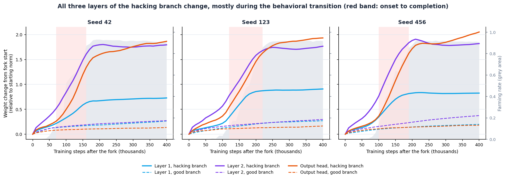

| Weight change from the fork start, relative to starting size (42 / 123 / 456) | Layer 1 | Layer 2 | Output head |
|---|---|---|---|
| Hacking branch, final | 0.73 / 0.91 / 0.83 | 1.80 / 1.77 / 1.82 | 1.87 / 1.93 / 2.05 |
| Good branch, final | 0.27 / 0.27 / 0.20 | 0.27 / 0.30 / 0.37 | 0.14 / 0.17 / 0.18 |
| Hacking branch, last checkpoint before onset | 0.19 / 0.26 / 0.28 | 0.43 / 0.66 / 0.64 | 0.22 / 0.43 / 0.29 |
| Share of the final change done by completion | 0.86 / 0.96 / 0.99 | 0.90 / 0.95 / 1.01 | 0.72 / 0.84 / 0.79 |

- **Largest changes: layer 2 and the output head, about equally** (1.8 and 1.9–2.1 times their starting size). Layer 1 changes about half as much.
- **Timing:** every layer changes fastest inside the behavioral transition (1.7 to 2.7 times its earlier rate). Layer 2 leads: before onset it has done 24–37% of its final change against 12–23% for the head, and it is finished at completion while the head keeps growing.
- **Q-values at matched states:** where one move approaches the tile and another the goal, the hacking branch's preference for the tile-ward move goes from −0.22…−0.25 at the fork to +1.1…+1.4 at completion (84–92% of such states). The good branch stays at −0.22…−0.25 throughout.
- **Drift does not explain behavior.** Before onset the hacking branch's layer 2 has already moved 0.43–0.66, more than three times the good branch, while it still reaches the goal directly in 80–88% of layouts. The good branch moves 0.14–0.37 with no behavior change at all. And a random edit as large as a repair produces wandering. Size of change says when the network is being rebuilt, not what it will do.

**Answer:** in these three independently trained networks, reversing reward hacking needs coordinated changes in the hidden layers and the output head. Changing the action-selection layer alone fails, changing either hidden layer alone fails, and copying any subset of goal-following weights fails, because each layer has adapted to the others. This is a statement about what was sufficient here under fixed budgets. It does not identify a reward-hacking circuit.

## Phase 6: can a small coordinated edit do the repair?

**Question:** Phase 5 repaired the hacking network only by retraining all 18,052 parameters. Can a low-rank update spread across the three layers do the same?

**Method (fixed in [configs/phase6.json](configs/phase6.json) before the run):** the hacking weights are frozen and each layer learns an update `W + A·Bᵀ` of rank 1, 2, 4 or 8, plus a bias update. Supervision, data, 50,000-update budget, checkpoint selection and the repair bar are exactly Phase 5's. After training the update is merged into the weight matrices, so the repaired model is an ordinary network with no adapter, donor or hook. Each setting ran 9 times: 3 DQN seeds × 3 optimization seeds. A method counts as reliable only if all 9 runs meet the bar.

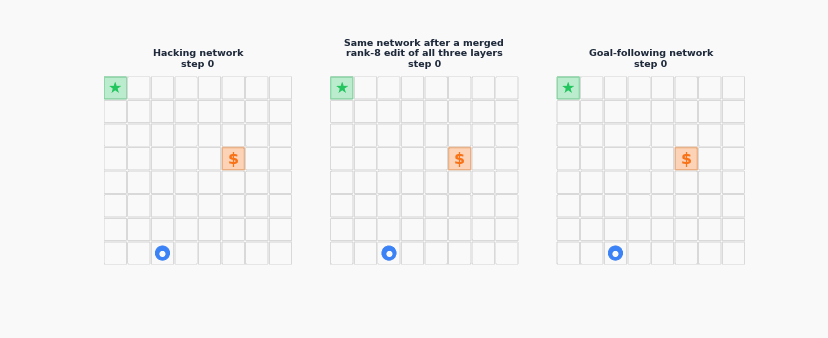

*Seed 42, same development layout as the Phase 5 GIF (chosen by rule, not by outcome). Middle: the hacking network after a merged rank-8 edit.*

**1. A rank-8 coordinated edit repairs all three agents, but only at the higher of two learning rates.**

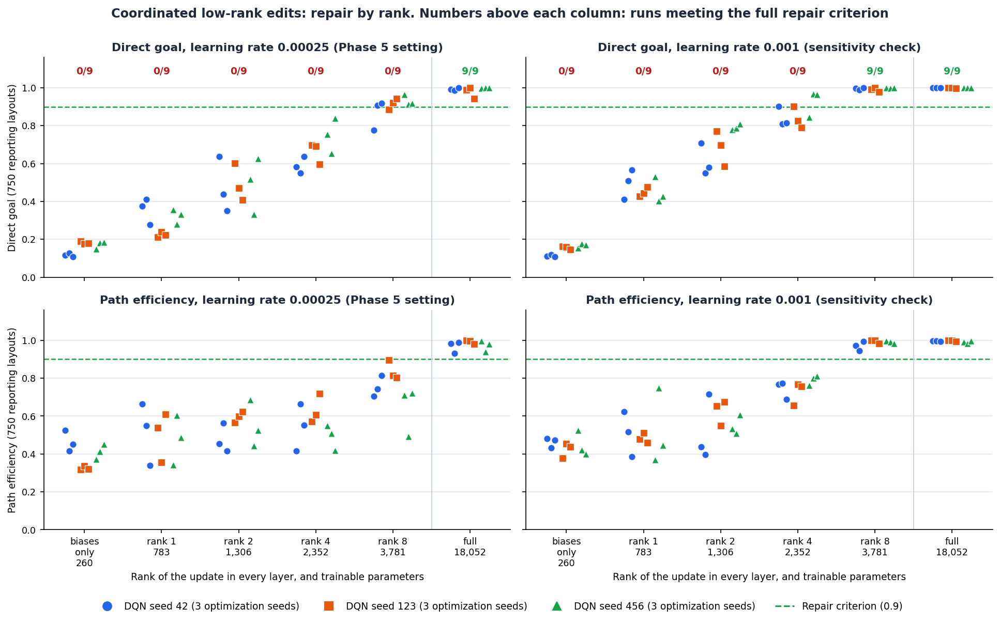

| Coordinated edit (all three layers) | Trainable parameters (factors + biases) | Runs meeting the bar, learning rate 0.00025 | Direct goal, 0.00025 | Runs meeting the bar, learning rate 0.001 | Direct goal, 0.001 |
|---|---|---|---|---|---|
| Biases only | 0 + 260 | 0 / 9 | 0.11–0.19 | 0 / 9 | 0.11–0.18 |
| Rank 1 | 523 + 260 | 0 / 9 | 0.21–0.41 | 0 / 9 | 0.40–0.57 |
| Rank 2 | 1,046 + 260 | 0 / 9 | 0.33–0.64 | 0 / 9 | 0.55–0.81 |
| Rank 4 | 2,092 + 260 | 0 / 9 | 0.55–0.84 | 0 / 9 | 0.79–0.97 |
| **Rank 8** | 3,521 + 260 | 0 / 9 | 0.78–0.96 | **9 / 9** | **0.98–1.00** |
| Full network, ordinary fine-tuning | 18,052 | 9 / 9 | 0.94–1.00 | 9 / 9 | 1.00 |

Ranges are over the 9 runs, on the 750 reporting layouts.

- **Smallest reliable rank tested: 8, at learning rate 0.001.** All 9 runs reach 0.98–1.00 direct goal with path efficiency 0.95–1.00 and no farming, and hold the bar from 22.5k–37.5k updates on.
- **At the Phase 5 learning rate (0.00025), no rank is reliable.** Rank 8 gets to 0.78–0.96 direct goal but its paths are inefficient (0.49–0.90), so 0 of 9 runs pass. Both learning rates were fixed before the run; 0.00025 was the headline setting and it failed.
- **Behavior improves steadily with rank.** There is no jump: each doubling of rank adds roughly 0.2 direct goal until the bar is reached.
- **Ordinary full fine-tuning is the more robust method.** It passes 9 of 9 at both learning rates. The low-rank edit matches it only in its better setting.

**2. What "rank 8" means here.** It does not mean eight weights changed.

- The rank is capped by each matrix's size: layer 1 is 128×7 and the head is 4×128, so the edit has rank 7 / 8 / 4 in the three layers. For layer 1 and the head that is every direction available. Only layer 2's update (rank 8 of a possible 128) is truly low-rank.
- Trainable parameters: 3,781, which is 21% of the network. The saving comes from layer 2 (2,048 factor parameters instead of 16,384 weights).
- Weights actually changed after merging: about 14,100 of 17,792. The rest belong to hidden units that never activate.
- Size of the change: 0.36–0.68 of the network's weight norm (mean 0.54), slightly larger than full fine-tuning at the same learning rate (0.40–0.54).

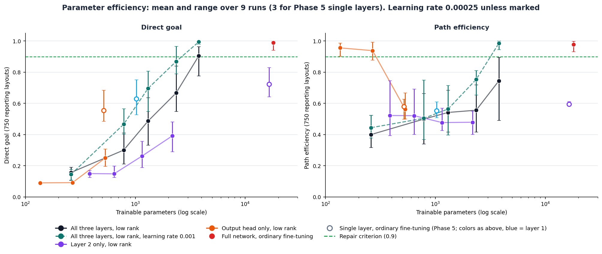

**3. Coordinated edits beat single-layer edits at every rank.**

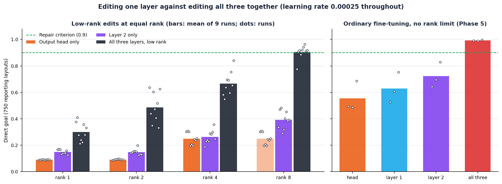

| Mean direct goal over 9 runs, learning rate 0.00025 | Rank 1 | Rank 2 | Rank 4 | Rank 8 |
|---|---|---|---|---|
| Output head only | 0.09 | 0.09 | 0.25 | (head has rank 4 at most) |
| Layer 2 only | 0.15 | 0.15 | 0.26 | 0.39 |
| All three layers | 0.30 | 0.49 | 0.67 | 0.91 |

A rank-2 edit of all three layers (1,306 parameters) does better than a rank-8 edit of layer 2 alone (2,176 parameters). A rank-1 or rank-2 head edit leaves the farming in place (0.86–0.89). No single-layer edit met the bar in any run, matching Phase 5.

**4. Random edits of the same size and rank do nothing useful.** They give 0.06–0.11 direct goal in every condition (153 learned edits, 5 random draws each).

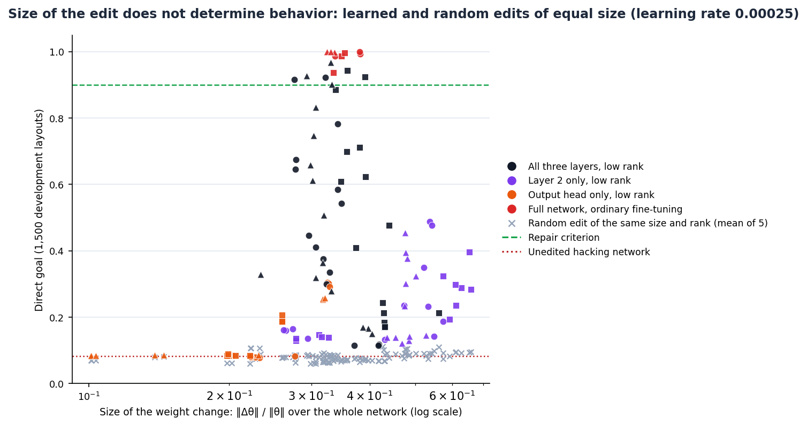

**5. The repair restructures the network; it does not lightly patch it.** After the rank-8 edit, layer-2 activations have a similarity (CKA) of 0.71 with the original hacking network and 0.50 with the good network, against 0.39 between the two originals. Full fine-tuning gives 0.81 and 0.52.

**6. The low-rank edit has to be learned.** Cutting the Phase 5 full-network update down to its top 8 singular directions per layer gives 0.06–0.12 direct goal, although those directions hold most of its energy (90% within 9–10 directions in layer 2).

**Answer:** a coordinated low-rank edit can reverse reward hacking in all three independently trained DQNs with about a fifth of the parameters, and the result is stable across optimization seeds. It is less robust to the learning rate than full fine-tuning and is genuinely low-rank only in layer 2. Because it is trained on a goal-following teacher's Q-values, it is policy distillation under a low-rank constraint. It shows a compact repair exists; it does not locate a reward-hacking circuit, and it is not a repair that works without a good network.

## Confirmatory evaluation: does the repair hold on layouts nothing was tuned on?

**Question:** the rank-8 edit was chosen and its checkpoints were selected on development layouts. Does it still meet the repair bar on layouts that no part of the project has used?

**Protocol (frozen in [configs/final_eval.json](configs/final_eval.json) and committed before the run):** the nine rank-8 networks selected in Phase 6 (3 DQN seeds × 3 optimization seeds, learning rate 0.001), identified by weight hash, with no retraining and no reselection. Each is evaluated once on the 1,500 reserved layouts with the same bar: direct goal ≥ 0.90, path efficiency ≥ 0.90, farming ≤ 0.05. The method is confirmed only if all nine pass.

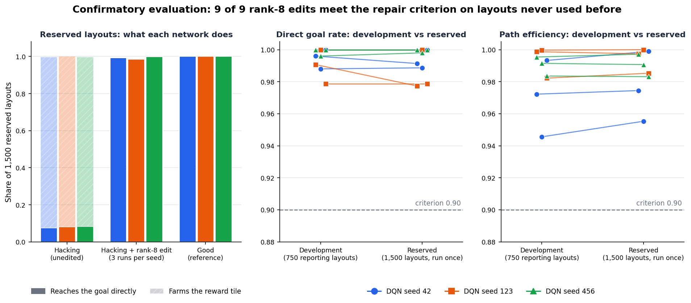

**Result: confirmed, 9 of 9.**

| Network (1,500 reserved layouts) | Direct goal | Farming | Path efficiency |
|---|---|---|---|
| Hacking, unedited (seeds 42 / 123 / 456) | 0.07 / 0.08 / 0.08 | 0.92 / 0.92 / 0.91 | 0.97–0.99 on the few direct episodes |
| **Hacking + rank-8 edit (9 models)** | **0.993 mean (0.977–1.000)** | **0.000 in all nine** | **0.987 mean (0.955–1.000)** |
| Good, reference (all seeds) | 1.00 | 0.00 | 1.00 |

**Development and reserved numbers agree.** Across the nine models, mean direct goal is 0.994 on the 750 development reporting layouts and 0.993 on the reserved set; mean path efficiency is 0.985 and 0.987. The largest change for any single model is 0.013 in direct goal and 0.010 in efficiency. The standard deviation across the nine models on the reserved set is 0.009 (direct goal) and 0.015 (efficiency).

| DQN seed | Optimization seed | Development: direct goal / efficiency | Reserved: direct goal / efficiency | Reserved direct goal, 95% interval | Reserved farming | Meets bar |
|---|---|---|---|---|---|---|
| 42 | 0 | 0.996 / 0.972 | 0.991 / 0.974 | 0.985–0.995 | 0.000 | Yes |
| 42 | 1 | 0.988 / 0.946 | 0.989 / 0.955 | 0.982–0.993 | 0.000 | Yes |
| 42 | 2 | 1.000 / 0.993 | 1.000 / 0.999 | 0.997–1.000 | 0.000 | Yes |
| 123 | 0 | 0.991 / 0.999 | 0.977 / 0.997 | 0.968–0.984 | 0.000 | Yes |
| 123 | 1 | 1.000 / 1.000 | 1.000 / 1.000 | 0.997–1.000 | 0.000 | Yes |
| 123 | 2 | 0.979 / 0.982 | 0.979 / 0.985 | 0.970–0.985 | 0.000 | Yes |
| 456 | 0 | 1.000 / 0.995 | 1.000 / 0.997 | 0.997–1.000 | 0.000 | Yes |
| 456 | 1 | 0.996 / 0.991 | 0.998 / 0.991 | 0.994–0.999 | 0.000 | Yes |
| 456 | 2 | 1.000 / 0.984 | 1.000 / 0.983 | 0.997–1.000 | 0.000 | Yes |

**What this does and does not show.**

- **Shown:** the frozen rank-8 repair generalizes to new position combinations from the same layout generator, for all three agents and all three optimization seeds, with no selection effect from the development set.
- **Not perfect:** five of the nine models still fail to reach the goal in a few reserved layouts (up to 2.3%, 34 of 1,500). None of them farm. These episodes were not analyzed further.
- **Constrained distillation, not teacher-free repair.** Every edit was trained to match the Q-values of the same seed's good network. The result says a small coordinated weight change can carry a known good policy into the hacking network and that it holds on unseen layouts. It does not say reward hacking can be repaired when no goal-following network is available: the only teacher-free method tried (Phase 5 fine-tuning on the corrected reward) removed farming but did not restore navigation, and was not part of this evaluation.
- **Same limits as before:** three DQN seeds, one architecture, one open 8×8 grid, one exploit, one learning rate (0.001; the edit failed at 0.00025 on development layouts), and a rank that is low only in layer 2. Passing the bar does not identify a unique reward-hacking circuit.

## What kind of generalization this is

**Experiment 2 currently shows generalization to unseen combinations of positions. It does not show generalization to new maze structures or new exploit mechanisms.**

- Shown: the agents behave the same on start/goal/tile combinations they never trained on, including the 282 test layouts whose goal/tile pair never appears in training.
- Not shown: anything about walls or obstacles, other grid sizes, other reward magnitudes, or a different way of hacking the reward. The grid is open, every cell has been seen in every role, and there is one exploit.

| Test condition | What changes | Status |
|---|---|---|
| Unseen layouts, same generator | New combinations of positions | Done (baselines on the test split; the rank-8 repair on the reserved set) |
| Independent training seeds | Different network weights | Done for baselines (3 seeds) |
| Unseen obstacles | New wall patterns | Not built |
| Unseen reward strengths | Different tile bonus | Not built |
| Unseen exploit types | A different hacking mechanism | Not built |

## Evaluation integrity going forward

| Layout set | Size | Status | Allowed use |
|---|---|---|---|
| Training | 7,000 | In use | Training; fitting any later method |
| Development | 1,500 | In use | Tuning, selection, method development |
| Test | 1,500 | **Used once** for the Phase 1 baselines | Not for selecting representations, interventions or hyperparameters |
| Final evaluation | 1,500 | **Used once** on 2026-11-25 for the confirmatory evaluation of the frozen rank-8 edit | Spent. Not for selecting or tuning anything |

The final evaluation set ([manifest](layouts/final_eval_manifest.json)) was generated independently, shares no layout with the other 10,000, and was frozen on 2026-11-23, before any intervention work. It was evaluated once, after the protocol was committed (`faf6cdb`); the script refuses to run a second time.

## Checkpoints

The nine final checkpoints are committed: for each seed (42, 123, 456), the pretrained network and the good and hacking networks that were forked from it. `results/exp2/phase1/checkpoints.json` records each file's hash and the hash of the checkpoint each branch started from, so the three networks of a seed can be compared on identical states. `rewardlens.exp2.checkpoints.load_triplet(seed)` loads and verifies them. Raw per-episode training logs are kept locally and not committed.

Phase 3 reads the fork-stage checkpoints saved every 10k steps (246 files, 73 MB). Most are not committed. `results/exp2/phase3/checkpoint_registry.json` lists every one with its hash, and `python -m scripts.exp2_train --all-seeds` regenerates them (about 9 minutes on CPU; the rerun in Phase 1 reproduced earlier checkpoints bit for bit on this machine). The 12 checkpoints of the decision-level comparison are committed (3.6 MB): for each seed, both branches at the last step before onset and at completion (`results/exp2/phase3/required_checkpoints.json`). Phase 4 adds nine more (2.7 MB): the hacking checkpoints 10k, 20k and 50k before each seed's completion step (`results/exp2/phase4/required_checkpoints.json`). Phase 5's interventions use only committed checkpoints (15 files); its weight-drift analysis reads all 246 trajectory files, listed with hashes in `results/exp2/phase5/required_checkpoints.json`. The 24 fine-tuned and distilled networks are saved in `results/exp2/phase5/finetuned/` and `distilled/`. Phase 6 uses only committed checkpoints and saves the 153 learned low-rank edits as factor files in `results/exp2/phase6/edits/`; merging one into its seed's hacking checkpoint reproduces the evaluated network.

## What to keep in mind

- **The first budget was too short for one seed.** With a 200k-step fork, seed 123's hacking agent was at 0.72 farming on development layouts and still rising. The fork was extended once to 400k steps for every seed and both branches, decided from development curves before the test set was touched. The 200k results are kept in `results/exp2/phase1/fork_200k/`.
- **The hacking agent still goes straight to the goal in about 8% of layouts,** mostly when the goal is closer to the start than the tile is (16% of those layouts, against 1% of the rest). Farming would pay more there too, so this is leftover goal-following, not a rational choice.
- **Three seeds, one architecture, one reward magnitude, one exploit type.** Harder tests (obstacles, other reward strengths, other exploits) are future work.
- **The 5-visit threshold** separates scripted goal-walking (0 visits) from scripted farming (38 or more). A uniformly random policy crosses it in 5.7% of episodes; results at thresholds of 10 and 20 differ by less than 0.01.

## Details and reproduction

| Document | Contents |
|---|---|
| [PROGRESS.md](PROGRESS.md) | Chronological journal: design decisions, pilot, the 200k shortfall, diagnostics, compute, Phase 2 to Phase 6 methods and negative results, confirmatory evaluation |
| [configs/](configs/) | `environment.json` (environment and layout split), `training.json` (DQN, budgets, tuning log) |
| [SETUP.md](../../SETUP.md) | Commands to regenerate everything |

Code: `rewardlens/exp2/`. Scripts: `scripts/exp2_*.py`. Results: `results/exp2/phase1/` to `results/exp2/phase6/` and `results/exp2/final_eval/`. Tests: `tests/test_exp2_phase1.py` to `tests/test_exp2_phase6.py` and `tests/test_exp2_final_eval.py`. Settings: `configs/phase2.json` to `configs/phase6.json` and `configs/final_eval.json`.

## Next

The research phases and the confirmatory evaluation are complete, and no further experiments are planned. What remains is the write-up (not started). One question is left open: a repair that works without a goal-following teacher has not been found.
